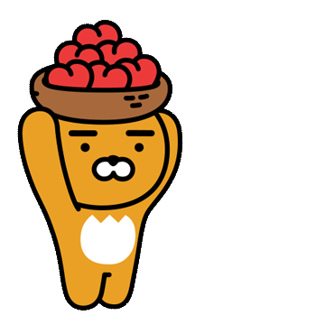
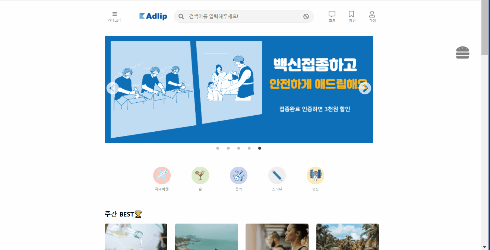

## ***난위도 : 무한대***

**위코드상 마지막 프로젝트 여정이 끝나고**

**배포기간인 3주차에 작성을 했지만**

**갑작스러운 할머니 상 이라 디테일하게 못쓴부분 양해 바란다.**

**느낀점 총 정리 : 배움에는 끝이 없다**

**클론한 사이트**

<http://3.34.61.252:3000/>

[](https://wecode-bootcamp.slack.com/files/U028BTUCCJZ/F02L0RK66BZ/______________________1________________________________________.mov)


### ***✔️ 2주동안  내가  구현한  API  및  맡은 구역 (프론트 엔드)***

**\* 자세한 : 이번 프로젝트에는 전반적으로 레이아웃 부분을 담당했고 주요 기능은 검색을 맡았다. 모달부분은**

**외부 라이브러리를 써도되지만 가능하면 직접 구현을 했고 케라셀이나 카드컴포넌트 부분은 팀원들이 만든 코드를 재사용** **가능하게 만들어 누구나 쓸 수 있게 만들었다.**

**\* 인원 : 프론트 총 5명 , 백엔드 총 2명**

**\*수**👤 - **주요기능** : 메인페이지, Header,Nav,Footer + 검색기능, 검색 모달 + ParentCategory (

카테고리 Component : (1️⃣ 상위카테고리(4개)))

- **1주**: 전반 레이아웃 (Header, Nav, Footer, MainPage, ParentCategory, SubCategory)
- **2주**: 기능적인 부분, 레이아웃 보안(SearchBox, TeamInfo, CardComponent, Caraoucel)
- **선택** : 호스트 지원, 공지사항, 자주묻는 질문, 마이페이지, 저장 , 피드, 기획전, 메거진,
- **특이사항**: 메인페이지에서 id를 전달하여 리스트 페이지 디테일페이지 차레대로 전달하기



### ***✔️  프로젝트 진행상황 및 스케쥴 공유~!!***

**\* 그 외 : 프로젝트 시작하기 전 주 금요일날 팀 발표가 났고 시작 주 월요일날 클론 페이지가 발표됬다. 시작하기 전 주 금요일날 미리 팀원들이랑 모여서 모이는 날과 어떻게 할지 전반적으로 의논했고 1차때보다는 수월하게 진행이 된듯했다.**

**그리고 3주차때 회고록 및 기업협업 준비 이력서 , 리팩토링 및 페이지 오류 보안 등 예정이다.**

|  |  |  |  |
| --- | --- | --- | --- |
| **1주차** | | **2주차** | |
| **기간** | **내용** | **기간** | **내용** |
| **10/25** **(월요일) at. 서울역** | - 초기세팅 및 이슈 생성하기 - 함수형 컴포넌트와 style 컴포넌트 도입 - 초기세팅한 부분 clone 받기 - 백엔드 모델링 구현하기 | **11/01** **(월요일) at. 서울역** | - 백엔드 API 가공 시작 - 검색했을때 로컬에 한탬포 느리게 저장되는 문제 발견함 - 검색했을때 모달나오는거 구현중 - 각종 오류 발견(비동기+동기, 모달) 커뮤니티에 질문 폭탄날림 |
| **10/26** **(화요일) at. 서울역** | - 작업시작! , Nav 컴포넌트 레이아웃 구성하고 기능구현 - 홈페이지에 들어갈 이미지 찾기 - rebase 세션 듣고 develop 브랜치 팜 - 빽엔드 모델링한부분 서로 프론트랑 공유했음 | **11/02** **(화요일) at. 을지로입구** | - 모달창 닫고 끄는 기능 + 검색시 한탬포느린거 추가질문 - 검색하고 모달 부분 관희님이 줌으로 1대1 코맨 주심 |
| **10/27** **(수요일) at. 집** | - 페이지별로 Routing ,id값전달 등 얘기하기 - 백엔드 모델링 구현한것 공유하기 | **11/03** **(수요일) at. 을지로입구** | - 모달 검색엔진 추가질문 관희님 추가 줌 해주심 - 프론트 빽엔드 각자 진행상황 공유 후 1차 병합 (프론트는 프론트끼리) |
| **10/28** **(목요일)  at. 종로** | - 카테고리 페이지 구현하기 - 작업중인 부분 맨토 리팩토링 받기 - 밑에 footer 레이아웃 구현하기(footer, Nav, Header 마무리) - 팀원, 맨토 피어리뷰 남긴거 수정하기 | **11/04** **(목요일) at. 을지로입구** | - 검색 마무리 및 메인페이지 추가 모달 구현 , 팀소계 페이지 구현 - 빽엔드 데이터 연결하고 수정할부분 수정함 - 관희님 전역상태관리 소박한 특강 - 카카오 로그인 부분 전역 상태 관리로 두고 헤더부분에서 로그인 여부 체크함 - 7시 이후에 백엔드 데이터 받아서 프론트에서 테스트 함 - 팀원 전반적인 기능 마무리하기 |
| **10/29** **(금요일) at. 종로** | - cardList 목데이터 만들고 List페이지에서 구현한 카드리스트 참고해서 재활용 - 케라셀 구현한거 참고해서 재활용 - style 컴포넌트 구현한거 리팩토링 - 한파일에 scss까지 다 쓰기 - mixin style.css로 다시 구성하기 - 검색했을때 로컬에 저장하기 - 레이아웃 부분 전부 구현함 | **11/05** **(금요일) at. 서울역** | - 최최종 merge 하고 충돌나거나 에러나는 부분 보안하기 - ppt 만들고 발표 대비하여 시연하기 - 오프라인 발표 (위드코르나 실행) - 맨토님들과 커피타임 및 팀원들과 회식 # 주말중으로 영상녹화 및 ReadMe 작성 예정 |

### ***✔️  프로젝트 하면서 사용한 기술 스텍 총 정리~!!***

**\* 개선해야될 기술 스텍**

**- 카카오or 네이버 API 사용**

**- Context API, Rebucks**

**- 비동기 or 동기**

**- 외부 라이브러리 사용**

|  |  |
| --- | --- |
| **분야** | **기술 스택** |
| **Frontend** | - JavaScript - StyleComponent - React - React Hook - HTML - Restful API - 전역 상태 관리 |
| **Common** | - Git - GitHub - Git Rebase - Prettier - Eslint |
| **Comunication** | - Slack - Zoom - Notion |

### ***✔️ 프로젝트하면서 못한것들 , 그리고 알게된것들~!!***

\* **느낀점** : **전반적으로 프로젝트하면서 style component , 모달 레이아웃 구현, 랜더링 한탬포 느린 오류 등으로 시간을 주로 썼고** **한편으로는 레이아웃을 빠르게 구현할 수 있는 스킬을 배웠다. 더욱더 나아가 하나의 컴포넌트로 모든 레이아웃을 재사용 할 수 있게 구현하는 방향으로 가면 좋을것같고 차후게 부족한 부분에대해 보안할 예정이다.**

1. **부족한 부분, 하고 싶었는데 하지못한 기능**

- **Reducks** : 전역 상태 관리중 하나이고 굳이 쉬운 context 를 두고 왜 쓰는지 궁금함
- **카카오 지도** : 카카오 API를 활용하여 소셜로그인을 구현하는 방법은 백엔드 요청시 바로 정보를 받아오는게 아니라 백엔드에서 카카오 백엔드로 요청후 데이터를 받아와야된다는거는 안다. 그럼 네이버지도도 동일한 방법으로 위도와 경도를 주면 요청해서 받아올수 있는 부분인지 궁금하다. 그리고 소셜로그인도 궁금~
- **state 비동기 -> 동기** : state로 비동기 있는 부분을 동기로 바꿀수 있다고하는데 콜백함수로 첫번째 인자를 줘도 안되는 경우가 있다 그 경우가 뭔지랑 왜 그렇게 나오는지 궁금하다.
- **페이지 네이션에 따른 솔팅** : 상품에따라 페이지가 자동으로 결정되고 5개씩 끈어서 다음으로가면 6~10 이렇게 되겠음 하는 기본적인 원리가 뭔지 궁금하다. 그리고 해당 페이지에따라 어떻게 상품을 보여줄지 구현해봐야될것같다.

2. **깨닭은것중 중요한거(알게된것)**

- **모달 레이아웃 기능 구현** : 전반적으로 모달 레이아웃은 전체 태그로 감싸고 그안에 모달 외 태그 , 모달 태그로 구성된다.  
  모달부분은 흰색으로 배경색을 하고 클릭시 state 값을 true로 두면되고 모달 외 부분은 opcity를 0.8로 두고 배경색은 검정 state 값은 false로 두면된다. 그리고 나머지 부분은 css 요소가 많이 들어가서 참고해서 진행하면 좋을것같다
- **style component 쉽게 쓰는법** : style 컴포넌트는 표현식을 변수안에? 집어넣는 형식이고 font awesome 이나 외부 컴포넌트에는 바로 style을 지정할 수 없다. 내가 활용한 방법중 각 컴포넌트 태그에 속성으로 값을 넘겨 props => props.?? 로 받아 값을 활용할수있고 구조가 같은 부분은 재사용도 가능하다 그리고 두번째 방법은 내가 구현한 mixin.js 같이 미리 css component로 만들어 함수형식으로 인자를 받아 사용할수있다.
- **비동기와 동기,  랜더링 시기 :** 비동기는 기다리는동안 다른 동작을 실행하는거고 동기는 기다렸다가 다른 동작을 실행하는건데 가끔 랜더링이 될때 한탬포씩 값이나 화면 이미지가 늦게 출력되는 경우가 있다( 두번째 랜더링될때 첫번째 실행될 값이 들어옴) 그럴때 해결하는 방법은 동기로 바꿔서 랜더링 시기를 늦추는거고 보통은 useEffect 로 랜더링 시기를 특정시키던가  
  state에 첫번째 인자로 콜백을 넣어 동기적으서로 실행하는것이다.
- **전역상태관리(context.api )** : 원래 리엑트 엔진은 부모에서 props로 넘겨받은 값을 사용하는데 만약 자식에서 부모로 넘겨주고 싶을때 주로 사용한다 예를들어 Nav.js 에게 Search.js(검색)의 값을 넘겨주고 싶을때 Search를 전역상태로 만들어주면되고 전반적인 방법은 app.js에서 context를 객체를 만들고 가장 밖에 컴포넌트로 감싸준다 그리고 그 속성값으로 state를 넘겨주고 해당 컴포넌트에서 props 로 받아서 쓰면된다. (자세한 사항은 서칭~)

### ***✔️ 2차 프로젝트 한후 느낀점 후기***

1차 프로젝트에서는 전반적으로 프로젝트가 처음이라 어떻게 진행해야되는지 몰랐지만 2차 프로젝트같은 경우에는 프로젝트는 경험해봐서 알지만 새로운 기술(StyleComponent, ReactHook, 함수형컴포넌트, 전역객체관리, gitRebase 등) 을 써서 어떻게 해야될지 막막했다. 그리고 프론트엔드랑 백엔드랑 나눠져서 하나에 집중하기가 좋았지만 너무 많은 레이아웃을 구현했고 디테일한 기능을 구현해서 **시간이 모자란것은 동일했다** 그리고 데이터는 전반적으로 목데이터를 짜고 2주차에 백엔드 데이터를 썼고

거기서도 **가장 중요한 부분이 소통이라는것을 깨닭았**다. 1차때보다는 2차때 팀원들과 교류를 많이했고 내가 구현하는 기능이 아니지만 같이 고민하고 해결해 나가는 방향으로 갔다. 아직 못써본 기능들이 많아 살짝 걱정이지만 이런 기세로 가면 못할것은 없다고 생각한다.

위에 얘기한데로 여러가지 중요한점도 있지만 이 **험란한 여정속을 잘 해쳐나가게 도와준 원동력은 바로 질문**이었다. 처음에는 커뮤니티에 글을 남기는게 어려웠고 정리하는것도 일이었지만 그냥 물어봤을때와 내가 고민하고 찾아보고난후에 질문하는거는 큰 차이가 있고 오히려 질문안하고 나혼자 고민하는것보다 시간적으로 절약할수 있을 뿐더러 내가 모르는 서칭해서 안나오는 부분을 알수 있는 계기가 될수 있다.

난 주로 모달과 검색기능 부분에대해 물어봤고 오류는 랜더링이 늦게 뜨는 부분에대해 질문을했다. 그러자 다양한 맨토님들이 답글을 달아주셨고 다양한 방법들을 알려주셨다.

1차때 뿐만 아니라 2차때도 나에게 좋은 경험과 깨닭음을 주었고 기업협업이 끝나고 3차 프로젝트의 경험이 있다면 그때는 외부 API 기능들을 많이 사용하고 싶은마음다.

### ***✔️ Self 질의 응답~! ( 개인적으로 프로젝트 보고 궁금할것 같은것들 정리함 )***

- **질문** : 1차랑 다르게 요번 프로젝트에는 다양한 기술을 사용했는데 각각 어땠나요?  
  **Re** : 처음에는 새로운 기술이고 익숙하지않아서 어떻게할줄 몰랐지만 공식문서 및 구글링으로 원칙을 지키며 더욱 편하게 쓸 수 있는 저만의 방법을 구현했습니다( mixin 등)
- **질문** : Style Component에서 props 로 넘기는 방법을 안쓰고 mixin을 선택한 이유가있나요?  
  **Re** : props로 넘길시 함수형으로 써야되서 중복되는 컴포넌트를 재사용할수는 있지만 width 나 height 같은 비슷한 속성끼리는 묶을 수 없습니다. 그래서 mixin을 사용한거고 style componet와 함수형 컴포넌트를 같이 쓰므로 import를 줄였습니다.  
  css component를 써서 mixin을 구현하면 인자를 받아 함수만 호출하면 사용할수 있고 중복되는부분 충분히 재사용 가능합니다.
- **질문** : 모달창을 라이브러리가 아닌 직접 구현하신 이유가 있나요?  
  **Re** : 라이브러리를 사용하면 css 속성만 바꿔서 미리 구현한 기능을 사용할 수 있지만 디테일한 부분을 수정하기에 제한이 있고 더욱더 어떻게 구현하는지부터 알아야지 미리 구현한 라이브러리도 쉽게 사용할 수 있다 생각해서 했습니다.

### ***✔️  이거는 무조건 공유 각! 셀프 칭찬과 함께 잘했다고 생각한 코드***

**\*여러가지 다양한 코드들 공유하고 싶은 코드들도 있지만 딱 2개만 추려서 뽑아봣다.**

**1. mixin.js 를 사용하여 Style Component 를 가독성 있게 바꾼것**

```javascript
import { css } from 'styled-components';

const colorStyleGroup = {
  whiteColor: '#FFFFFF',
  headerBgColor: '#f4f4f4',
  headerColor: '#777777',
  navColor: '#858585',
  AdlipColorBold: '#1187cf',
  AdlipColor: '#53B7E7',
  AdlipColorSoftly: '#e8f5fc',
  footerContentColor: '#666666',
  footerIconColor: '#9b9b9b',
  footerMenuColor: '#333333',
  middleCategoryTextColor: '#aaaaaa',
};

const widthStyleGroup = {
  topHorizontalWidth: '100wv',
  secondTopWidth: '768px',
  searchModalWidth: '600px',
};

const flexStyleGroup = (justify, align, direction) => css`
  display: flex;
  justify-content: ${justify || 'flex-start'};
  align-items: ${align || 'flex-start'};
  flex-direction: ${direction || 'row'};
`;

const fontStyleGroup = (size, color, weight) => css`
  font-size: ${size || 'none'};
  color: ${color || 'none'};
  font-weight: ${weight || 'normal'};
`;

const widthHeightStyleGroup = (width, height) => css`
  width: ${width || 'none'};
  height: ${height || 'none'};
`;

const marginStyleGroup = margin => css`
  margin: ${margin};
`;

const paddingStyleGroup = padding => css`
  padding: ${padding};
`;

const firstTopTagStyle = height => css`
  ${flexStyleGroup('center')}
  ${widthHeightStyleGroup(widthStyleGroup.topHorizontalWidth, height)}
`;

const commonHoverStyle = (fontSize, bold) => css`
  cursor: pointer;

  &:hover {
    ${fontStyleGroup(fontSize || '', colorStyleGroup.AdlipColor, bold)}
    transform: scale(1.1);
  }
`;

const mixinStyle = {
  colorStyleGroup,
  widthStyleGroup,
  flexStyleGroup,
  fontStyleGroup,
  widthHeightStyleGroup,
  marginStyleGroup,
  paddingStyleGroup,
  firstTopTagStyle,
  commonHoverStyle,
};

export default mixinStyle;
```

**2. 검색어 입력후 엔터를 치면 로컬에 저장하고 페이지 이동하고 최근검색어에 저장(최근검색어 중 하나 클릭시 검색 input에 들어가고 페이지 자동 이동)**

```javascript
const localValue = localStorage.getItem('search');
  const [searchValueArray, setSearchValueArray] = useState(
    JSON.parse(localValue) || []
  );
  const [searchContent, setSearchContent] = useState('');
  const [isSearchBoolean, setSearchBoolean] = useState(false);
  const history = useHistory();

  const listPageMove = deliverData => {
    history.push({
      pathname: `/category/${deliverData}/searchAll`,
      state: deliverData,
    });
  };

  const searchOnchange = e => {
    setSearchContent(e.target.value);
  };

  const searchEnterEvent = e => {
    e.preventDefault();
    setSearchBoolean(false);
    listPageMove(searchContent);
    setSearchValueArray([...searchValueArray, searchContent]);
    localStorage.setItem(
      'search',
      JSON.stringify([...searchValueArray, searchContent])
    );
  };

  const DeleteSearchData = searchData => {
    const dataIndex = searchValueArray.indexOf(searchData);
    searchValueArray.splice(dataIndex, 1);
    setSearchValueArray(searchValueArray);
    localStorage.setItem('search', JSON.stringify(searchValueArray));
  };

  const pushInputValueAtMotal = e => {
    setSearchContent(e.target.innerText);
    console.log(searchContent);
    listPageMove(searchContent);
    setSearchBoolean(false);
  };
```

### ***✔️  프로젝트 참고 링크~!!***

**1. 프론트엔드 깃헙 링크**

<https://github.com/wecode-bootcamp-korea/fullstack2-2nd-ADLIP-frontend/pulls>

[🔗 GitHub - wecode-bootcamp-korea/fullstack2-2nd-ADLIP-frontend](https://github.com/wecode-bootcamp-korea/fullstack2-2nd-ADLIP-frontend/pulls) — Contribute to wecode-bootcamp-korea/fullstack2-2nd-ADLIP-frontend development by creating an account on GitHub.

**2. 백엔드 깃헙 링크**

<https://github.com/wecode-bootcamp-korea/fullstack2-2nd-ADLIP-backend>

[🔗 GitHub - wecode-bootcamp-korea/fullstack2-2nd-ADLIP-backend](https://github.com/wecode-bootcamp-korea/fullstack2-2nd-ADLIP-backend) — Contribute to wecode-bootcamp-korea/fullstack2-2nd-ADLIP-backend development by creating an account on GitHub.

**3. 클론 사이트 링크**

<https://www.frip.co.kr/>

[🔗 프립(Frip) : 세상 모든 경험의 시작](https://www.frip.co.kr/) — 일상을 바꿔줄 새로운 경험을 시작하세요. 집에서 편하게 취미를 시작하거나, 개성있는 사람들과 특별한 시간을 가지세요. 취미, 클래스, 모임, DIY, 밀키트, 액티비티까지 모든 경험을 프립에서


