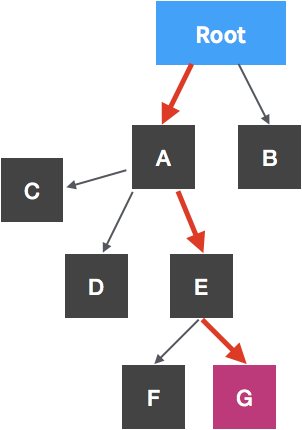
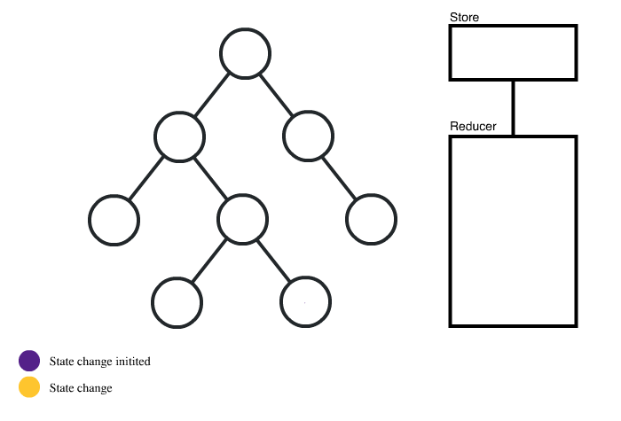

## ***난위도 : 별이 5개~~!***

**전역 상태 관리의 끝판왕~! context API 의 최후...**

**기본적인 구조와 개념을 이해하고 정용하면 금방 이해할수있음**

**미션~~! 클리어해야됨!**  
**React에서 전역 상태 관리 라이브러리로서의 Redux의 필요성을 이해한다**   
**Action, Dispatch, Reducer, Store 등 Redux의 핵심 개념을 이해한다**   
**React-Redux 라이브러리에서 제공하는 useSelector, useDispatch Hook을 사용할 수 있다**   
**Redux가 상태 관리를 위해 도입한 제약(순수 함수, 불변 객체)을 이해한다**

**<https://github.com/wecode-bootcamp-korea/redux-exercise>**

[🔗 GitHub - wecode-bootcamp-korea/redux-exercise](https://github.com/wecode-bootcamp-korea/redux-exercise) — Contribute to wecode-bootcamp-korea/redux-exercise development by creating an account on GitHub.


### ***✔️ Redux 왜 사용하는거지??***

**\* 정의** : 자바스크립트 앱을 위한 예측 가능한 상태 컨테이너입니다.   
**\* 사용하는 이유**

- props 로 필요한 부분까지 내려서 관리해야된다  
  (자식의 자식의 자식... 이런식으로 몇단계씩 내려가야되면 중간에 있는 컴포넌트는 정작 그 값을 안쓰는데도 계속 받아서 넘겨줘야되서 코드가 지저분해지고 유지보수하기 힘들어진다)
- 불필요한 랜더링을 줄일수 있다.  
  (상위 컴포넌트의 state가 바뀌면 그 밑에 있는 자식들도 상관없이 같이 랜더링 되는 경우가 생기는데 redux는 useSelector로 필요한 값만 구독해서 가져오기 때문에 그 부분을 줄일수 있다)



*props로 넘겨줄때*



*redux를 사용할때*

### ***✔️ 리듀서의 기본 개념 , 사용 메소드 종류~!***

|  |  |  |  |
| --- | --- | --- | --- |
| **기본적인 개념** | | **사용 메소드 종류** | |
| **액션(Action)** | 애플리케이션의 상태를 어떻게 변경시킬지 추상화한 표현 , 단순 객체로 type 프로퍼티를 꼭 가지고있어야 된다 | **useDispach** | 액션을 생성하는 함수인자로 받고 객체를 리턴하는데 리듀서를 거쳐 스토어를 직접 업데이트 하게됨(수정하는데 사용) |
| **리듀서(Reducer)** | 애플리케이션의 다음 상태를 반환하는 함수이다. 이전 상태와 액션을 받아 처리하고 다음 상태를 반환한다 | **useSelector** | index에서 Provider로 통해 전달한 store를 인자로 받고 콜백함수를 통해 특정 reducer의 함수를 실행 하여 store의 정보를 가져올수있다(읽어오는데만 사용) |
| **스토어(store)** | 애플리케이션의 상태를 저장하고 읽을 수 있게 하며 액션을 보내거나 상태의 변화를 감지할 수 있도록 API를 제공하는 객체 | **createStore** | 앱의 상태 트리 전체를 보관하는 Redux 저장소를 만듭니다. 앱 내에는 단 하나의 저장소만 있어야 합니다. |
|  |  | **combineReducers** | 각 컴포넌트 별로 리듀서를 작성했다면 이를 하나의 리듀서로 통합할때 사용한다. |

### ***✔️ 코드 예시본 ( 위에 개념에 맞춰서 정리함***

**초기세팅**  
npm install redux react-redux

- **action 생성하기** : 리듀서에 state에 따라 실행될 함수 정의  

  ```javascript
  //action폴더 -> index.js

  export const addCart = (item) => {
    return {
      type : "ADD_ITEM",
      payload : item
    } 
  }

  export const deleteCart = (items) => {
    return {
      type : "DELETE_ITEM",
      payload : items
    } 
  }​
  ```
- **reducer 생성** : action 의 type에 따른 새로운 payload 반환 (첫번째 인자 state, 두번째 인자 action) 통상 switch 문으로 작성해야됨, state 의 초기값 설정 가능  

  ```javascript
  //reducers -> cartReducer.js

  const cartReducer = (state = INITIAL_STATE,action) => {
    switch(action.type) {
      case "ADD_ITEM":
        return [...state, action.payload]
      case "DELETE_ITEM":
        return [...action.payload]
      default:
        return state
    }
  }

  export default cartReducer;

  const INITIAL_STATE = [
    {
      isChecked: true,
      product_name: "플루크 new 피그먼트 오버핏 반팔 티셔츠 FST701",
      product_id: 1304,
      product_img: "/images/tShirt.jpg",
      price: 33250,
    },
    ...(생략​
  ```
- **combineReducers 로 reducer 병합** :  인자로 reducer 들을 프로퍼티로한 객체를 받음  

  ```javascript
  //reducers -> index.js

  import { combineReducers } from "redux";
  import cartReducer from "./cartReducer";

  export default combineReducers({cartReducer});​
  ```
- **store 생성 및 Provider의 속성으로 넘기기** : context API 같이 프리패스로 전달가능  

  ```javascript
  //index.js

  import { Provider } from "react-redux";
  import { createStore } from "redux";
  import rootReducer from"./store/reducers"

  const store = createStore(rootReducer)

  ...(생략)

  ReactDOM.render(
    <React.StrictMode>
      <Provider store={store}>
        <Routes />
        <GlobalStyle />
      </Provider>

   ...(생략)​
  ```
- **useSelector hook 을 활용하여 state 값 읽어오기** :   

  ```javascript
  //CartList.js

  import { useSelector } from "react-redux";
  ...(생략)

  export default function CartList() {

    const cartItems = useSelector((store) => store.cartReducer);
    return (
    ...(생략)​
  ```
- **useDispatch hook 을 활용하여 state 값 수정하기**  

  ```javascript
  //ProductCard.js

  import React from "react";
  import { useDispatch } from "react-redux";
  import styled from "styled-components";
  import CartIcon from "./CartIcon";
  import {addCart} from "../store/actions"

  function ProductCard({ item }) {
    const dispatch =useDispatch()

    return (
      <Card>
        ...(생략)
        <AddCartBtn onClick={() => dispatch(addCart(item)) }>
        ...(생략)​
  ```

### ***✔️ 참고한 url ( 위에 코드예시는 전반적으로 wecode 에서 제공한것으로 함)***

**1. 공식문서**   
<https://ko.redux.js.org/tutorials/essentials/part-1-overview-concepts>

[🔗 Redux 핵심, Part 1: Redux Overview and Concepts | Redux](https://ko.redux.js.org/tutorials/essentials/part-1-overview-concepts) — The official Essentials tutorial for Redux: learn how to use Redux, the right way

**2. 개념정리 블로그**  
<https://wooder2050.medium.com/%EB%A6%AC%EB%8D%95%EC%8A%A4-redux-%EB%8A%94-%EC%99%9C-%EC%93%B0%EB%8A%94-%EA%B1%B4%EB%8D%B0-2eaafce30f27>

[🔗 리덕스(Redux)는 왜 쓰는 건데⁉](https://wooder2050.medium.com/%EB%A6%AC%EB%8D%95%EC%8A%A4-redux-%EB%8A%94-%EC%99%9C-%EC%93%B0%EB%8A%94-%EA%B1%B4%EB%8D%B0-2eaafce30f27) — 리덕스 개념을 정리하는 포스팅이다.


