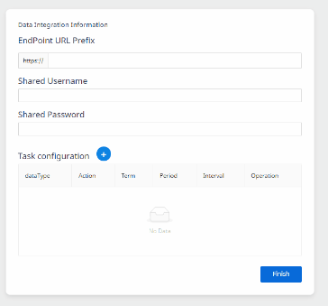
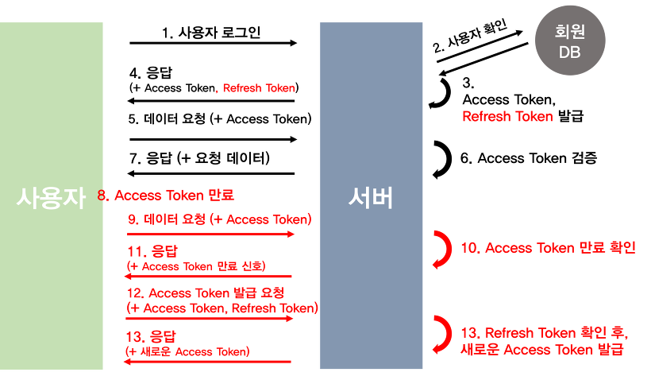
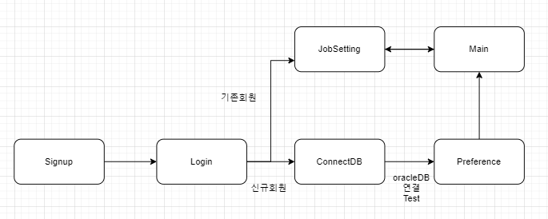
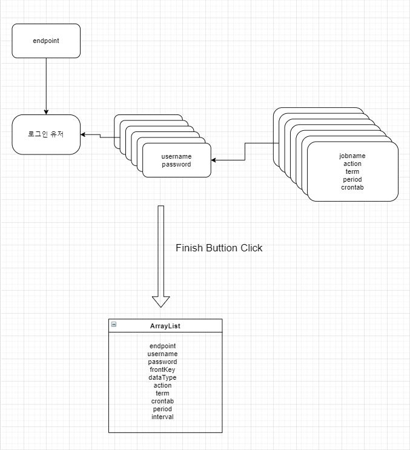
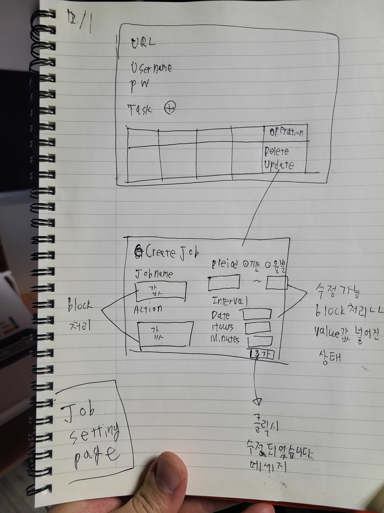
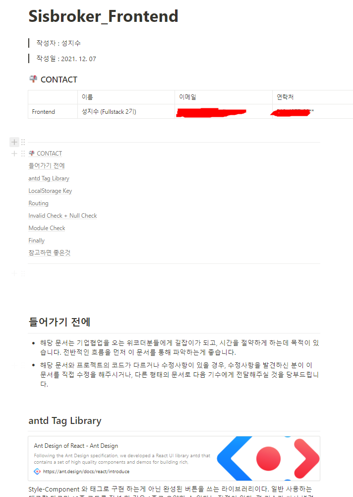

## **난위도 : 쉬엄쉬엄**

**기업협업 시즌동안 많은것을 생각하게 되고**

**실제로 기업에서 일하는것 같은 느낌을 받아**

**앞으로 어떻게 해야될지 목표가 생긴것같다.**

**(aws 배포는 못했고 기업정보를 노출할수 없기에 사진으로 대체한다)**




### ***✔️ 들어가기전에......***

- 해당 TIL은 기업협업의 회고록에 대한 내용을 담고있으나  
  회사 자료를 외부에 유출할 수 없기에 사전에 허락된 부분만 내용으로 담았다.
- 차후에 위코드 수강생중 기업협업으로 문의 사항 있으면 댓글로 남겨주기 바란다.

### ***✔️ 4주동안 내가 구현한 기능 및 프로젝트 간략소계***

**\* 자세한 : 전반적인 프론트 기능은 전 기수가 못다한 부분을 구현했고 디자인이나 기획적인 부분은 대표님이랑**

**상의후 구현했습니다**

**\* 인원 : 프론트 총 1명 , 백엔드 총 2명**

1. **프로젝트 소계**

- Blackboard LEARN 시스템과 클라이언트(대학기관)의 학사 정보 데이터 통합 구현을 제공하기 위해 데이터 연동 SaaS 플랫폼을 구축하고자 합니다.
- 해당 프로젝트는 클라이언트가 수월한 학사관리를 이용할 수 있도록 설계된 프로젝트 입니다.

2. **내가 구현한 기능**

- Refresh 토큰과 access 토큰
- 스케쥴링 CRUD
- 라우팅 block , 하나의 user당 스케쥴 ID생성 and 하나의 스케쥴 ID 당 다수의 스케쥴 생성
- 전반적인 문서화 , 리팩토링

### ***✔️ 프로젝트 진행상황및 스케쥴 공유***

**\* 프로젝트 기간보다는 충분히 여유있는 시간이었고 추가적인 기능을 더 구현 못한게 아쉬웠다**

|  |  |  |  |  |  |  |  |
| --- | --- | --- | --- | --- | --- | --- | --- |
| **1주차** | | **2주차** | | **3주차** | | **4주차** | |
| **기간** | **내용** | **기간** | **내용** | **기간** | **내용** | **기간** | **내용** |
| 11/15 (월) | 첫미팅, 프로젝트 설명 | 11/22(월) | 스케쥴링 관련 코드 파악 | 11/29(월) | 대표님과 스케쥴링 관련 미팅, 추가된기능 코드 재수정 | 12/6(월) | 대표님과의 점심식사, 백엔드랑 마지막으로 오류체크 및 기능 테스트 |
| 11/16 (화) | 코드 분석 | 11/23(화) | 스케쥴링 관련 코드 파악+리팩토링 | 11/30(화) | 다른 페이지 인데 같은 스케쥴링 기능을 사용하는거 공통 컴포넌트로 수정 뺌 | 12/7(화) | 코드+기능 전반적인 부분 문서화 (at. Notion), 최종 점검 및 대표님과의 마지막 회의 팀회식 |
| 11/17 (수) | 코드분석 | 11/24(수)  (at. 홍대) | 프+백 연결해서 오류찾기, 2기에가 3기가 | 12/01(수) | 스케쥴링을 toggle 할때마다 상황 부여및 백엔드 요청 처리 | 12/8 (수)  (at. 홍대) | 문서화 다듬기 + README 작성 |
| 11/18 (목) | 위코드데이 소헌님 상담 | 11/25(목) 위코드데이 (선릉) | 인자에 따라 alert메세지를 리턴하고 정규식 체크하는 공통함수 구현 | 12/02(목) 위코드데이 (at. 을지로) | crontab 부분, 변수명, 데이터 타입 관련 해서 대표님에게 질문 | 12/9목) (at. 자택) | 팀별 발표 PPT작성, 기업협업 회고록 TIL 작성 |
| 11/19 (금) | 대표님 미팅 프론트 전반적인 가이드 얘기해주심 | 11/26(금) (at. 자택) | 스케쥴링 코드 수정 | 12/03(금) (at. 자택) | 대표님이 얘기하신 부분 수정 | 12/10(금) (at. 서울역) | 수료식 |
| 11/20, 11/21  (토,일) | 오라클 클라이언트 설치, 30% 마무리 | 11/27(토), 11/28(일) | Main페이지 코드 파악,  진행한 부분 리팩토링 | 12/04(토), 12/05(일) | 백엔드에서 5초씩 늘어나는 부분 코드파악, 마지막 오류 체크 및 수정 |  |  |

### ***✔️ 프로젝트하면서 사용한 기술 스택***

**\* 개선해야될 기술 스텍**

**- Context API, Rebucks**

**\* antd라이브러리 설명서(<https://ant.design/docs/react/introduce>)**

|  |  |
| --- | --- |
| **분야** | **기술 스택** |
| **Frontend** | - JavaScript - StyleComponent - React - React Hook - HTML - Restful API - antd |
| **Common** | - Git - GitHub - Git Rebase - Prettier - Eslint |
| **Comunication** | - Slack - Zoom - Notion - Teams |

### ***✔️* Refresh 토큰과 access 토큰**

- **Refresh 토큰 :** 모든 요청마다 refresh를 체크하고 있으면 access토큰만 재발급 없으면 모든키 삭제후 로그아웃
- **Access 토큰 :** 모든 요청마다 access를 체크하고 없으면 재발급한 후 다시 fetch 요청을한다

<https://tansfil.tistory.com/59>

[🔗 쉽게 알아보는 서버 인증 2편(Access Token + Refresh Token)](https://tansfil.tistory.com/59) — 안녕하세요! 이전 포스팅에는 크게 세션/쿠키 인증, 토큰 기반 인증(대표적으로 JWT)에 대하여 알아보았습니다. 저희가 앱, 웹 혹은 서버 개발을 하면서 꼭 사용하게 되는 인증(Authorization)은 아주



### ***✔️* 라우팅 block , 하나의 user당 스케쥴 ID생성 and 하나의 스케쥴 ID 당 다수의 스케쥴 생성**

- **새로운유저 :** 회원가입 -> 로그인 -> connectDB -> preference -> 메인 -> Jobsetting
- **기존유저 :** 회원가입 -> 로그인 -> main -> Jobsetting



- 로그인 유져당 하나의 endpoint 다수의 username을 하나의 username당 다수의 dataType을 만들수 있지만 finish 버튼클릭시 body에 담는 감은 여러객체의 배열이다.



### ***✔️ 스케쥴링 CRUD***

- **Create** : + 버튼을 클릭했을때 onClick 이벤트로 getList라는 함수가 실행되며 해당 가공된 객체가 totalJob이라는 state 배열에 들어가 화면을 랜더링한다  

  ```javascript
  ////CommonScheduling.js
  const getTotalList = () => { // onClick이벤트
      const {
        dataType,
        action,
        term,
        totalPeriod,
        monthly,
        date,
        hours,
        minutes,
        frontKey,
      } = jobInfo;
      const { username, password } = bbInfo;
      const period = monthTab === 1 ? totalPeriod : monthly?.join();
      const interval = `Date: ${date}, Hours: ${hours}, Minutes: ${minutes}`;
      let crontab = `${minutes} ${hours} ${date || '*'} ${period} *`;
      const validation =
        dataType && action && !isTermInvalid && !checkMonth && hours && minutes;
      if (!validation) {
        alert(errorMessage('nullMs'));
        return;
      }
      let newJobData = {
        frontKey: frontKey === undefined ? jobTotal.length : frontKey, //update일때도 생각
        username,
        password,
        dataType,
        action,
        term: term || '',
        period,
        interval,
        crontab,
      };
  		...(생략)
      } else { //create일떼 아닐때
        setJobTotal(jobTotal?.length ? [...jobTotal, newJobData] : [newJobData]);
      }
      setIsModalAction(!isModalAction);
    };
  ```
- **Read** : ComponentDidmount시 Get 요청으로 state에 저장후 View단에 뿌려준다.  

  ```javascript
  ////CommonScheduling.js
  useEffect(() => {
      const isJobsettingPage = location.pathname !== '/jobsettings';
      if (isJobsettingPage) {// url block check
        setIsUrlModify(false);
        return;
      }
      fetch(`${LOCAL_GET_GETLIST_API}`, {
        headers: {
          'Content-Type': 'application/json',
          Authorization: localStorage.getItem('token-access'),
        },
      })
        .then(res => res.json())
        .then(({ data }) => {
          console.log(data);
          setIsUrlModify(data?.length);
          setBbInfo({
            ...bbInfo,
            endpoint: data?.length ? data[0].endpoint : '',
          });
          setJobTotal(
            data?.map((job, index) => {//하나씩 데이터 가공
              const crontabArr = job.crontab.split(' ');
              return {
                ...job,
                frontKey: index,
                period: job.crontab.split(' ')[crontabArr.length - 2],
                interval: `Date: ${
                  job.crontab.split(' ')[crontabArr.length - 3] || 0
                }, Hour: ${
                  job.crontab.split(' ')[crontabArr.length - 4] || 0
                }, Minute: ${
                  job.crontab.split(' ')[crontabArr.length - 5] || 0
                } `,
              };
            })
          );
        });
    }, []);​
  ```
- **Update** : 클릭한 객체를 받아 필수 값을 state에 저장후 CreateJob모달에 초기값으로 지정하고 나머지 수정 가능한 데이터를 onChange시 state에 추가한다. 완료버튼 누를때 수정된 데이터 포함해서 Post로 요청을 보낸다.   

  ```javascript
  //TaskListTable.js
  {
        title: 'Operation',
        dataIndex: 'Operation',
        render: (_, clickJob) =>
          jobTotal.length >= 1 && (
            <div>
  			       ...(생략)
              <Popconfirm
                title='Sure to update?'
                onConfirm={() => handleModal(clickJob)}
              >
                <a>Update</a>
              </Popconfirm>
            </div>
          ),
      },

  ////CommonScheduling.js
  const handleModal = updateData => {
      if (!updateData?.username && (!bbInfo.username || !bbInfo.password)) {//update일경우 username password check 노노
        alert(errorMessage('nullMs'));
        return;
      }
  		...(생략)
      setIsOperationUpdate(updateData?.username ? true : false); //update시 createJob에서 block처리하는거
      const reset = { //update시 바꾸지 않는 데이터들 고대로 넣기
        frontKey: updateData?.frontKey === '' ? '' : updateData?.frontKey,
        dataType: updateData?.dataType || '',
        action: updateData?.action || '',
        term: updateData?.term || '',
        startDate: '',
        endDate: '',
        totalPeriod: '',
        monthly: '',
        date: 0,
        hours: 0,
        minutes: 0,
      };
      setUpdateBodyData({ // 백엔드에 받은 데이터들
        clientId: updateData?.clientId || '',
        id: updateData?.id || '',
        toggle: updateData?.toggle || 0,
        endpoint: updateData?.endpoint || '',
      });
      setIsModalAction(!isModalAction);
      setCheckMonth('');
      setJobInfo(reset);
      setMonthTab(1);
    };

  const getTotalList = () => {
  	 ...(생략 create랑 동일)
      let updateJobData = {
        ...newJobData,
        ...updateBodyData,
      };
      if (updateJobData.frontKey !== undefined) {
        const deleteJob = jobTotal.filter(job => { //click한 요소빼고 나머지
          return job.frontKey !== updateJobData.frontKey;
        });

        setJobTotal([...deleteJob, updateJobData]);
  			} else{
      ...(생략 )
  			}
      setIsModalAction(!isModalAction);
    };​
  ```
- **Delete** : 사용자가 추가한 데이터일 경우 state에서 삭제, DB에서 받은 데이터일 경우 Id를 body에 담아 fetch요청을 보낸다  

  ```javascript
  //TaskConfig.js

  const handleDelete = async record => {
      let resSuccess = true;
      if (record.id) {
        resSuccess = await fetchDelete(record.id);
      }
      resSuccess &&
        setJobTotal(
          jobTotal.filter(item => {
            return item.frontKey !== record.frontKey;
          })
        );
    };

    const fetchDelete = async jobId => {
      const response = await fetch(`${LOCAL_GET_DELETEJOB_API}`, {
        method: 'DELETE',
        headers: {
          'Content-Type': 'application/json',
          Authorization: localStorage.getItem('token-access'),
        },
        body: JSON.stringify({ id: jobId }),
      });
      const data = await response.json();
      if (data.message === 'jwt expired') {
        const isTokenChange = await tokenCheck();
        isTokenChange ? fetchDelete() : history.push('/login');
      } else {
        resMessageAlert(data.message);
        return data.message === 'JOB DELETED';
      }
    };​
  ```

### ***✔️ 전반적인 문서화 , 리팩토링***

**\* 문서화 참고하면 좋은것 : (<https://www.youtube.com/watch?v=lBxXKJyAJ28>)**

- Style 컴포넌트를 전반적으로 mixin으로 통일했습니다  

  ```javascript
  //mixin.js

  import { css } from 'styled-components';

  const colorStyleGroup = {
    white: '#FFFFFF',
    pageColumn: ' #232e3c',
    inputBorder: '#ededed',
    inputShadow: '#9c88ff',
    inputPlaceholder: '#bcbcbc',
    cautionTextStyle: '#d63939',
    buttonBackground: '#086ad8',
    testButtonBackground: '#3ae374',
    settingMenuFont: '#333333',
    mainPageInfoColor: '#0000008a',
  };

  const flexStyleGroup = (justify, align, direction) => css`
    display: flex;
    justify-content: ${justify};
    align-items: ${align};
    flex-direction: ${direction};
  `;

  const inputHoverStyle = () => css`
    outline: none;

    &:focus {
      box-shadow: 0px 0px 0px 3px rgba(156, 136, 255, 0.7);
      transition: 0.5s ease-in-out;
    }

    &::placeholder {
      ${fontStyleGroup('14px', colorStyleGroup.inputPlaceholder)}
    }
  `;​
  ```
- 공통적인 error메세지나 response 에따른 액션등 공통 모듈 CommonFunction으로 처리했습니다.  

  ```javascript
  import { LOCAL_GET_REFRESH_API } from '../../utils/config';

  export const errorMessage = what => {//error에 따른 메세지
    const message = {
      nullMs: '빈값을 입력해주세요',
      resStateAlse: '통신 에러',
  	...(생략
    };
    return message[what];
  };

  export const resMessageAlert = message => {//response 메세지를 alert메세지로 바꾸기
    const KorMessage = {
      'SIGNUP SUCCESS': '회원 가입을 성공했습니다.',
      'INVALID INPUT': '입력이 잘못되었습니다.',
   	...(생략
    };
    KorMessage[message] ? alert(KorMessage[message]) : console.error(message);
  };

  export const isValidCheck = (what, testObject) => {
    const invaild = {
      email:
        /([\w-\.]+)@((\[[0-9]{1,3}\.[0-9]{1,3}\.[0-9]{1,3}\.)|(([\w-]+\.)+))([a-zA-Z]{2,4}|[0-9]{1,3})(\]?)$/,
  	...(생략
    };
    return !invaild[what].test(testObject);
  };

  export const isValidErrorMessage = (what, testObject) => { // invalid check에 따른 error메세지 반환
    return isValidCheck(what, testObject) ? errorMessage(what) : '';
  };

  export const dataToPageMove = where => {//response메세지에따른 경로
    const routing = {
      'NEW USER': '/connectdb',
     	...(생략
    };
    return routing[where];
  };

  export const tokenCheck = async () => { //refresh check
    const refreshResult = await fetch(`${LOCAL_GET_REFRESH_API}`, {
      method: 'GET',
      headers: {
        'Content-Type': 'application/json',
        Authorization: localStorage.getItem('token-access'),
        Refresh: localStorage.getItem('token-refresh'),
      },
    });
    const refreshData = await refreshResult.json();
    if (refreshData.message === 'NO AUTHORIZED') {
      resMessageAlert(refreshData.message);
      localStorage.clear();
      return false;
    } else if (refreshData.message === 'ACCESS TOKEN IS REFRESHED') {
      localStorage.setItem(
        'token-access',
        JSON.stringify(refreshData.newAccessToken)
      );
      return true;
    } else console.error(refreshData.message);
  };​
  ```
- Preference 페이지와 JobSetting 페이지에서 같은 모달을 쓰는데신 세부적인 기능만 다르게 구현했습니다  

  
- 문서화는 다음 기수가 알아볼 수 있게 최대한 세밀하게 준비했습니다.




### ***✔️ 프로젝트 하면서 부족한거 그리고 알게된것***

1. **부족한 부분, 하고 싶었는데 하지못한 기능**

- **Reducks** : 전역 상태 관리중 하나이고 어떤식으로 활용해서 쓰는지 적용을 하지는 못했다.

2. **깨닭은것중 중요한거(알게된것)**

- refresh 토큰 : 하나의 토큰만 발급한다면 그 시간이 만료시 로그아웃이 된다. 하지만 토큰을 2개로 놓고  
  하나는 2시간 하나는 2주로 설정하면 첫번째 토큰이 만료되더라도 두번째 토큰이 만료가 않됬다면 재발급해주면되고 만료되었다면 로그아웃해주면된다. 즉 2중으로 검사할수있기 때문에 더 효율적으로 토큰을 관리할수있다.
- CRUD : 여기서 CRUD는 Create Read Update Delete 인데 Read랑 Create 는 쉬우나 Update 하는 부분이 골치아플수 있다. 그래서 필자는 애초에 수정할 데이터랑 수정안할 데이터를 state 분류하여 관리했고 수정된 데이터만 변경후 id값을 비교해 해당 state(객체의 프로퍼티)만 수정하면된다
- antd 라이브러리 사용 : 전 기수가 antd 라이브러리를 사용하여 태그를 구성했는데 처음에는 정의된 속성에 맞춰서 구현해야 된다는 번거로움이 있었는데 쓰다보니 10줄 써야될것을 한줄로 축약됬고 어려운 버튼조차 이미 정의가 된 태그를 가져다가 쓰면 된다는 장점이 있었다.

### ***✔️ 기업협업 4주동안 느낀점***

프로젝트 2차 3주때 기업협업 가고싶은곳을 투표하는데 나는 거리 순으로 설정했고 가장 가장 가까운 아이비즈가 됬다

우선 우리는 프론트엔드가 나 혼자에 백엔드가 2명있었는데 보통은 사수가 있어야되지만 우리가 간곳은 15년차 자바 백엔드 개발자이신 대표님만 있었다. 초반에는 프론트에대해 조언을 구할곳이 없어서 난감했지만 그래도 백엔드 측면에서 많이 배웠고 추가적인 기능 구현보다 전기수가 짜놓고 간 코드를 리팩토링 하는데 중점을 잡았는데 코드를 파헤쳐보니까 기능적인 부분이나 view 단에 구현이 않되있는 부분이 있어서 대표님이랑 많이 미팅을 했다.

그리고 3주 정도때는 오히려 CRUD 구현이나 refresh토큰등 추가적으로 구현해야되는 부분이 생겨서 바빴고 추가적으로 모듈을 통일하는 부분이나 코드의 가독성부분 백엔드랑 맞춰서 error나는 부분해결 등 생각했던것보다 할게 많았다

그리고 마지막 주차때는 문서화를 진행했는데 오히려 문서에 초점을 맞춰서 이해하는것보다 코드를 보며 이해해야된다고했고 누구나 봐도 이 프로젝트는 이렇게해야되는구나 라는것을 많이 일깨워줬다.

전반적으로 많이 아쉽고 하지만 뭔가 다른사람의 코드를 분석하는것이 얼마나 중요하고 리팩토링이나 변수명도 빼놓을수 없는 중요한 부분이라는것을 깨닭게 된 프로젝트였다.

### ***✔️ 참고 url***

**오라클 클라이언트 까는법**

[Download and install the Oracle client for Windows at IU](https://kb.iu.edu/d/agpr)

[🔗 Download and install the Oracle client for Windows at IU](https://kb.iu.edu/d/agpr) — Download and install the Oracle client for Windows at IU Overview At Indiana University, to download the Oracle client for Windows, UITS recommends downloading the client directly from Oracle's website. This requires a valid OTN (Oracle Technology Network)

**문서화 예시본**

[개발 문서화는 왜 하는 걸까?](https://blog.kmong.com/%EC%83%88%EB%A1%9C%EC%9A%B4-%ED%8C%80%EC%9B%90%EC%9D%84-%EA%B2%A9%EB%A0%AC%ED%9E%88-%ED%99%98%EC%98%81%ED%95%98%EB%8A%94-%EB%B2%95-bf42f7159309)

[🔗 개발 문서화는 왜 하는 걸까?](https://blog.kmong.com/%EC%83%88%EB%A1%9C%EC%9A%B4-%ED%8C%80%EC%9B%90%EC%9D%84-%EA%B2%A9%EB%A0%AC%ED%9E%88-%ED%99%98%EC%98%81%ED%95%98%EB%8A%94-%EB%B2%95-bf42f7159309) — 우리는 한 사람의 인생을 더 격렬히 환영해줘야 한다… 문서로…

**Redis 정리**

[Redis 기본 정리](https://brunch.co.kr/@jehovah/20)

[🔗 Redis 기본 정리](https://brunch.co.kr/@jehovah/20) — 캐시를 알아야 하는 순간! | 캐시를 접하게 되는 순간 서비스를 처음 운영할 때는 WEB-WAS-DB의 전형적인 3티어 구조를 취하는 편이 보통입니다. 사용자가 몇 명 되지 않는 서비스의 경우에는 3티어

**SOA 설명**

[서비스 지향 아키텍처](https://docs.microsoft.com/ko-kr/dotnet/architecture/microservices/architect-microservice-container-applications/service-oriented-architecture)

[🔗 서비스 지향 아키텍처](https://docs.microsoft.com/ko-kr/dotnet/architecture/microservices/architect-microservice-container-applications/service-oriented-architecture) — 마이크로 서비스 및 SOA(서비스 지향 아키텍처) 간의 근본적인 차이점을 알아봅니다.

**스케쥴링**

[node-schedule](https://www.npmjs.com/package/node-schedule)

[🔗 node-schedule](https://www.npmjs.com/package/node-schedule) — A cron-like and not-cron-like job scheduler for Node.

**CS용어 정리**

[달채비 개발팀이 생각하는 CS 기초란](https://www.notion.so/CS-bfbe0736a3714d34bc5e21e754f8c38c)

[🔗 달채비 개발팀이 생각하는 CS 기초란](https://www.notion.so/CS-bfbe0736a3714d34bc5e21e754f8c38c) — 다음 질문들에 대해서
