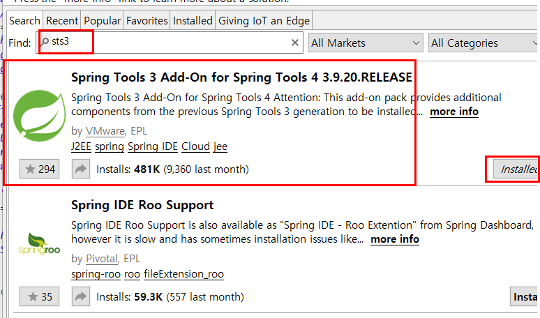
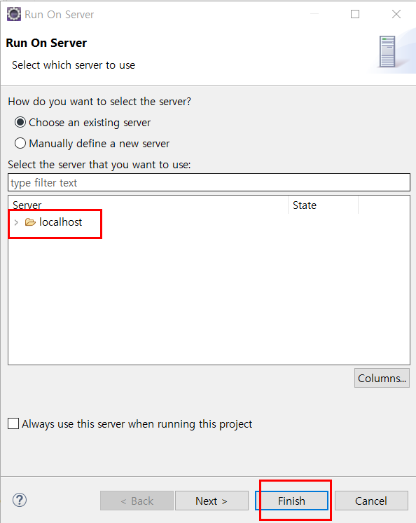
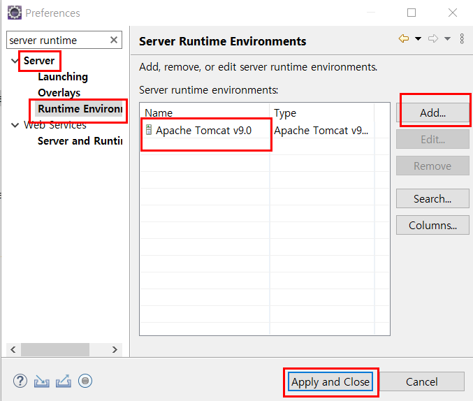
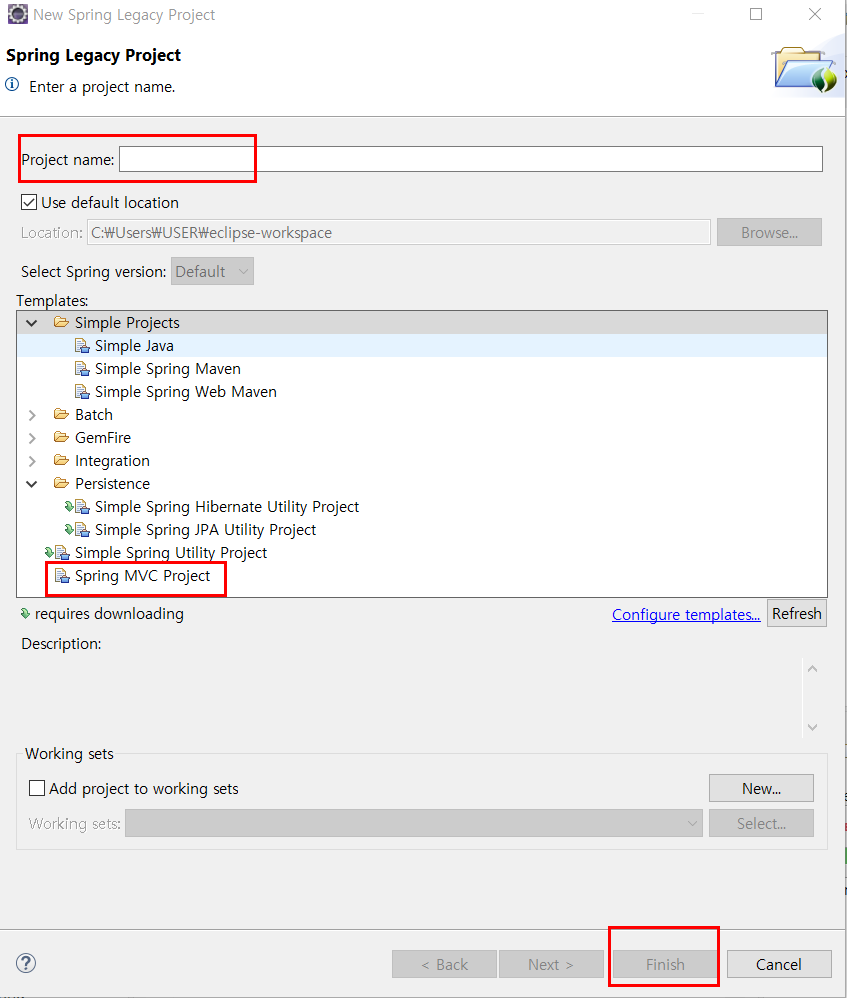

#### **Spring 시작!!!!!!**

## ***난위도 : ★★☆(할게 너무 많음 ㅠ)***

**이제 서버랑 이클립스세팅은 다 끝났다**

**하지만 데이터베이스 MyBatis 등 세팅을 해야되고**

**가장 편한 Spring Boot도 있지만 먼저 FM인 Spring을**

**마스터 해보고자 시작했다.**

**추가로 Eclips 대신 IntellJs 를 써도 된다고한다.**


### ***✔️ 각각 설치해야되는 이유***

- JDK : 자바 통합 개발 환경으로 자세한 사항은 아래 참고  
  (참고 : <https://zibu-story.tistory.com/12>)
- STS : 스프링을 하기위한 기본적인 프레임워크
- Tomcat : 웹 서버와 연동하여 실행할 수 있는 자바 환경을 제공하여 자바서버 페이지(JSP)와 자바 서블릿이 실행할 수 있는 환경을 제공
- Lombok : Java 라이브러리로 반복되는 getter, setter, toString 등의 메서드 작성 코드를 줄여주는 코드 다이어트 라이브러리
- Junit : 자바 프로그래밍 언어용 단위 테스트 도구로 보이지 않고 숨겨진 단위 테스트를 끌어내어 정형화시켜 단위 테스트를 쉽게 해주는 테스트용 Framework

### ***✔️ JDK 설치 ( JDK 11버전) , 환경변수 세팅, 이클립스 설치***

**(참고 : <https://www.oracle.com/java/technologies/downloads/#java11-windows> )**

**\* 필수~ 이클립스 한글 설정**

Eclips 파일 실행후 window메뉴 -> preference -> workspace,HTML,CSS,JSP 전부 UTF-8로 변경

**\* Eclips sts.ini 수정**

```javascript
//Eclips 설치폴더 -> sts.ini 파일 수정 \bin\javaw.exe 추가
...(생략
-vm
C:\Program Files\Java\jdk-11.0.13\bin\javaw.exe
...(생략)
```

### ***✔️STS 3 설치 (Spring Tools 3)***

**주의! STS4라는 항목말고 STS3을 설치해야됨**

**\* STS 홈페이지에서 설치하기**

(참고 : <https://spring.io/blog/2019/06/20/spring-tool-suite-3-9-9-released> )

**\* Eclips에서 설치하기**

Help -> eclipse Marketplace -> STS3 Install



### ***✔️Tomcat (서버)설치 및 연결***

**( 참고 : <https://www.notion.so/Spring-9cb2cbb4c3ca477e9451ad9bf39a7695#3417a95b97d14d08bdca747dcaa158ff>)**

**\* 주의 : 이클립스에서 Spring Tool 3을 다운받았으면 tomcat 9 으로 다운받아야됨(버전 헷깔리지 않게 주의)**

**\* 다운 완료후**

다운완료후 eclipse 에서 window -> preference ->server runtime 항목을 tomcat으로 추가

이후 Run As -> Run on Server -> Hello world 브라우저에 출력된거 확인





### ***✔️프로젝트 생성 및 버전 변경***

**\* 프로젝트 생성**

File -> New -> Spring Legacy Project 클릭

만약 Spring Legacy Project 없을때 아래 링크 참고

(참고 : <https://www.notion.so/Spring-9cb2cbb4c3ca477e9451ad9bf39a7695#b528babd51d14104bbf39627f47f06cd>)



**\* pom.xml 파일 가서 버전 변경**

```javascript
//pom.xml
<java-version>1.6</java-version>
		<org.springframework-version>5.0.7.RELEASE</org.springframework-version>//변경
		<org.aspectj-version>1.6.10</org.aspectj-version>
		<org.slf4j-version>1.6.6</org.slf4j-version>
	</properties>
...(생략
<plugin>
    <groupId>org.apache.maven.plugins</groupId>
    <artifactId>maven-compiler-plugin</artifactId>
    <version>2.5.1</version>
    <configuration>
        <source>11</source>//변경
        <target>11</target>
        <compilerArgument>-Xlint:all</compilerArgument>
        <showWarnings>true</showWarnings>
        <showDeprecation>true</showDeprecation>
    </configuration>
</plugin>
```

### ***✔️Lombok 설치 및 연결***

**( 설치 링크 : <https://projectlombok.org/>)**

```javascript
//터미널에서 lombok 연결하기
> java -jar lombok.jar
```

**\* 생성한 프로젝트에 Lombok 세팅하기**

(링크: <https://mvnrepository.com/artifact/org.projectlombok/lombok>)

```javascript
//pom.xml
<dependency>
    <groupId>junit</groupId>
    <artifactId>junit</artifactId>
    <version>4.12</version>
    <scope>test</scope>
</dependency>        
<dependency>//여기부터 추가
    <groupId>org.projectlombok</groupId>
    <artifactId>lombok</artifactId>
    <version>1.18.16</version>
    <scope>provided</scope>
</dependency>
```

```javascript
//pom.xml
<properties>
		<java-version>1.6</java-version>
		<org.springframework-version>5.0.7.RELEASE</org.springframework-version>//수정
		<org.aspectj-version>1.6.10</org.aspectj-version>
		<org.slf4j-version>1.6.6</org.slf4j-version>
	</properties>
...(생략
<plugin> 
    <groupId>org.apache.maven.plugins</groupId>
    <artifactId>maven-compiler-plugin</artifactId>
    <version>2.5.1</version>
    <configuration>
        <source>11</source>//수정
        <target>11</target>
        <compilerArgument>-Xlint:all</compilerArgument>
        <showWarnings>true</showWarnings>
        <showDeprecation>true</showDeprecation>
    </configuration>
</plugin>
<plugin>//추가
    <groupId>org.apache.maven.plugins</groupId>
    <artifactId>maven-war-plugin</artifactId>
    <version>3.2.0</version>
    <configuration>
        <failOnMissingWebXml>false</failOnMissingWebXml>
    </configuration>
</plugin>
```

**\* 파일 생성해서 연결된거 확인하기**

**( 콘솔에 출력되는지 확인해야됨)**

```javascript
//org.zerock.config -> RootConfig.java
package org.zerock.config;

import org.springframework.context.annotation.Configuration;

@Configuration
public class RootConfig {

}

//org.zerock.config -> WebConfig.java
package org.zerock.config;

import org.springframework.web.servlet.support.AbstractAnnotationConfigDispatcherServletInitializer;

public class WebConfig extends AbstractAnnotationConfigDispatcherServletInitializer {

	@Override
	protected Class<?> [] getRootConfigClasses() {
		return new Class[] {RootConfig.class};
	}

	@Override
	protected Class<?> [] getServletConfigClasses() {
		return null;
	}
	@Override
	protected String [] getServletMappings() {
		return null;
	}
}
```

### ***✔️junit 세팅 및 설정하기***

**(테스트 코드 작성하는 방법은 차후에 TIL로 작성하겠음)**

```javascript
//pom.xml
<dependency>
			<groupId>log4j</groupId>
			<artifactId>log4j</artifactId>
			<version>1.2.17</version>

		</dependency>
...(생략)
<dependency>
			<groupId>junit</groupId>
			<artifactId>junit</artifactId>
			<version>4.12</version>//수정
			<scope>test</scope>
		</dependency>
```

```javascript
//pom.xml
<dependency>
			<groupId>org.springframework</groupId>
			<artifactId>spring-test</artifactId>
			<version>${org.springframework-version}</version>
		</dependency>
```


