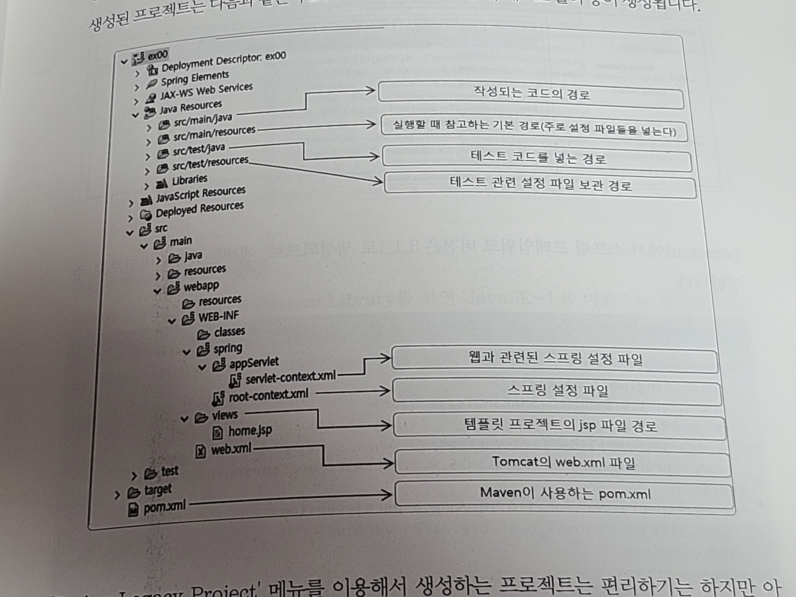
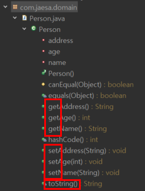
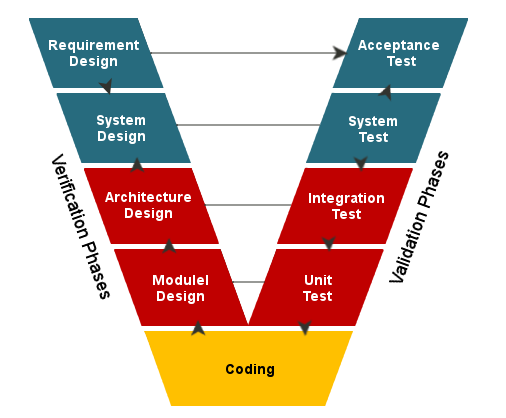

## ***난위도 : ★★★★***

**나의 블로그를 보신분이라면 Why?라는 생각이 먼저 들것이다.**

**원래 자바스크립트랑 react 를 주로 했었는데 갑자기 스프링을 시작하니까**

**그럴수도있다.**

**가장 큰 이유는 금융권에 가고 싶은것도 있고 전부터 궁금하기도 했기때문이다.**

**먼저 스터디 할 인원들을 3명 구했고 정기적으로 목요일마다 zoom으로**

**각자 공부한 내용에대해 얘기하기로 했다.**

**책은 현업 개발자한테 추천받은것이고**

**좀 오래됬지만 부트가 아닌 기본인 스프링 프레임워크부터 마스터 해보겠다.**

**(책 링크 : <http://www.yes24.com/Product/Goods/64340061>)**


### ***✔️스프링 프레임워크의 정의 및 특징***

**(참고: <https://joychae.tistory.com/27>)**

**1. 왜써야됨?**

- 개발에 필요한 구조를 이미 코드로 만들어 놓았기 때문에 실력이 부족한 개발자라 하더라도 반쯤 완성한 상태에서 필요한 부분을 조립하는 형태의 개발이 가능합니다.
- 어느정도 품질이 보장되어있고, 구축되어있는 구조에 코드를 넣어 개발하는 형태이기 때문에 개발시간의 단축또한 장점입니다.
- 비즈니스 로직을 구성할때 편리한 사항이 있습니다 (아래 특징 참고

**2. 특징**

- POJO 기반 구성  
  원래 라이브러리나 프레임워크에 종속되는 경향이 있는데 Java 코드를 이용해 객체를 구성하는 방식등 자유롭게 사용할수있다
- 의존성 주입(DI, 자세한 부분은 아래에서 설명하도록 하겠다)  
  외부에서 두 객체 간의 관계를 결정해주는 디자인 패턴으로, 인터페이스를 사이에 둬서 클래스 레벨에서는 의존관계가 고정되지 않도록 하고 런타임 시에 관계를 다이나믹하게 주입
- AOP 지원(관점지향 프로그래밍)  
  코드를 줄이고 공통된 기능을 분류하여 원하는 로직에 넣을 수 있게 한다.
- 편리한 MVC 구조  
  역활별로 나누어서 Model(모든 데이터의 정보), View(시각적인 UI), Controller(모델과 뷰를 연결) 로 구성한다
- WAS의 종속적이지 않는 개발 환경  
  기본적으로 동적 데이터를 처리하는 서버로 DB 연동 데이터 조작, 서버관리등 처리를 도와준다

**3.  스프링 프로젝트 폴더구조**

**(참고 사이트 : <https://bokbok-tistory.tistory.com/13>)**



### ***✔️어노테이션이란??  기본적으로 사용하는 종류***

**1. 어노테이션이란?**

- @를 이용한 주석, 자바코드에 주석을 달아 특별한 의미를 부여한 것  
    (참고로 클래스, 메소드, 변수 등 모든 요소에 선언이 가능)
- 메타데이터(실제데이터가 아닌 Data를 위한 데이터) 라고도 불리고 JDK5부터 등장
- 컴파일러가 특정 오류를 억제하도록 지시하는 것과 같이 프로그램 코드의 일부가 아닌   
  프로그램에 관한 데이터를 제공, 코드에 정보를 추가하는 정형화된 방법.
- **왜 쓰는지** : 아래에 나오는 root-context.xml, servlet-context.xml 처럼 XML로 하나하나 설정을 다 적으면 파일이 길어지고 어디에 뭐가 있는지 찾기 힘든데, 어노테이션은 클래스나 메소드 위에 바로 붙여서 설정할 수 있어서 훨씬 간결하다. 그래서 최근 스프링 프로젝트는 XML보다 어노테이션 기반으로 많이 가는 추세다.

**2. 종류 및 역활**

|  |  |  |
| --- | --- | --- |
| 구분 | 종류 | 뜻 |
| Lombok 관련 어노테이션 | @Data | @toString, @getter/setter, @RequiredArgsConstructor 등 모두 사용한것과 같은 기능 |
|  | @AllArgsConstructor | 모든 필드를 파라미터로 가지는 생성자 생성 |
|  | @NoArgsConstructor | 파라미터가 없는 기본 생성자를 생성시켜주는 어노테이션 |
|  | @EqualsAndHashCode | equals와 hashCode를 오버라이딩 시켜주는 어노테이션 |
| Spring Annotation | @Test | JUnit 에서 테스트 대상을 표시하며 단위 테스트 메소드임을 명시 |
|  | @ContextConfiguration | 지정된 클래스나 문자열을 이용해 필요한 객체들을 스프링 내 객체로 등록 |
|  | @RunWith | Unit 프레임워크의 테스트를 할수 있도록 설정 @Runwith에 Runner클래스 설정시 JUnit의 내장된 runner대신 설정한 SpringJUnit4ClassRunner를 실행 |
| Spring 관련 어노테이션 | @Getter | Get()메소드 자동생성 |
|  | @Setter | Set()메소드 자동생성 |
|  | @Log4j | Lombok을 이용해 로그를 기록하기 위한 Logger 변수 생성 |
|  | @Autowired | 해당 인스턴스 변수에 스프링으로부터 자동으로 Bean을 주입, new 연사자와 같음 |
|  | @Component | Component는 스프링에게 해당 클래스가 관리해야할 대상임을 표시 |

### ***✔️의존성 주입이란??? 코드 작성까지***

**1. 의존성이란?**

의존성이라는거는 하나의 객체가 다른 객체 없이 제대로 된 역할을 할 수 없다는것, 주입은 외부에서 밀어 넣는 것을 의미한다 이 둘을 결합하면 어떤 객체가 필요한 객체를 외부에서 밀어 넣는다 는 의미

ex)체인점 같은 경우 본사에서 식재료를 제공한다.

**2. 주입하는 과정 설명**

1. 스프링 프레임워크가 시작되면 스프링이 사용하는 메모리 영역을 만들게 됙ㅎ 이를 context 라고 합니다. 스프링에서는 ApplicationContext라는 이름의 객체가 만들어집니다
2. 스프링은 자신이 객체를 생성하고 관리해야하는 객체들에 대한 설정이 필요합니다 이에 대한 설정이 root-context.xml입니다.
3. root-context.xml 에 설정되있는 태그 내용을 통해서 chef있는 패키지를 스캔하기 시작합니다
4. 해당 패기지에 있는 크래스들 중에서 스프링이 사용하는 @Component라는 어노테이션이 존재하는 클래스 인스턴스를 생성합니다
5. Restaurant 객체는 Chef 객체가 필요하다는 어노테이션 설정이 있으므로 스프링은 Chef객체의 레퍼런스를 Restaurant 객체에 주입합니다

**3. 테스트 해보기전 설정**

```java
//pom.xml
<dependency>
    <groupId>log4j</groupId>
    <artifactId>log4j</artifactId>
    <version>1.2.17</version>
</dependency>

<dependency>
	<groupId>junit</groupId>
	<artifactId>junit</artifactId>
    <version>4.12</version>
    <scope>test</scope>
</dependency>     
<dependency>
    <groupId>org.projectlombok</groupId>
    <artifactId>lombok</artifactId>
    <version>1.18.16</version>
    <scope>provided</scope>
</dependency>
<dependency>
    <groupId>org.springframework</groupId>
    <artifactId>spring-test</artifactId>
    <version>${org.springframework-version}</version>
</dependency>
```

**4. 코드 예시 작성**

1. @Component 어노테이션 허용작업

```java
//src/main/java
package org.zerock.sample;
import org.springframework.stereotype.Component;
import lombok.Data;

@Component
@Data
public class Chef {
}
```

2. root.context.xml에 bean 생성

```java
<context:component-scan base-package="org.zerock.sample"></context:component-scan>
```

3. chef 객체 Restaurant에 주입

```java
//src/main/java

//생성자주입
@Component
@ToString
public class Restaurant {
	@Autowired
	private Chef chef;

}

//Setter주입
@Component
@ToString
public class Restaurant {

	@Setter(onMethod_ = {@Autowired} )
	private Chef chef;
}

//생성자주입
@Component
@ToString
@AllArgsConstructor
public class Restaurant {

	private Chef chef;
}

//final 주입
@Component
@ToString
@RequiredArgsConstructor
public class Restaurant {

	private final Chef chef;
}
```

4. test 코드 작성

```java
//src/test/java
package org.zerock.sample;

...(생략)
@RunWith(SpringJUnit4ClassRunner.class)
@ContextConfiguration("file:src/main/webapp/WEB-INF/spring/root-context.xml")
@Log4j
public class SampleTests {

	@Autowired
	private Restaurant restaurant;

	@Test
	public void test1() {
		System.out.println("test1............");
		log.info("test1...........d....");
		log.info(restaurant);
	}
}
```

### ***✔️Lombok을 써야하는 이유, 사용하는거랑 사용안하는거랑 차이점***

**1. Lombok을 사용하는 이유**

getter, setter, toString 등의 메소드 작성 코드를 줄여주는 JAVA 라이브러리이다.

룸북을 사용하면 반복되는 복잡한 코드가 줄어듦으로써 가독성을 높일 수 있고 코드 생산성 또한 높일 수 있다.



**2. 사용할때랑 안할때 차이점 (코드로 비교)**

-> Lombok을 사용하면 Get(), Set(), toString() 이 자동으로 만들어줘서 class 생성시 코드량이 줄어든다.

```java
//Lombok을 작성안할때
package com.jaesa.domain;
public class Person {
	private String name;
	private int age;
	private String address;

	public String getName() {
		return name;
	}
	public void setName(String name) {
		this.name = name;
	}
	public int getAge() {
		return age;
	}
	public void setAge(int age) {
		this.age = age;
	}
	public String getAddress() {
		return address;
	}
	public void setAddress(String address) {
		this.address = address;
	}
	@Override
	public String toString() {
		return "Person [name=" + name + ", age=" + age + ", address=" + address + "]";
	}
}
```

```java
//Lombok 사용했을때 코드
package com.jaesa.domain;
import lombok.Data;
@Data
public class Person {
	private String name;
	private int age;
	private String address;
}
```

### ***✔️servlet-context.xml, root-context.xml 차이점***

**\* Bean 이란?**

우리가 알던 기존의 Java에서 Class를 생성하고 new를 입력하여 원하는 객체를 직접 생성한 후에 사용했다.

하지만 Spring에서는 직접 new를 이용하여 생성한 객체가 아니라, Spring에 의하여 관리당하는 자바 객체를 사용한다. 이렇게 Spring에 의하여 생성되고 관리되는 자바 객체를 Bean이라고 한다.

Bean을 처리하는 방법으로는 XML설정, 어노테이션(@) 설정, Java 설정 방식이 있다.

**1. servlet-context.xml**

View와 관련된 객체를 정의한다.

예를 들면, Controller, ViewResolver, Interceptor, MultipartResolver등의 설정이 이루어짐

**2. root-context.xml**

servlet-context.xml 과는 반대로 View와 관련되지 않은 객체를 정의한다.

예를 들면, Service, Repository(DAO), DB 등 **비지니스 로직**과 관련된 설정을 한다

### ***✔️테스트 주도 개발(TDD, Test-Driven-Development)***

테스트 주도 개발(TDD)은 설계 이후 코드 개발 및 테스트케이스를 작성하는 기존의 개발 프로세스와 다르게 테스트 코드를 작성한 후 실제 코드를 개발하는 절차를 따른다.

**\* 단위 테스트(Unit Test)**

- 가장 작은 단위의 테스트로 하나의 모듈을 기준으로 독립적으로 진행되는 가장 작은 단위의 테스트이다. 여기서 모듈은 애플리케이션에서 작동하는 하나의 기능 또는 메서드이다. 즉, 단위 테스트는 애플리케이션을 구성하는 하나의 기능이 올바르게 동작하는지에 대한 테스트이다.
- 단위 테스트의 목적은 문제가 발생했을 때 어느 부분이 잘못되었는지 확인하기 위함이다. 따라서 안정성이 높아진다. 이러한 이유로 코드를 수정하더라도 문제점을 금방 파악할 수 있고 수정된 코드가 정상적으로 동작하는지 쉽게 알 수 있게 되므로 변경 및 수정에 용이하다.





