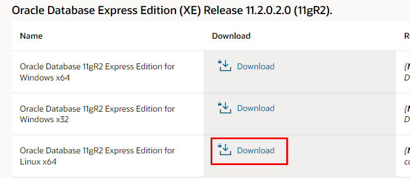
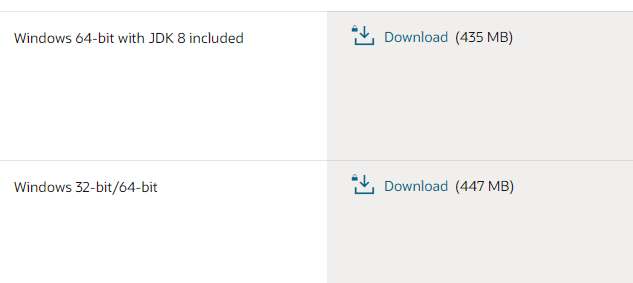
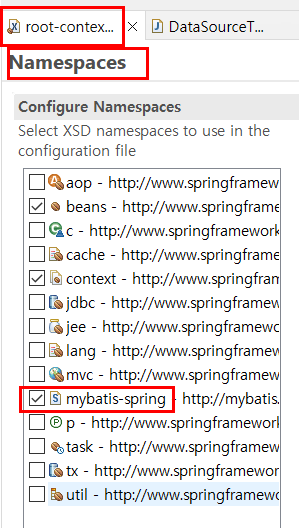

## ***난위도 : ★★★***

**Oracle 말고 Mysql 로 데이터 세팅해도되고**

**전반적으로 왜 이거를 사용하는지 이렇게하는지 알고있어야된다.**

**그리고 sqlDeveloper 설치중 password 입력하는거 까먹으면**

**블랙홀에 빠질 수 있음! 꼭 주의**


### ***✔️각각 설치해야되는 이유***

- Oracle 11g Express Edition : 데이터 관리시스템 (DBMS) 중 하나이며 Mysql로 사용해도 무방하다
- SQLDeveloper : 오라클사에서 SQL 개발들을 위해 제공하는 DB 개발 Tool로써 라이센스 없이 무료로 사용가능하다
- JDBC : 자바 프로그램이 데이터베이스와 연결되어 데이터를 주고 받을 수 있게 해주는 프로그래밍 인터페이스
- Connection Pool :웹 컨테이너(WAS)가 실행되면서 DB와 미리 connection(연결)을 해놓은 객체들을 pool에 저장해두었다가 클라이언트 요청이 오면 connection을 빌려주고, 처리가 끝나면 다시 connection을 반납받아 pool에 저장하는 방식을 말합니다.
- Hikari :  default로 설정되어 있는 DB Connection Pool로써 Zero-Overhead가 특징으로 높은 성능을 자랑하는 DB Connection Pool
- MyBatis : 쿼리 기반 웹 애플리케이션을 개발할 때 가장 많이 사용되는 SQL 매퍼(Mapper) 프레임워크이다.
- sqlSessionFactory : 데이터베이스와의 연결과 SQL의 실행에 대한 모든 것을 가진 가장 중요한 객체다.  
  이 객체가 DataSource를 참조하여 MyBatis와 Mysql 서버를 연동시켜준다.
- Mapper : 관계형 데이터베이스(RDBMS)를 자바의 객체 지향 모델로 매핑하게 도와주는 인터페이스다. 해당 프레임워크는 RDBMS에 접근할 때 필요한 자바코드를 현저하게 줄일 수 있도록 해준다.
- log4jdbc : Log4j를 JDBC와 연결하여 사용하기 위해 만들어진 오픈소스 프로젝트이고 Log4j는 자바 기반 로깅 유틸리티고 로그를 다향하게 출력할수 있도록 도와준다.
- DataSource : 경우에따라 여러개가 생성되는 ConnectionPool 들을 관리하는 목적으로 사용되는 인터페이스

### ***✔️Oracle 11g Express Edition 설치***

**(참고 : <https://www.oracle.com/database/technologies/xe-prior-release-downloads.html>)**

**\* 오라클 로그인 해야지 다운로드 가능~!**



### ***✔️sqlDeveloper 다운로드 및 세팅***

**(참고 : <https://www.oracle.com/tools/downloads/sqldev-downloads.html>)**

**\* JDK 있으면 밑에 없으면 위에, 다운로드할때 입력한 비밀번호 알고있어야됨**



**\* 계정 생성 및 권한 부여, port 수정**

```javascript
//계정 생성 및 connect dba 권한 부여
create user book_ex IDENTIFIED BY book_ex;
grant connect, dba to book_ex;

//오라클 포트 변경
exec dbms_xdb.sethttpport(9090);
```

### ***✔️JDBC 연결 및 세팅***

**(참고 링크 : <https://mvnrepository.com/artifact/com.oracle.database.jdbc/ojdbc6>)**

```javascript
//pom.xml 추가
<!-- https://mvnrepository.com/artifact/com.oracle.database.jdbc/ojdbc6 -->
<dependency>
    <groupId>com.oracle.database.jdbc</groupId>
    <artifactId>ojdbc6</artifactId>
    <version>11.2.0.4</version>
</dependency>
```

**\* test 코드로 연결 테스트 (unit test개념 차후에 정리)**

```javascript
//JDBC 연결 테스트
//시간 오래걸림 
package org.zerock.persistence;

import java.sql.Connection;
import java.sql.DriverManager;

import org.junit.Test;

import lombok.extern.log4j.Log4j;

@Log4j
public class JDBCTests {
	@Test
	public void testConnection() throws Exception {
		Class clz = Class.forName("oracle.jdbc.driver.OracleDriver");
		//log.info(clz);

		Connection con= 
				DriverManager.getConnection("jdbc:oracle:thin:@localhost:1521:XE","book_ex","book_ex");
		log.info(con);
		con.close();
	}
}
```

### ***✔️Connection Pool 설정 및 세팅(Hakari 사용)***

**(참고 링크 : <https://mvnrepository.com/artifact/com.zaxxer/HikariCP/3.4.5>)**

```javascript
//pom.xml
<!-- https://mvnrepository.com/artifact/com.zaxxer/HikariCP -->
<dependency>
    <groupId>com.zaxxer</groupId>
    <artifactId>HikariCP</artifactId>
    <version>3.4.5</version>
</dependency>
```

```javascript
//root-context.xml
//connectio pool 만들기
//hikari를 만든다음 dataSource 에 주입 소스코드가 없으면 xml로
<bean id="hikariConfig" class="com.zaxxer.hikari.HikariConfig">
	<property name="driverClassName" value="oracle.jdbc.driver.OracleDriver"></property>
	<property name="jdbcUrl" value="jdbc:oracle:thin:@localhost:1521:XE"></property>
	<property name="username" value="book_ex"></property>
	<property name="password" value="book_ex"></property>
	</bean>
	<bean id="dataSource" class="com.zaxxer.hikari.HikariDataSource" destroy-method="close">
	<constructor-arg ref="hikariConfig"></constructor-arg>
	</bean>
```

**\* test 코드로 연결 테스트 (unit test개념 차후에 정리)**

```javascript
//Connection pool 로 연결
//시간 단축
//연결되있는 하나로 끈고 연결 반복
package org.zerock.persistence;

import java.sql.Connection;

import javax.sql.DataSource;

import org.junit.Test;
import org.junit.runner.RunWith;
import org.springframework.beans.factory.annotation.Autowired;
import org.springframework.test.context.ContextConfiguration;
import org.springframework.test.context.junit4.SpringJUnit4ClassRunner;
import org.zerock.sample.SampleTests;

import lombok.extern.log4j.Log4j;

@RunWith(SpringJUnit4ClassRunner.class)
@ContextConfiguration("file:src/main/webapp/WEB-INF/spring/root-context.xml")
@Log4j
public class DataSourceTest {
//connection pool 코드를 쓰는것 같은 주소값을 씀, JDBC 사용할때는 느림
	@Autowired
	private DataSource ds;

	@Test
	public void testConnection(){
		try(Connection con = ds.getConnection()){
			log.info(con);
		}catch(Exception e) {
			e.printStackTrace();
			log.error(e.getMessage());
		}

	}
}
```

### ***✔️spring-mybatis 라이브러리 추가(MyBatis 설정)***

**(참고 : <https://mvnrepository.com/artifact/org.mybatis/mybatis>)**

```javascript
//pom.xml (추가)
<dependency>
    <groupId>org.springframework</groupId>
    <artifactId>spring-jdbc</artifactId>
    <version>${org.springframework-version}</version>
</dependency>

<dependency>
    <groupId>org.springframework</groupId>
    <artifactId>spring-tx</artifactId>
    <version>${org.springframework-version}</version>
</dependency>
...(생략
<!-- https://mvnrepository.com/artifact/org.mybatis/mybatis -->
<dependency>
    <groupId>org.mybatis</groupId>
    <artifactId>mybatis</artifactId>
    <version>3.5.6</version>
</dependency>

<!-- https://mvnrepository.com/artifact/org.mybatis/mybatis-spring -->
<dependency>
    <groupId>org.mybatis</groupId>
    <artifactId>mybatis-spring</artifactId>
    <version>2.0.6</version>
</dependency>
```

### ***✔️sqlSessionFactory 설정***

```javascript
//root-context.xml
<bean id="sqlSessionFactory" class="org.mybatis.spring.SqlSessionFactoryBean">
	<property name="dataSource" ref="dataSource"></property>
	</bean>
```

**\* test 코드로 연결 테스트 (unit test개념 차후에 정리)**

```java
//src/test/java
package org.zerock.persistence;
...(생략)
@RunWith(SpringJUnit4ClassRunner.class)
@ContextConfiguration("file:src/main/webapp/WEB-INF/spring/root-context.xml")
@Log4j
public class DataSourceTest {
  @Autowired
      private SqlSessionFactory sessionFactory;
  @Test
      public void testConnection2() {
          try(SqlSession session = sessionFactory.openSession()){
              log.info(session);
          }catch(Exception e) {
              System.out.println("error남");
              e.printStackTrace();
          }
      }
}
```

### ***✔️Mapper 인터페이스 설정***

```java
//src/main/java
//java 폴더에 인터페이스 생성
package org.zerock.mapper;

import org.apache.ibatis.annotations.Select;

public interface TimeMapper {

	@Select("select sysdate from dual")
	String getTime();
}
```

**\* root-context.xml 파일에서 Namespaces 로 들어가 mybatis-spring 추가**



```java
//root-context.xml 에서 Source에 추가
<mybatis-spring:scan base-package="org.zerock.mapper"/>
```

**\* test 코드로 연결 테스트 (unit test개념 차후에 정리)**

```java
//src/test/java
package org.zerock.persistence;

import org.junit.Test;
import org.junit.runner.RunWith;
import org.springframework.beans.factory.annotation.Autowired;
import org.springframework.test.context.ContextConfiguration;
import org.springframework.test.context.junit4.SpringJUnit4ClassRunner;
import org.zerock.mapper.TimeMapper;
import org.zerock.sample.SampleTests;

import lombok.extern.log4j.Log4j;

@RunWith(SpringJUnit4ClassRunner.class)
@ContextConfiguration("file:src/main/webapp/WEB-INF/spring/root-context.xml")
@Log4j
public class TimeMapperTests {
	@Autowired
	private TimeMapper timeMapper;

	@Test
	public void testTime1() {

		timeMapper.getTime();
		log.info(timeMapper.getTime());
	}
}
```

```java
//src/main/resource/org/zerock/mapper 폴더 추가
//TimeMapper.xml 파일 추가

<?xml version="1.0" encoding="UTF-8"?>
<!DOCTYPE mapper PUBLIC "-//mybatis.org//DTD Mapper 3.0//EN"
"http://mybatis.org/dtd/mybatis-3-mapper.dtd">
<mapper namespace="org.zerock.mapper.TimeMapper">
    <select id="getTime2" resultType="string">
        select sysdate from dual
    </select>
</mapper>
```

### ***✔️추가 설정( log4JDBC , DataSource )***

```java
//pom.xml
<dependency>
    <groupId>org.bgee.log4jdbc-log4j2</groupId>
    <artifactId>log4jdbc-log4j2-jdbc4.1</artifactId>
    <version>1.16</version>
</dependency>
```

```java
//src/main/resources 에서 log4jdbc.log4j2.properties 파일 추가
log4jdbc.spylogdelegator.name=net.sf.log4jdbc.log.slf4j.Slf4jSpyLogDelegator
```

```java
//root-context.xml 변경
<property name="driverClassName" value="net.sf.log4jdbc.sql.jdbcapi.DriverSpy"></property>
<property name="jdbcUrl" value="jdbc:log4jdbc:oracle:thin:@localhost:1521:XE"></property>
```


