## ***난위도 : ★★★★★***

**React 초기세팅은 프로젝트를 많이해서 어려움이 없었지만**

**React Native는 또 다른 느낌에 초기세팅이다.**

**솔직하게 구글링으로 처음부터 끝까지 혼자힘으로 했지만**

**시간을 많이 소비했고 강의나 책을사서 공부하면서 초기세팅을**

**익히는게 좋은것같다.**

**추가설정 및 사용방법, 문법은 차후에 글을 올리겠다**


### ***✔️Node 설치 세팅하기 ( LTS 버전으로 다운)***

**( 설치 사이트 : <https://nodejs.org/ko/>)**

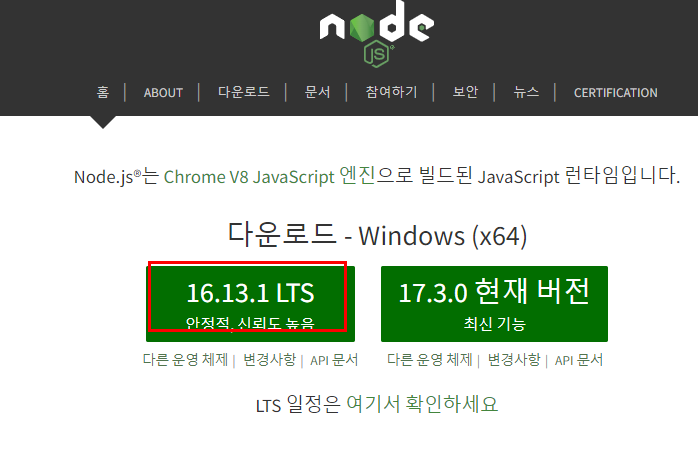

**\* 설치 버전 확인**

```java
npm -v
node -v
```

### ***✔️JDK 설치 환경변수 세팅(아래 링크 참고)***

**(**

**참고 사이트 : <https://zibu-story.tistory.com/12>**

**설치 사이트 : <https://www.oracle.com/java/technologies/downloads/>**

**)**

**\* 왜 리엑트에서 자바 설치?**

Java 및 JDK에 의존하여 Android Studio에서 제공하는 에뮬레이터와 통신

**\* 설치 버전 확인**

```java
java -version
```

### ***✔️Python 설치***

**(설치 사이트 : <https://www.python.org/downloads/>)**

**\* 왜 리엑트에서 파이썬 설치?**

빌드 시스템 자체가 파이썬에 의존하고 있으므로 윈도우에서는 설치가 필요하나 맥에는 기본적

으로 파이썬이 설치되있다고함

**\* 설치 버전 확인**

```java
python --version
```

### ***✔️안드로이드 스튜디오 설치***

**(설치 사이트 : <https://developer.android.com/studio/index.html>)**

**\* 안드로이드 스튜디오?**

작성한 코드대로 안드로이드 앱 빌드를 하기위해 설치해야됨

**\* 아래 그림대로 설치하면 됨**

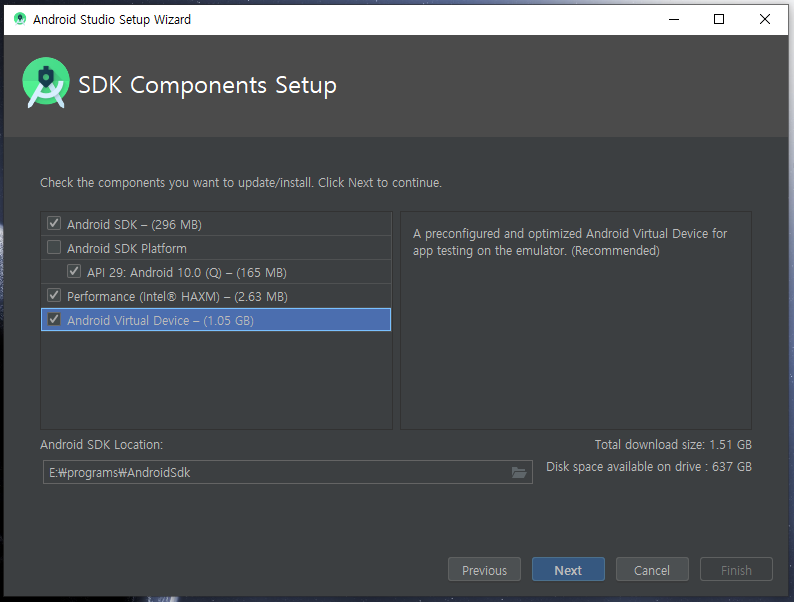

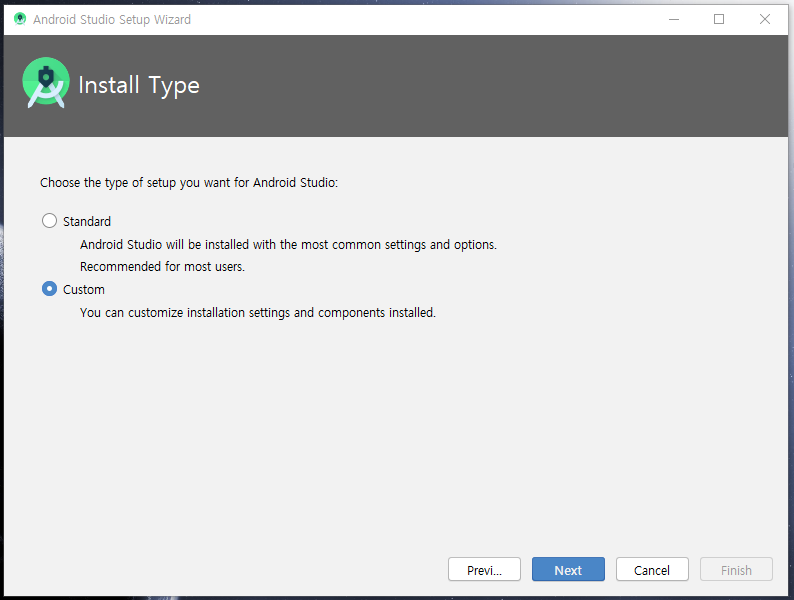

### ***✔️SDK 환경변수 세팅하기***

**1. SDK 경로 복사 (File -> Setting)**

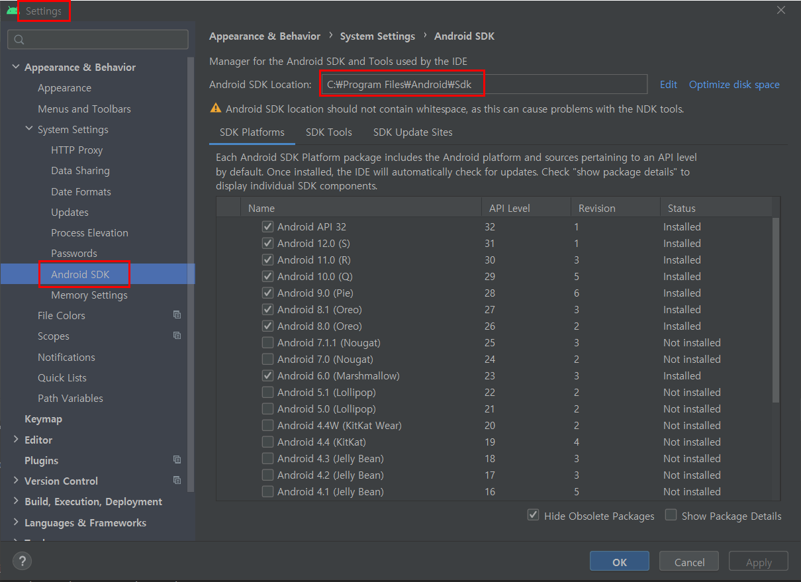

**2. 환경변수 및 경로 세팅 ( 변수 이름에는 아무거나, 변수값은 아까 복사한 경로)**

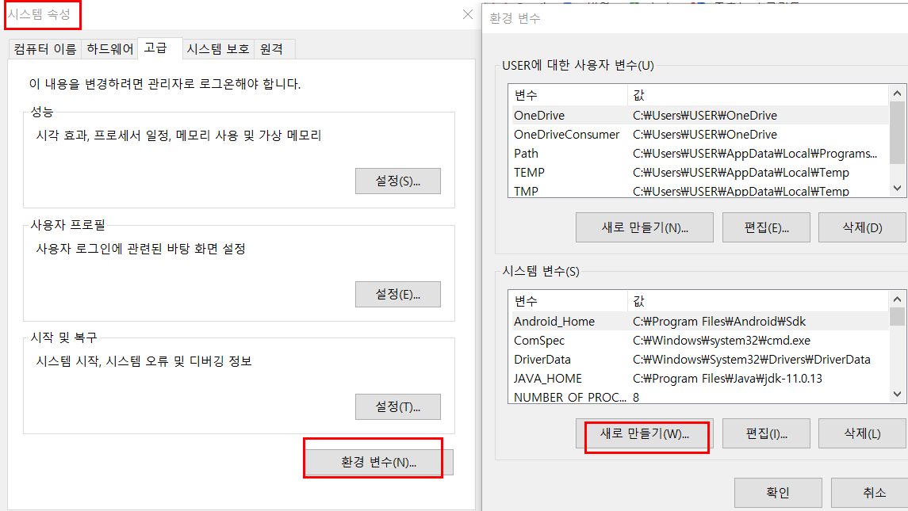

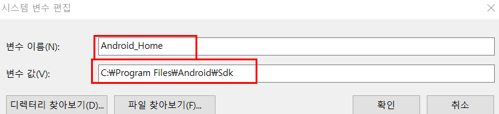

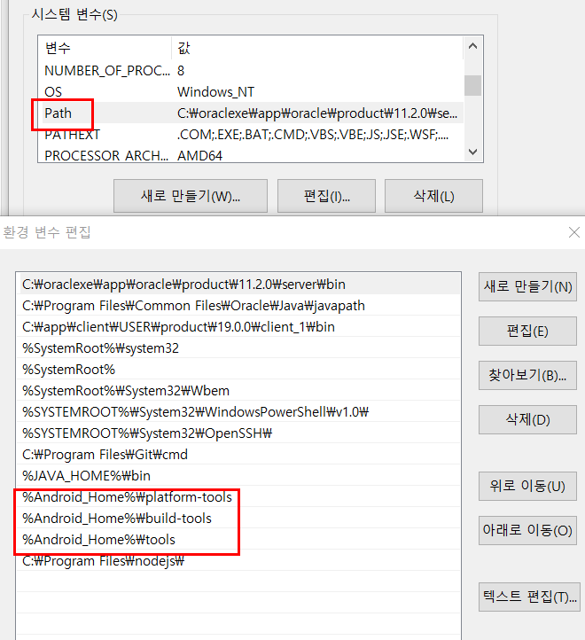

### ***✔️ 에뮬에이터 실행 및 SDK 버전 맞추기***

**1. 에뮬레이터 생성 및 Hello World 출력**

(상단 아이콘 클릭하고 아래 Create로 생성 -> 상단 메뉴 Run 으로 실행 후 에뮬레이터 실행 확인)

**(참고 링크 : <https://yewon918.tistory.com/69>)**

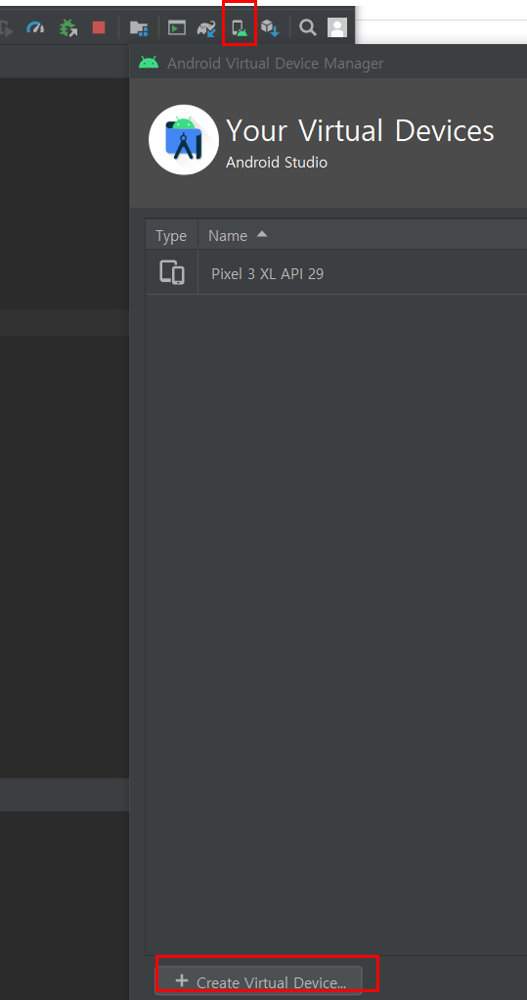

**2. SDK 버전 변경 및 추가**

(나중에 SDK 부분에서 안맞아서 빌드시 오류날수도 있다)

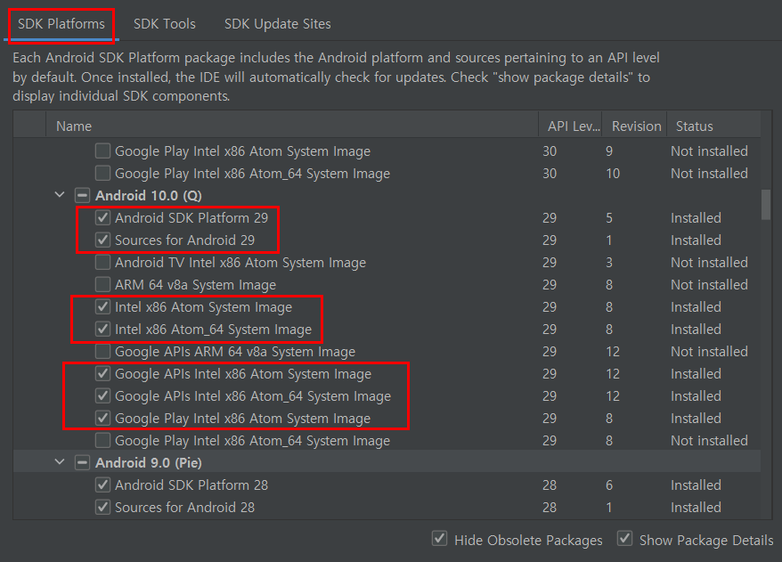

### ***✔️VS Code 로 React-Native-CLI 세팅(IDE : 편집 툴)***

**(VS Code 설치 사이트 : <https://code.visualstudio.com/download>)**

**(참고 사이트 : [https://ssjeong.tistory.com/entry/React-Native-%ED%94%84%EB%A1%9C%EC%A0%9D%ED%8A%B8-%EC%83%9D%EC%84%B1-%EB%B0%8F-%EC%97%90%EB%AE%AC%EB%A0%88%EC%9D%B4%ED%84%B0-%EC%8B%A4%ED%96%89?category=981429](https://ssjeong.tistory.com/entry/React-Native-%ED%94%84%EB%A1%9C%EC%A0%9D%ED%8A%B8-%EC%83%9D%EC%84%B1-%EB%B0%8F-%EC%97%90%EB%AE%AC%EB%A0%88%EC%9D%B4%ED%84%B0-%EC%8B%A4%ED%96%89?category=981429 "VS Code에서 React-Native-CLI"))**

**1. 폴더 생성 후 원하는 경로에서 React-Native-CLI 설치**

(-g는 전역으로 설치하겠다는 말)

```java
npm i -g react-native-cli
```

**2. init 하고 프로젝트 생성**

**(에러날때 참고 링크 : <https://hellcoding.tistory.com/entry/VSCode-%EC%98%A4%EB%A5%98-%EC%9D%B4-%EC%8B%9C%EC%8A%A4%ED%85%9C%EC%97%90%EC%84%9C-%EC%8A%A4%ED%81%AC%EB%A6%BD%ED%8A%B8%EB%A5%BC-%EC%8B%A4%ED%96%89%ED%95%A0-%EC%88%98-%EC%97%86%EC%9C%BC%EB%AF%80%EB%A1%9C>)**

```java
react-native init
```

**3. VS Code 들어가서 실행 확인**

```java
react-native run-android
```

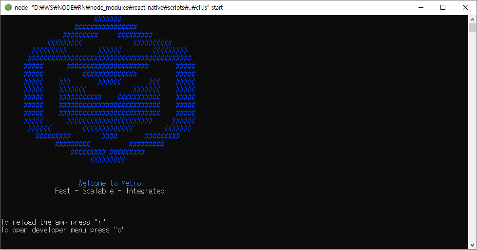

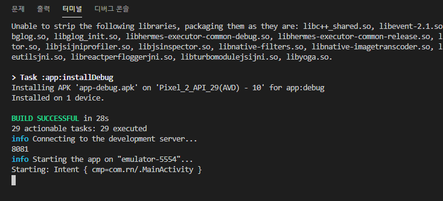

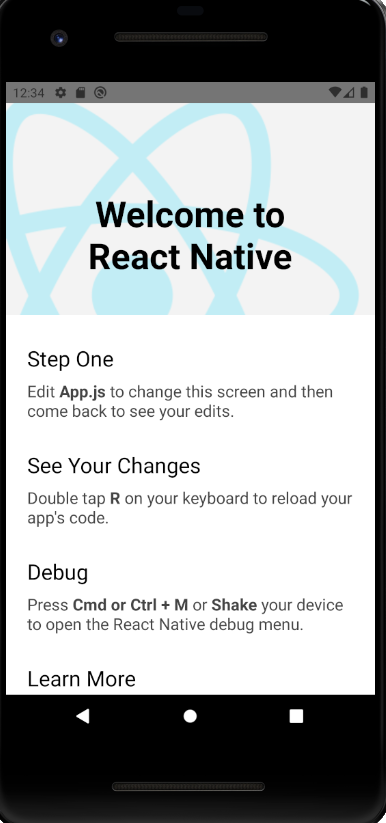

### ***✔️만약에 위에 같이 안뜨고 에러나 나올때 상황 해결***

**(또 다른 에러 위에 SDK 설정변경한 이유 : <https://drcode-devblog.tistory.com/103>)**

\* **꿀팁** : 만약에 구글링해도 무슨 에러인지 감이 안잡힌다면 밑에 명령어 입력하면되고 환경변수 같은거 잘 설정해줘야됨( 참고로 필자는 에러의 원인 찾는데만 2틀걸렸음...)

```java
npx @react-native-community/cli doctor
```

**1. Build 할때 에러상황 => 문제원인 한글폴더(영어폴더로 해야됨)**

```java
//VS Code 터미널상 오류
C:\Users\USER\Desktop\위디\widi> npm run android

> widi@0.0.1 android
> react-native run-android

info Running jetifier to migrate libraries to AndroidX. You can disable it using "--no-jetifier" flag.
Jetifier found 886 file(s) to forward-jetify. Using 8 workers...
info Starting JS server...
'C:\Program':(��) ���� �Ǵ� �ܺ� ���, ������ �� �ִ� �wα׷�, �Ǵ�
��ġ ������ �ƴմϴ�.
info Launching emulator...
'C:\Program':(��) ���� �Ǵ� �ܺ� ���, ������ �� �ִ� �wα׷�, �Ǵ�
��ġ ������ �ƴմϴ�.
'C:\Program':(��) ���� �Ǵ� �ܺ� ���, ������ �� �ִ� �wα׷�, �Ǵ�
��ġ ������ �ƴմϴ�.
error Failed to launch emulator. Reason: Emulator exited before boot..
warn Please launch an emulator manually or connect a device. Otherwise app may fail to launch.
info Installing the app...
:ReactNative:Unexpected empty result of running '[node, C:\Users\USER\Desktop\?��?��\widi\node_modules\@react-native-community\cli\build\bin.js, config]' command.
:ReactNative:Running '[node, C:\Users\USER\Desktop\?��?��\widi\node_modules\@react-native-community\cli\build\bin.js, config]' command failed.

FAILURE: Build failed with an exception.

* Where:
Script 'C:\Users\USER\Desktop\����\widi\node_modules\@react-native-community\cli-platform-android\native_modules.gradle' line: 213

* What went wrong:
A problem occurred evaluating script.
> node:internal/modules/cjs/loader:936  throw err;  ^Error: Cannot find module 'C:\Users\USER\Desktop\�쐞�뵒\widi\node_modules\@react-native-community\cli\build\bin.js'    at Function.Module._resolveFilename (node:internal/modules/cjs/loader:933:15)    at Function.Module._load (node:internal/modules/cjs/loader:778:27)    at Function.executeUserEntryPoint [as runMain] (node:internal/modules/run_main:81:12)    at node:internal/main/run_main_module:17:47 {  code: 'MODULE_NOT_FOUND',  requireStack: []}Node.js v17.3.0

* Try:
Run with --stacktrace option to get the stack trace. Run with --info or --debug option to get more log output. Run with --scan to get full insights.

* Get more help at https://help.gradle.org

BUILD FAILED in 2s

error Failed to install the app. Make sure you have the Android development environment set up: https://reactnative.dev/docs/environment-setup.
Error: Command failed: gradlew.bat app:installDebug -PreactNativeDevServerPort=8081
:ReactNative:Unexpected empty result of running '[node, C:\Users\USER\Desktop\?��?��\widi\node_modules\@react-native-community\cli\build\bin.js, config]' command.
:ReactNative:Running '[node, C:\Users\USER\Desktop\?��?��\widi\node_modules\@react-native-community\cli\build\bin.js, config]' command failed.

FAILURE: Build failed with an exception.

* Where:
Script 'C:\Users\USER\Desktop\����\widi\node_modules\@react-native-community\cli-platform-android\native_modules.gradle' line: 213

* What went wrong:
A problem occurred evaluating script.
> node:internal/modules/cjs/loader:936  throw err;  ^Error: Cannot find module 'C:\Users\USER\Desktop\�쐞�뵒\widi\node_modules\@react-native-community\cli\build\bin.js'    at Function.Module._resolveFilename (node:internal/modules/cjs/loader:933:15)    at Function.Module._load (node:internal/modules/cjs/loader:778:27)    at Function.executeUserEntryPoint [as runMain] (node:internal/modules/run_main:81:12)    at node:internal/main/run_main_module:17:47 {  code: 'MODULE_NOT_FOUND',  requireStack: []}Node.js v17.3.0

* Try:
Run with --stacktrace option to get the stack trace. Run with --info or --debug option to get more log output. Run with --scan to get full insights.

* Get more help at https://help.gradle.org

BUILD FAILED in 2s
```

```java
//node 터미널상 오류
Failed to construct transformer:  Error: error:0308010C:digital envelope routines::unsupported
    at new Hash (node:internal/crypto/hash:67:19)
    at Object.createHash (node:crypto:130:10)
    at stableHash (C:\Users\USER\Desktop\위디\widi\node_modules\metro-cache\src\stableHash.js:19:8)
    at Object.getCacheKey (C:\Users\USER\Desktop\위디\widi\node_modules\metro-transform-worker\src\index.js:593:7)
    at getTransformCacheKey (C:\Users\USER\Desktop\위디\widi\node_modules\metro\src\DeltaBundler\getTransformCacheKey.js:24:19)
    at new Transformer (C:\Users\USER\Desktop\위디\widi\node_modules\metro\src\DeltaBundler\Transformer.js:48:9)
    at C:\Users\USER\Desktop\위디\widi\node_modules\metro\src\Bundler.js:22:29
    at runNextTicks (node:internal/process/task_queues:61:5)
    at processTimers (node:internal/timers:507:9) {
  opensslErrorStack: [ 'error:03000086:digital envelope routines::initialization error' ],
  library: 'digital envelope routines',
  reason: 'unsupported',
  code: 'ERR_OSSL_EVP_UNSUPPORTED'
}
```

**2. build 성공, 에뮬레이터 실행않됨 => 해결방법 : node 버전 다운그레이 17 → 16(LTS)**

```java
//node 터미널상 에러
error: TypeError: Cannot read properties of undefined (reading 'transformFile')
    at Bundler.transformFile (C:\Users\USER\Desktop\WidiProject\widi\node_modules\metro\src\Bundler.js:48:30)
    at processTicksAndRejections (node:internal/process/task_queues:96:5)
    at async Object.transform (C:\Users\USER\Desktop\WidiProject\widi\node_modules\metro\src\lib\transformHelpers.js:101:12)
    at async processModule (C:\Users\USER\Desktop\WidiProject\widi\node_modules\metro\src\DeltaBundler\traverseDependencies.js:137:18)
    at async traverseDependenciesForSingleFile (C:\Users\USER\Desktop\WidiProject\widi\node_modules\metro\src\DeltaBundler\traverseDependencies.js:131:3)
    at async Promise.all (index 0)
    at async initialTraverseDependencies (C:\Users\USER\Desktop\WidiProject\widi\node_modules\metro\src\DeltaBundler\traverseDependencies.js:114:3)
    at async DeltaCalculator._getChangedDependencies (C:\Users\USER\Desktop\WidiProject\widi\node_modules\metro\src\DeltaBundler\DeltaCalculator.js:164:25)
    at async DeltaCalculator.getDelta (C:\Users\USER\Desktop\WidiProject\widi\node_modules\metro\src\DeltaBundler\DeltaCalculator.js:94:16)
    at asy

Failed to construct transformer:  Error: error:0308010C:digital envelope routines::unsupported
    at new Hash (node:internal/crypto/hash:67:19)
    at Object.createHash (node:crypto:130:10)
    at stableHash (C:\Users\USER\Desktop\WidiProject\widi\node_modules\metro-cache\src\stableHash.js:19:8)
    at Object.getCacheKey (C:\Users\USER\Desktop\WidiProject\widi\node_modules\metro-transform-worker\src\index.js:593:7)
    at getTransformCacheKey (C:\Users\USER\Desktop\WidiProject\widi\node_modules\metro\src\DeltaBundler\getTransformCacheKey.js:24:19)
    at new Transformer (C:\Users\USER\Desktop\WidiProject\widi\node_modules\metro\src\DeltaBundler\Transformer.js:48:9)
    at C:\Users\USER\Desktop\WidiProject\widi\node_modules\metro\src\Bundler.js:22:29 {
  opensslErrorStack: [ 'error:03000086:digital envelope routines::initialization error' ],
  library: 'digital envelope routines',
  reason: 'unsupported',
  code: 'ERR_OSSL_EVP_UNSUPPORTED'
```


