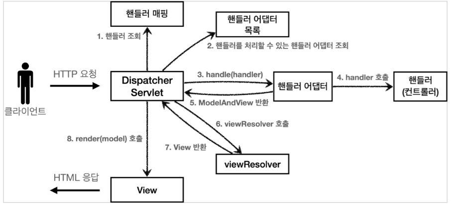

## ***난위도 : ★★★★***

**먼저 이 챕터를 이해하기 위해서는 기본적으로 Request올때 백엔드에서**

**어떤처리를 하는지 알고있어야된다. 필자는 Node로 프로젝트를 한 경험이 있어서**

**어느정도 이해했고 원리는 Request요청 -> 경로에따른 Controller 처리 -> Service에서 데이터 가공**

**Model에서 Sql로 쿼리문실행(DB와 접촉) 이다 전반적으로 약간은 Spring이랑 다르지만 이정도**

**개념은 가지고 접근하는게 이해하기 편할것같다.**

**그리고 어노테이션으로 쓰고 자동적으로 View단을 보여주는 Dispacher는 짱인것같다.**


### ***✔️스프링 MVC 패턴의 개념과 장점***

**(참고 링크 : <https://catsbi.oopy.io/f52511f3-1455-4a01-b8b7-f10875895d5b>)**

- MVC 주 목적은 Business와 Presentation logic을 분리하기 위함이다
- Model, View, Controller 으로 이루어져 있다
- 다른부분은 신경 안쓰고 View랑 Controller 부분만 신경쓰면된다.
- 요청을 보낸 부분에 따라 어노테이션으로 분류하여 API를 처리할수있다.



### ***✔️MVC 구조 각각 이해하기***

**(참고 링크 : <https://emongfactory.tistory.com/121>)**

**1. 모델 (Model) 컴포넌트**

- 데이터 저장소(ex:  데이터베이스 등)와 연동하여 사용자가 입력한 데이터나 사용자에게 출력할 데이터를 다루는 일은 함
- 여러 개의 데이터 변경 작업(추가, 변경, 삭제)을 하나의 작업으로 묶는 트랜잭션을 다루는 일도 함
- DAO클래스 Service 클래스에 해당

**2. 뷰(View) 컴포넌트**

- 모델이 처리한 데이터나 그 작업 결과를 가지고 사용자에게 출력할 화면을 만드는 일을 함
- 생성된 화면은 웹 브라우저가 출력하고, 뷰 컴포넌트는 HTML/CSS/JS를 사용하여 웹 브라우저가 출력할 UI를 만듦
- HTML과 JSP를 사용하여 작성할 수 있음

**3. 컨트롤러(Controller)  컴포넌트**

- HttpServletRequest, HttpServletResponse를 거의 사용할 필요 없이 필요한 기능 구현
- 다양한 타입의 파라미터 처리, 다양한 타입의 리턴 타입 사용가능
- Get 방식 Post 방식등 전송 방식에 대한 처리를 어노테이션으로 처리 가능
- 상속/ 인터페이스 방식 대신에 어노테이션만으로도 필요한 설정 가능

### ***✔️MVC 동작하는 원리 및 순서***

**( 코드를 따라치기전에 흐름을 먼저 파악하는게 좋다)**

**\* return 타입에따른 차이**  
void : 호출하는 URL 과 동일한 이름의 jsp

String : return 과 같은 jsp 파일을 호출

**1. 사용자의 Request는 DispatcherServlet에서 먼저 처리한다**

```java
//web.xml
	<servlet>
		<servlet-name>appServlet</servlet-name>
		<servlet-class>org.springframework.web.servlet.DispatcherServlet</servlet-class>
		<init-param>
			<param-name>contextConfigLocation</param-name>
			<param-value>/WEB-INF/spring/appServlet/servlet-context.xml</param-value>
		</init-param>
		<load-on-startup>1</load-on-startup>
	</servlet>​
```

**2. @RequestMapping 으로 해당 컨트롤러를 찾아 작동시킵니다**

```java
//src/main/java
package org.zerock.controller;
...(생략)

@Controller
@RequestMapping("/sample/*")
@Log4j
public class SampleController {

	@RequestMapping("")
	public void basic() {
		log.info("basic.................");
	}

	@RequestMapping(value = "/basic", method = { RequestMethod.GET, RequestMethod.POST })
	public void basicGet() {
		log.info("basic get.................");
	}

	@GetMapping("basicOnlyGet")
	public void basicGet2() {
		log.info("basic get only get.................");
	}
}​
```

**3. return값에따라 servlet-context.xml에 ViewResolver를 이용하여 각기 다른 jsp파일로 화면에 보여준다.**

```java
//servlet-context.xml
	<beans:bean class="org.springframework.web.servlet.view.InternalResourceViewResolver">
		<beans:property name="prefix" value="/WEB-INF/views/" />
		<beans:property name="suffix" value=".jsp" />
	</beans:bean>
    -------------------
//src/main/java
//Controller
//배열
	@GetMapping("ex01")
	public String ex01(SampleDTO dto) {
		log.info("" + dto);
		return "ex01";
	}

	@GetMapping("ex02")
	public String ex02(@RequestParam("name") String name, @RequestParam("age") int age) {
		log.info("name: " + name);
		log.info("age: " + age);
		return "ex02";
	}

	// 배열
	@GetMapping("ex02List")
	public String ex02List(@RequestParam("ids") ArrayList<String> ids) {
		log.info("ids: " + ids);
		return "ex02List";
	}

	@GetMapping("ex02Array")
	public String ex02Array(@RequestParam("ids") String[] ids) {
		log.info("array ids: " + Arrays.toString(ids));
		return "ex02Array";
	}

//객체
	@GetMapping("ex02Bean") // urlMapping :
							// http://localhost:8081/sample/ex02Bean?list%5B0%5D.name=aaa&list%5B1%5D.name=bbb
	public String ex02Bean(SampleDTOList list) {
		log.info("list dtos: " + list);
		return "ex02Bean";
	}

	@GetMapping("/ex04")
	public String ex04(SampleDTO dto, @ModelAttribute("page") int page) {
		log.info("dto: " + dto);
		log.info("page: " + page);
		return "/sample/ex04";
	}​

    ------------------------

//view    
<%@ page language="java" contentType="text/html; charset=UTF-8"
    pageEncoding="UTF-8"%>
<!DOCTYPE html>
<html>
<head>
<meta charset="UTF-8">
<title>Insert title here</title>
</head>
<body>
	<h2>SampleDTO ${sampleDTO}</h2>
	<h2>Page ${page}</h2>
</body>
</html>​
```

**4. Model단을 이용하려면 인터페이스로 생성후 Controller에 메서드의 인자로 값을 받는다**

```java
//src/main/java
package org.zerock.domain;

@Data
public class SampleDTO {

	private String name;
	private int age;
}

package org.zerock.domain;

@Data
public class SampleDTOList {

	private List<SampleDTO> list;

	public SampleDTOList() {
		list = new ArrayList<>();
	}
}​
```

### ***✔️파일 업로드 처리 방법***

**(책에서는 기본적인 파일 업로드하고 콘솔에 크기 파일이름정도 출력걸로 나온다. View단에 바로 출력하거나 DB에 저장하는거는 뒷 파트에서 다룰것같다)**

1. **servlet-context.xml에 코드 추가(단, uploadTempDir에 value 랑 동일 경로에 폴더 만들어야됨)**  

   ```applescript
   <beans:bean id="multipartResolver" class="org.springframework.web.multipart.commons.CommonsMultipartResolver">
   		<beans:property name="defaultEncoding" value="utf-8"></beans:property>
   		<beans:property name="maxUploadSize" value="10485760"></beans:property>
   		<beans:property name="maxUploadSizePerFile" value="2097152"></beans:property>
   		<beans:property name="uploadTempDir" value="file:/C:/upload/tmp"></beans:property>
       	<beans:property name="maxInMemorySize" value="10485756"></beans:property>
   	</beans:bean>
   ```
2. **Controller 처리**  

   ```pgsql
   //src/main/java
   // 파일 업로드
   	@GetMapping("/exUpload")
   	public void exUpload() {
   		log.info("/exUpload...............");
   	}

   	@PostMapping("/exUploadPost")
   	public void exUploadPost(ArrayList<MultipartFile> files) {
   		files.forEach(file -> {
   			log.info(".................");
   			log.info("name: " + file.getOriginalFilename());
   			log.info("size: " + file.getSize());
   		});
   	}
   ```
3. **View 단 설정**  

   ```xml
   //views/sample
   //화면단
   <%@ page language="java" contentType="text/html; charset=UTF-8"
       pageEncoding="UTF-8"%>
   <!DOCTYPE html>
   <html>
   <head>
   <meta charset="UTF-8">
   <title>Insert title here</title>
   </head>
   <body>
   	<form action="/sample/exUploadPost" method="post" enctype="multiPart/form-data">
   		<div>
   			<input type="file" name="files">
   		</div>
   		<div>
   			<input type="file" name="files">
   		</div>
   		<div>
   			<input type="file" name="files">
   		</div>
   		<div>
   			<input type="submit">
   		</div>
   	</form>
   </body>
   </html>
   ```

### ***✔️궁금했던것! + 오류***

- **궁금했던것** : 보통 프로젝트를 하면 View 단은 프론트나 퍼블리셔가 만들고 fetch로 Request를 요청하면 백엔드에서 데이터 가공및 DB에 CRUD를 하는 작업을 하는데 굳이 MVC중 V(View)가 필요한 이유를 모르겠다  
  **그나마 생각한 답** : Front가 나오기전에는 백엔드에서 View단까지 처리했다고 들었다 그래서 아직도 View를 쓰는?그런게 아닐까하는 생각이다
- **오류난것** : 스프링에서는 서버를 Tomcat으로 띄우는데  프로젝트를 만들때마다 계속 새로운? 서버를 만들어줘야된다 그럴때 동일한 Port와 Server를 사용하면 아래와 같은 에러가 나온다 이럴때 해결방안?  
  **오류 해결하는 방법** : 링크에 나온데로 server를 영구 삭제한후 재시작해야된다고한다  
  **링크** :<https://to-dy.tistory.com/59>  

  ```routeros
  Port 8080 required by Tomcat v9.0 Server at localhost is already in use. The server may already be running in another process, or a system process may be using the port. To start this server you will need to stop the other process or change the port number(s).
  ```


