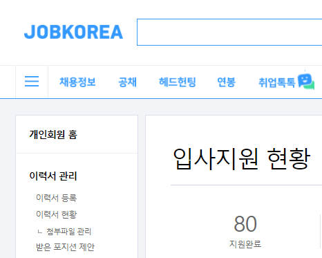
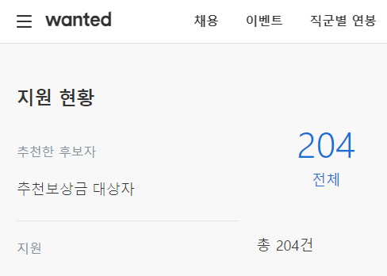
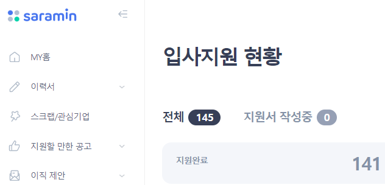
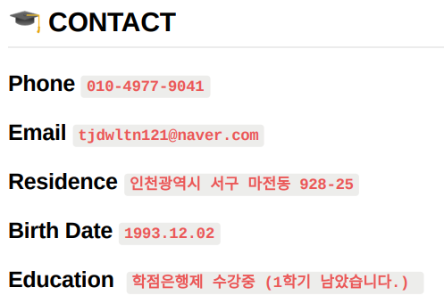
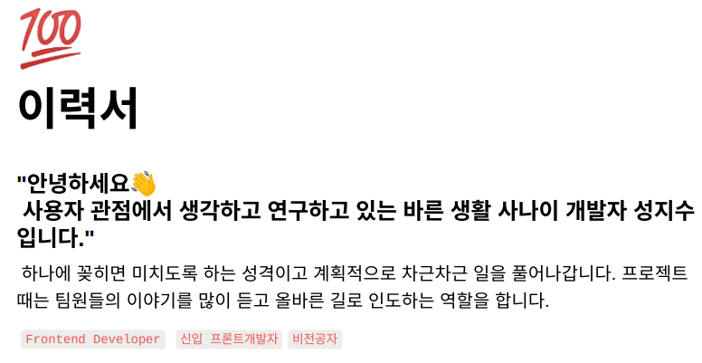

## **한문장 정리**

**제 3자에게 물어봐라! 내가 보는 눈이 무조건 답이 아니다.**

**(이 글은 필자의 지극히 주관적인 생각이고 무조건 맞다**

**라는 보장은 없다. 다만 여러 실패와 서칭으로 깨닭게 된 부분이라**

**알고 있으면 도움 될것같다.)**

**필자 포토폴리오**

**필자 이력서**

**필자 자소서**

#### 참.....많이 지원했다......ㅠ

### **✔️ 이력서 만들때 깨닭은것~!**

#### **1. 나이, 이름, 사는 곳, 학력, 번호, 이메일은 필수로 쓰자**

필자는 나이랑 학력을 이력서에 기제를 안 했었다. 그 나의 장점이라고 생각하지 않기 때문이다. 하지만 면접 볼 때마다 면접관이 이력서에 왜 기제 안 했냐고 얘기했었고 그에대한 대답을 못했다. 그리고 그때와서 생각해 보니 면접때 얘기할거 이력서에 적어도 크게 차이는 없을것 같았다. 그 후에는 사실 그대로 적었다.

*개인정보란*

#### **2. 이력서 초반에 간단한 문장으로 본인을 소개해라**

거의 대부분 이력서는 '프론트 개발자' , '열심히 하는 개발자', '비전 있는 개발자' 등 누구나 쓸법한 말로 시작한다.  
그거는 나를 표현하기에 너무 추상적인 말이다. 오히려 한눈에 딱 봤을 때 이해할 수 있는 말을 적는 게 좋다.

*이력서 상단 부분*

#### **3. 이력서 형식은 자유롭게~!! (노션 강추!)**

요즘은 개성 있게 쓰는 이력서가 유행이다. 전에는 딱딱한 이력서에 증명사진이랑 이런 거를 붙였는데 지금은 노션이나 블로그 등 다양한 형태로 쓰는 편인 것 같다. 하지만 너무 튀거나 형식에 어긋나면 안 되고 개인 정보나 프로젝트 유무, 경력, 학력 정도는 써주는 게 좋다. 그리고 개발과 전혀 무관한 부분을 쓰면 면접 때 차질이 생길 수 있는 점 유념하는 게 좋다

(회사마다 추구하는 방향이 다르기 때문에 참고하면 좋을것같다.)

#### **4. 이력은 자세하게 X, 간단하게 O**

프로젝트 이력이나 경력은 최대한 간단하게 적는 게 좋다. 너무 길고 딥하게 적으면 읽는 사람 입장에서 루즈 해질 수 있다. 그래서 필자는 오히려 이력서에는 간단하게 적고 포트폴리오를 따로 만들어서 이력서에 링크로 적었다.

#### **5. 구인 사이트에도 이력서 작성하는 게 있다면 꼭 작성해라!**

잡코리아나 사람인, 프로그래머스 같은 사이트에는 이력서를 형식에 맞게 작성하는 란이 있다. 그리고 면접관이 출력했을 때는 잡코리아 이력서 형식으로 나오는 걸로 알고 있다. 그래도 직접 만들었을 때는 나의 개성이나 스타일을 표현할 수 있는 부분이기 때문에 둘 다 하는 게 좋고 필자는 추가로 노션에 정리를 깔끔하다는 평을 받았다.

#### **6. 맞춤법 ..... 진짜.....**

타이핑을 하다 보면 간혹 실수로 오타가 나는 경우가 있다. 그런데 이 이력서는 앞으로 네가 다닐 회사의 PM이 볼 수도 있고 회사 대표가 직접 볼 수도 있다. 그리고 그냥 넘어갈 수도 있지만 예민한 사람들은 오타 난 부분 때문에 중요한 정보를 놓칠 수도 있다. 여러 가지 부분으로 봤을 때 리스크가 있는 부분이라 무조건 네이버 맞춤법 검사기를 돌리고 가라!

### **✔️ 자기소개서는 이렇게 쓰자!**

#### **1. 안 좋은 얘기는 넣지 않는 게 좋다**

간혹 이력서나 자기소개서를 쓰다 보면 나를 깎아내리는 얘기를 쓰곤 한다. 그건 치명적인 약점이자 단점이 될 수 있다 그래서 오히려 단점을 부각하는 말보다는 오글거려도 장점을 어필할 수 있는 말만 쓰는 게 좋다

#### **2. 어려운 속담을 쓰는 것보다는 누구나 이해할 수 있는 글에 조청을 둬서 쓰자!**

인터넷에 여러 자소서를 보다 보면 속담이나 사자성어 영어를 써서 자신을 표현하는 사람도 있다. 하지만 그 글을 읽다 보면 문맥에 안 맞거나 주제를 벗어나는 이야기를 하는 경우가 있다. 필자는 오히려 어렵게 이야기를 풀어나가기보다는 누구나 이해할 수 있는 쉬운 글로 표현해 문맥에 맞게 작성하는 것에 포커싱을 맞췄다.

#### **3. 자기소개서 추천 제목**

- **나의 성장 배경** : 태어날 때부터 지금까지 적는 게 아닌 핵심적인 시기만 적을 것!
- **왜 개발자를 택했는지** : 비전공자가 쓰면 좋은 제목이고 다른 직업도 많은데 꼭 이 직업을 선택한 이유에 대한 부분을 얘기하는 거다. 면접관이 가장 궁금한 부분이고 어영부영 흘려서 넘어가는 게 아닌 누구나 이해할 수 있게 적는 게 좋다.
- **나의 성격** : 장점과 단점을 주로 쓰라고 하는데 장점은 부풀려서 적고 단점은 다른 사람에게 피해 가는 단점이 아닌 보안할 수 있고 장점으로 바꿀 수 있다는 패기를 보여주는 게 좋다.
- **회사에서 다니면 어떤 역할을 하고 싶은지** : 어떤 부분 때문에 어떻게 회사에 도움이 될지 그 부분을 적으면 된다.
- **문제가 생길 때 해결 방법** : 프로젝트나 개발을 했을 때 오류나 소통 부분에 갈등이 생길 때 대처 방법을 보는 것이다. 필자는 문제가 생기면 그 문제를 명확이 알고 그에 따른 계획을 세워서 해결해 날 거라고 적었다.
- **좋아하는 시나 소설, 노래, 영화를 중심으로' 자신을 자유롭게 소개(배민)** : 얼마나 자신을 표현할 수 있고 그 주체를 다른 부분에 비유해서 설명해야되기때문에 굉장히 까다로운 질문이다.

### **✔️ 이력서 넣는거에대한 모든것**

#### **1. 가리지 말고 눈을 낮춰서 넣어라**

신입 개발자가 갈 수 있는 곳을 없다. 오히려 선택해서 이력서를 지원하면 시간도 오래 걸리고 면접도 많이 안 잡히는 경우가 많다. 필자도 처음에는 인원수 50명 이상 초봉 3000 이상 거리 가까운 곳 등 필터링해서 지원했는데 면접 일정 잡힌 곳은 없어서 그 이후 가리지 않고 마구 넣었고 원티드 같은 경우에는 하나를 지원하고 난 뒤 여러 회사를 선택 지원할 수 있겠음 구현돼있다 이런 부분을 참고해서 넣으면 1주일 동안 150군대를 한 번에 넣을 수 있고 오히려 나를 원하는 여러 회 사람 면접을 볼 수가 있다.

#### **2. 상처받지 말고 현실을 냉정하게 파악해라**

솔직하게 얘기하면 10퍼센트의 확률로 이력서가 합격된다. 만약 필자처럼 학력이나 경력이 없을 경우 더 낮은 확률이 될 수 있다 하지만 필자는 그거에 개의치 않고 300군대 정도 이력서를 넣었고 그중에 30군대 정도 면접을 봤다.  
결론은 30군대의 다양한 회사랑 면접을 보며 나중에는 면접 본 곳에서 합격 제의도 받았다. 그만큼 노력을 해야 되고 노력을 하려면 많은 학습이 필요하기 때문에 여러 군대 면접을 보는 게 좋다.

#### **3. 네이버 카카오 요기요 토스 등 회사도 가리지 마라**

위에 현실을 파악해라고 얘기했지만 안되더라도 넣는 게 맞는다고 생각한다. 그래야지 차후에 목표가 생겨 더 스팩을 보안할 수 있고 대기업은 어떤 식으로 자소서나 이력서를 하는지 빨리 느낄 수 있다. 누가 아나 로또처럼 면접까지 이어질지~

#### **4. 추천 구인 구직 사이트**

- **잡코리아, 사람인** - 이 두 개는 좀 비슷한 거 같다. 다양한 회사들을 볼 수 있다는 장점이 있지만 신입들 입장에서는 지원할 수 있는 부분이 한정적이라서 오랜 시간이 걸린다.
- **원티드** - 한곳을 지원하면 그거랑 비슷한 회사를 리스트업 해주는 창이 나오고 20군대 한꺼번에 지원이 가능하다. 단점은 신입들 기준으로 회사가 나오기 때문에 연봉이나 면접까지 이어지는 경우는 많이 없다. 그리고 저렇게 한꺼번에 지원할 경우 로딩 시간이 길어진다.
- **잡플랜잇** - 회사 평점 리뷰 등 보는 곳
- **프로그래머스** - 다양한 이력과 디테일한 부분까지 적을 수 있고 코딩 테스트나 과제로 본인의 개발 역량을 표현할 수 있다. 단점은 연락이 직접 오는 게 아닌 코딩 테스트나 메일로 직접 일정이 잡혀서 오는 경우가 많다.

### **✔️ Q & A + 후기**

#### **1. 후기**

이력서랑 자소서를 만들때부터 지원할때까지 서칭을 엄청나게 했다. 그중 자소서 쓰는게 가장 어려웠고 너무 다양하고 포괄적이라 어떠한 주제로 적을지 많은 고민을 했다. 그리고 고졸에 비전공자 30살인 필자는 지원할 수 있는 회사가 너무 적었고 그 문제 때문에 빠르게 많이 지원할 수 있는 방법을 알게된것 같다.

솔직하게 면접관이 가장 좋아하고 칭찬을 많이 한 부분은 개인적으로 포토폴리오 사이트를 만든것이고(노션 링크만 보여주는것보다 직접 배포한 사이트를 보여주니까 실제 개발 실력을 바로 증명할 수 있어서 그런것 같다) 한번에 프로젝트 갯수랑 포토폴리오를 하는 일타 쌍피의 기록을 세웠다.

마지막으로 제발 필자처럼 눈좀 낮춰라~! ㅎㅎ

#### **2. Q & A**

- **몇군대 이력서를 지원했나요?**  
  원티드만 250군대 지원했고 나머지까지하면 300군대 정도 됩니다.
- **이력서는 왜 노션으로 작성했나요?**  
  Wecode 부트캠프에서부터 계속 노션을 주로 썼고 다양한 형식으로 만들 수 있다는 장점 때문에 선택하게 됬습니다.
- **취업 준비한 기간은 총 얼마나 되나요?**  
  이력서 처음 지원한 날부터 면접 합격날까지 2주정도 인것같다.
- **프로젝트도 아닌데 굳이 회고록을 쓴 이유가 있을까요?**  
  회고록은 지난일을 기록하며 적는것이며 시간이 지나도 까먹지 않고 좋은 정보를 공유하기 위해서 작성했습니다.  
  이력서나 자소서 작성, 지원만해도 깨닭은게 많았습니다.
- **앞으로 어떤점을 보안하고 싶나요?**  
  신입기준으로 프로젝트 4개에 기업협업이면 괜찮은 이력이다. 다만 기회가 되면 오픈소스나 해커톤에 참여 해보싶고 당장 단점을 보안하는것보다는 장점이 될만한 부분을 더 추가하는 형식으로 가고싶다.

