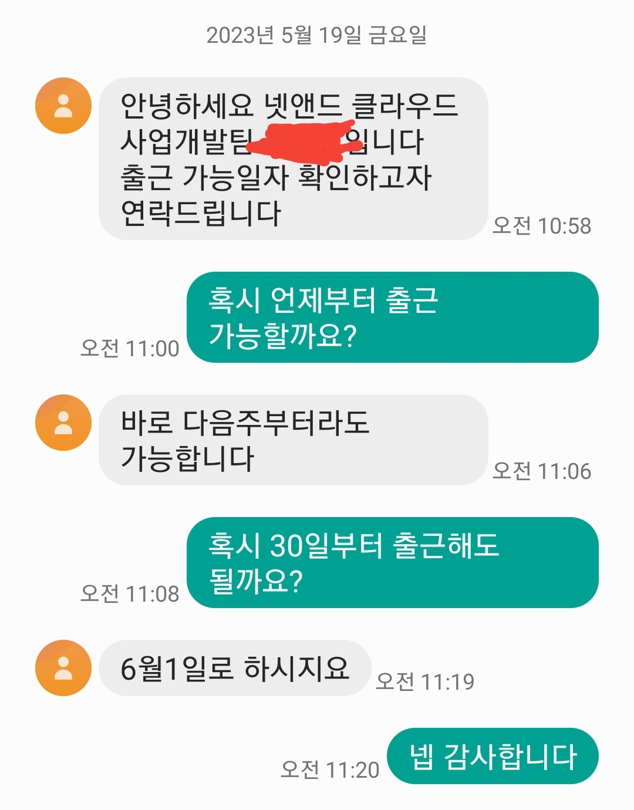

## **요약**

**말이란 작은 경력도 거대하게 보이게 할 수 있는 힘이 있고**  
**반대로 속까지 다 비칠 수 있는 양날의 검이다.**  
**그리고 한번 내 뱉은 말은 주워 담을 수 없기에 오랫동안 생각하고**  
**말하는 게 맞다.**

**(이 글은 지극히 필자의 주관적인 생각이므로**

**100% 맞는거는 아니다. 다만 피드백해서 면접 보는게 좋다)**

### **면접하고 코테 봤었던 회사**

**(목표: 3500만원, 개발자 20명 이상)**

**에이프리카** (코테)

**위시정보기술**(면접)

**이즈피엠피**(면접)

**아이뎃**(화상 인터뷰)

**메이크봇**(면접)

**아이페이지온**(면접)

**고고에프앤디**(면접)

**캐플릭스**(온라인 면접)

**쏘카**(5문제 코테)

**벤티드**(3문제 코테, 온라인 면접)

**글로벌널리지**(게시판 구현 과제)

**바이오넷**(면접)

**피크페이**(3문제 코테, 화상 인터뷰)

**에스제이소프트텍**(면접)

**시리어스랩**(면접)

**포씨게이트**(면접)

**넷앤드**(기술 면접, 임원 면접)

**현대 오토에버**(3문제 코테 + 객관식, 인성검사)

**KT**(5문제 코테 + 객관식)

**디하이소프트**(4문제 코테, 오프라인 인터뷰)

**[커리어리 Profile](https://careerly.co.kr/profiles/472645?from=newsfeed&location=gnb "커리어리 사이트")**

### ***✔️ 면접까지 오는 과정중 피드백***

#### **1. 알림이 오는 부분을 자주 안쓰는 메일로 통일시켜라**

간혹 문자나 전화로 이력서 합격 여부를 알려주지 않고 메일로 알려주는 경우가 있다. 내가 만약 자주 쓰는 메일이  
아니라 다른 메일을 등록했다면 못 보고 지나갈 수도 있다. 그리고 이력서 합격이든 불합격이든 다 메일로 오기 때문에  
매일 들어가서 확인해 보는 게 좋다.

#### **2. 보통 전화로 면접 여부를 물어보는데 당황하지 말고 문자로 남겨달라고하자**

갑자기 모르는 번호로 연락이 와서 '이력서가 좋은 것 같아요 이때 시간 괜찮으세요?'라고 얘기를 한다. 애매하게 일정 잡는 것보다 '혹시 회사 이름이랑 주소 한번 문자로 남겨주실 수 있나요?' 라고 정중하게 이야기하는 것이 좋다. 일정을 빡빡하게 잡는것보다 여유있게 잡는게 좋다. 그리고 면접 일정은 메모장이나 노선에 정리해서 관리하는 게 좋다~!

#### **3. 만약 얘기한 일정에 다른 면접이 있다면 양해를 구하고 너의 일정을 전달해라**

면접 전화가 왔을 때 일정을 얘기했지만 그날에 다른 회사 면접이 잡혀있고 계속 조율이 안되는 경우는 나의 일정을 이야기하는 게 더 이야기가 빠를 수 있다. 주절 주절 설명하지 말고 면접 일정은 빠르게 잡는 것이 좋다.

#### **4. 면접과 면접 사이 여유시간은 2시간 ~ 3시간으로 잡자**

보통 짧으면 30분 길면 1시간 좀 넘게 면접을 본다. 그리고 거의 서울에 있어서 다른 면접까지 거리가 30분 ~ 1시간 정도 소요된다. 만약 빡빡하게 잡게 되면 다음 면접에 지각하게 되고 점심을 못 먹게 될 수도 있다. 최대한 여유롭게 잡고 시간이 남으면 다음 면접 장소 근처 카페에 가서 면접 질문을 복습하는 게 좋다.

#### **5. 제발 급하게 생각하지 말고 신중하게 회사를 선택하자!**

지금 백수라서 돈도 없고 빨리 취업해야 되어서 아무곳이나 마구 지원하는 것보다 이 회사가 어떤 플랫폼을 개발하고 있고

앞으로의 비전이 어떤지 최대한 구글링해서 정보를 끌고 오는 것이 좋다. 그냥 여기 아니면 다른 회사 가야지 하는 마인드라면 취업해도 원하는 회사가 아니라서 작은 트러블로 그만둘 수 있다.

#### **6. 이력서, 포폴, 면접 준비는 1주일 안에 끝내자!**

이력서랑 포토폴리오는 면접을 보러 다니는 동안에도 계속 수정을 해야 하는 부분이기 때문에 시간을 많이 쓸 필요는 없다. 그리고 항상 지금 공부나 프로젝트를 진행하고 있어야 하며 면접과 별개로 무언가를 하고 있어야 한다. 공백의 기간동안 내가 무엇을 했으며 앞으로의 목표를 위해 지금 무엇을 하고 있는지 누군가 물어봐도 설명이 되어야 한다.

#### **7. 뭐하는 회사인지 어떤 스킬을 쓰는지 사이트나 구인구직으로 찾아보고 가라**

모든 회사들이 항상 면접 때 '저희 뭐하는 회사인지 아시나요?"라고 처음에 물어본다. 회사 홈페이지가 있는 회사도 있고 없는 회사도 있지만 어느 정도 뭐 하는 회사인지 정도는 알고 가는 게 좋고 구인 공고에 올라온 스킬에 대해 기본적인 거를 물어보니까 한 번쯤 찾아보고 가는 게 좋다. 만약 정보가 적거나 못 찾아본 경우라면 '죄송한데 제가 찾아본 결과 구인구직밖에 없어서 000회사인걸로 알고있습니다. 혹시 잘못됬다면 다시 설명해주시면 좋을것같아요.' 라고 양해를 구하는 게 좋다.

### ***✔️ 면접 볼때 주의사항***

#### **1. 면접관의 얘기가 끝나고 난뒤에 말을해라**

어른이나 상사가 얘기할 때 끼어들면 안된다는 말이 있듯이 면접관의 얘기를 끝까지 경청하는 게 좋다. 말하고 있는데  
갑자기 얘기를 하게 되면 오히려 무시한다고 생각할 수 있기 때문이다. 만약 질문에 대해 이해를 못 했으면 면접관이 질문 다 끝나고 양해를 구하고 '아 죄송합니다 제가 잘 이해를 못 해서 다시 한번 얘기해 주실 수 있을까요?'라고 하는 게 좋다.

#### **2. 모르는게 있으면 아는 척하지말고 모른다고 하고 끝나고 찾아봐라**

모르는 부분을 아는척하고 잘못 이야기를 하거나 어영부영 얘기하면 꼬리를 무는 질문이 될 수 있고 자기 무덤을 파는  
분위기가 될 수 있기 때문에 3초 동안 생각이 안 나면 '죄송합니다 제가 그 부분을 잘 몰라서요 꼭 찾아보고 보안하겠습니다'라고 얘기하는 게 좋다. 단 모르는 게 뭔지 아는데 보안하려고 하지 않으려는 거는 잘못된 행동이다.

#### **3. 긴장하지마라! 다 똑같은 사람이다**

필자는 영업을 오래 하고많은 사람들과 대화를 했기 때문에 말하는 거는 어렵지 않았는데 같이 면접 본 사람은 긴장했는지 말도 빠르고 버벅거리면서 얘기했다. 그러면 면접관 입장에서 무슨 말을 하는지 잘 이해를 못 할 수도 있고 좋은 이미지로 비치지는 않는다. 진짜 긴장하고 실수할 것 같으면 면접 질문 몇 개를 리스트 업한 후 가족들한테 연습해 보는 게 좋다. (이건 우수 영업사원들도 매일같이 하는 연습이다)

#### **4. 거짓말이나 부풀려서 얘기하는것보다 솔직하게 나의 생각을 얘기하는게 더 낫다**

오히려 거창하게 부풀려서 없는 얘기를 지어내는 것보다 솔직하게 얘기하는 게 좋다. 어찌 됐든 나의 생각을 전하는 자리고 그 부분이 맞는지 틀린 지 면접관이 알 수는 없다 다만 회사와 맞는 사람을 뽑는 거고 우리도 맞는 회사를 가면 된다. 없는 얘기를 했을 때는 언젠가 꼬리가 잡혀 상황이 더 안 좋아질 수 있다.

#### **5. 연봉, 개발자 몇명인지, 무슨 라이브러리 프레임워크 쓰는지 등 꼭 물어봐라**

연봉은 회사가 보는 너의 가치라고 생각하면 좋고 개발자가 많으면 문화가 잘 형성이 돼있는 경우가 많다. 적으면 오히려 사수가 없고 가서 개고생 할 수도 있기 때문이다. 어차피 라이브러리나 프레임워크는 네가 배운 거 말고도 더 공부해야 되지만 그래도 미리 공부하기 위해 알아두는 것이 좋다

### ***✔️ 기술 면접 리스트***

#### **1. HTML, CSS, Javascript 관련 질문들**

|  |
| --- |
| let const var 차이점이란? |
| 호이스팅이랑 스코프는 무엇인가? |
| html을 사용하지 왜 시맨틱 태그를 사용해야되냐? |
| flex랑 Grid의 차이점은? |
| rem이랑 em의 차이점은? |
| float는 언제 사용하나? |
| transition이랑 position으로 top:10px 이동했을때 차이점 |
| 자바스크립트 모듈 시스템을 사용하는 이유 |
| 이벤트 위임이란? |
| 클로저란? |
| null과 undefined의 차이점이란? |
| spread랑 구조분해의 차이점이란? |
| ES6에 추가된 문법 |
| 화살표함수랑 일반함수의 차이점 |
| promise랑 async의 차이점 |

#### **2. React 관련 질문들**

|  |
| --- |
| Virtual Dom이란 무엇인가? |
| 리엑트랑 뷰의 차이점 |
| Css말고 Sass를 사용하는 이유는? |
| StyleComponent를 사용하는 이유는 |
| 생명주기(lifecycle) 이란? |
| Restful Api 란? |
| state랑 props의 차이점 |
| Redux를 사용하는 이유는? |
| hook의 종류, 어느때 사용하는지 |
| Next.js를 사용하는 이유는? |
| 비동기랑 동기의 차이점 |
| React에서 class를 안쓰고 className을 쓰는 이유 |

#### **3. 개발관련 상식 질문 모음**

|  |
| --- |
| URL과 URI의 차이점 |
| 시간복잡도란? |
| 배열과 링크드리스트를 어느때 사용하는지, 시간복잡도로 설명 |
| 웹팩이란? 어느때 사용하는지 |
| CORS란? 이를 해결하기위해서 어떻게? |
| Get 메소드랑 Post 메소드의 차이점 |
| 토큰을 왜 사용하는지, 어떻게 사용하는지 |
| 로컬스토리지를 사용하는 이유, 어떻게 사용하는지 |
| URL로 엔터 쳐서 들어갈때 브라우저 동작원리 |

#### **4. 개발외 질문**

|  |
| --- |
| 만약 당장 혼자서 하는 프로젝트가 주어진다면 어떤식으로 진행할꺼냐 |
| 사수도 없는 상황에서 파악되지 않는 에러가 발생되면 어떻게 접근할꺼냐 |
| 주도적으로 프로젝트한거에대해 설명, 그리고 어떤 역활을 했는지 |
| 얕게 많이 개발하는게 좋은지 집중해서 하나만 개발하는거를 원하는지 |
| 5년뒤 나의 개발모습 또는 희망하는 모습 |
| 전직장을 그만두고 개발자를 선택한 이유 |
| 다른회사 면접 봤을때랑 지금이랑 비교했을때 다른부분 |
| 어느정도 개발을 할 수 있을때 만들어보고 싶은 서비스나 사이트 |
| 연봉 얼마정도 생각하는지 |

### ***✔️ 임원 면접 준비 과정***

넷앤드 1차 기술 면접을 합격해서 2차 임원 면접을 준비하게 되었는데 필자는 처음이라서 우선 구글에 있는 질문들을

싹 긁어 보아서 정리했다. 그리고 그에 맞는 대답을 계속 수정해가며 스피칭 연습을 했다. 목표는 많은 정보를 얻는 것과 자연스럽게 이야기를 할 수 있겠음 하는 것이다. 그 결과 중간 중간 웃으면서 면접이 진행되었고 생각보다 10분도 안걸려서 끝났다. **(아래 내용은 개인적인 생각이고 답변이므로 수정해야 한다.)**

#### **질문 리스트**

- **나에 대한 1분 소개**   
  (넷앤드가 원하는 인재상 → 창의성, 체력, 도전정신, 놀 때 노는, 공부하는, 소비자 마인드)  
  저는 계획한 부분에 대해서는 무조건 수행하는 개발자입니다. 개발을 하는 것도 중요하지만 어떻게 팀원들과   
  효율적으로 프로젝트를 수행하는지 중요하다고 생각합니다. 그리고 다양한 사람들과 소통하기 위해 백엔드   
  네트워크 등 공부하고 있고 개발하는 것이 즐거워서 많은 시간을 할애합니다. 쉬는 날에는 운동하면서 체력을   
  키우고 있습니다.
- **회사 지원 동기와 선택 기준**(지원 회사의 비전, 핵심 가치, 문화 등을 고려했을 때 회사가 추구하는 가치에 공감하며 자신의 가치관과   
  부합함을 경험, 사례를 통하여 이야기)  
  넷앤드 회사에 지원한 이유는 끈임없는 성장을 통해 시스템 계정관리에 업계 최고라고 생각하고 있습니다.   
  계정관리 접근 통제를 다루는 Hiware 시스템에 대해 흥미를 얻었습니다. 그리고 다양한 Product와 블로그나   
  유튜브 캐치티비 등 직원들과 소통하는 모습이 활발한 회사 문화를 대변하는 것 같아 보였습니다.
- **해당 회사가 어떠한 일을 수행하는지**(회사에 대한 이해가 있는지 파악, 직무를 고려해서 지금까지 어떠한 활동을 통해 역량을 보유했는지 이야기)  
  정보 보안의 위헙이 나날이 커져가고 있고 가장 큰 위협은 내부인에 의한 위협이라고 생각합니다  
  넷앤드는 접근 통제, 통합 계정관리, 보안 등 일곱 개의 솔루션으로 구성된 HIWARE를 구축한 회사입니다. 다양한 환경에서 누구나 사용 가능하게 만들고 직원들의 입사, 보직 변경, 퇴사 등 상황에서 신속하게 대응할 수 있게 합니다. 관리자는 사용자의 모든 작업을 실시간으로 모니터링 할 수 있고 만약 누군가 계정을 탈취하려고 한다면 AI가 사용자의 일상적인 작업과 명령을 분석하여 이상 패턴이 감지되면 조치를 취합니다.  
  개발자들이 쉽게 사용하기 위해 네이버 클라우드랑 협업해서 사용하게 했습니다.  
  [HIWARE (접근통제 및 계정관리 솔루션)](https://www.youtube.com/watch?v=nHUzFpBMsjQ)  [IT 인프라 통합 보안 관리](https://www.youtube.com/watch?v=xA2uF9SkD4I)
- **회사에 어떠한 사람이 되고 싶고 비전이 무엇인지**(지원 회사의 비전 & 직무를 고려하여 미래 자신이 이루고 싶은 모습 이야기)  
  어떠한 일이든 신입이 가장 중요한 시기라고 생각합니다. 무엇을 해야 하는지 모르고 시키는 일만 하며 시간을   
  보내는 사람과 명확히 할 일을 아는 사람이 있다면 저는 후자를 선택할 것입니다. 회사에 적응하기 위해 개발   
  문서들을 빠르게 이해할 것이고 선임님들의 비결을 배우며 제게 맡겨진 업무 일정에 맞춰서 진행해 나갈 것입니다.   
  그리고 웹 프로젝트는 팀 단위로 이루어지기 때문에 부서 내에서 많은 사람과 소통을 하며 원활한 의사소통을 위해   
  노력할 것입니다. 그리고 시간이 지나면서 회사에 점차 적응해가면 크게 3가지의 목표를 이루겠습니다.  
  첫 번째, 배움을 즐기며 다양한 기술과 기능을 구현하며 빠르게 회사 시스템에 적응하겠습니다.  
  두 번째, 경험한 내용들을 따로 정리하여 차후에 후임 양성에 도움이 되겠습니다.  
  세 번째, 코드 리팩토링과 문서화에 앞장서겠습니다.  
  정확히 1년 뒤에는 목표를 이루고 소비자 대신 먼저 스스로 필요한 제품을 생각하는 사람으로써 필수적인 인재가   
  되도록 노력하겠습니다.
- **문제를 해결하는 과정**(개발자에 있어서는 문제 해결 능력이 중요함, 버그가 났을 때 그 동안 어떻게 해결했는지 예시를 들어 설명하면 좋음)저는 어릴 적 일을 일찍 시작했고 수많은 문제를 경험했습니다. 그럴 때마다 문제를 어떻게 해결할까 먼저 생각하기   
  보다는 문제의 원인이 무엇인지 정확하게 파악하려고 노력했습니다. 그리고 누구나 알 수 있게 블로그나 노션에   
  정리했습니다. 그러다 보니 다양한 사람들에게 공유할 수 있게 되었고 혼자 문제를 해결하는 것이 아닌 팀원들에게   
  조언을 구하며 폭넓은 생각을 할 수 있게 되었습니다. 개발도 동일했었고 그 결과 빠른 시간 내에 문제를 해결하고   
  개발에 집중할 수 있게 되었습니다. 문제를 두려워하는 것이 아닌 흥미로 바뀌었습니다.
- **야근이나 주말 출근에 대한 생각**(마음 속에서는 정말 하기는 싫지만 절실함을 보는 것 같음, 필요하지만 무의미한 시간에는 공부를 더하겠다고   
  말하기)  
  제가 맡은 일에 대해 완벽하게 수행하려면 야근은 필요하다고 생각합니다. 회사 일을 하는 것이 저 자신에 성장에도   
  도움된다 생각합니다. 다만, 무의미하게 시간만 보내는 야근을 보내는 것 보다는 퇴근 후 공부하는 것이 더 좋다고   
  생각합니다.
- **다른 업무를 맡게 되었을 때**(직무를 지원하기 위해 준비한 과정, 아쉽다는 솔직한 감정, 어떠한 일이든 해낼 수 있다는 긍정적인 마인드 어필,   
  무조건 상관 없습니다는 적절하지 않음)  
  저는 wecode에서 React를 처음 접했고 전 회사에서 Vue를 사용해도 문서를 보며 공부해가며 프로젝트에   
  참여했습니다. 직접 사용자가 보는 화면에 대응한다는 점이 매력있었고 내가 원하는 View를 얼마든지 개발할 수   
  있다는 장점이 있어서 시작을 했습니다. 솔직하게 다른 업무를 맡게 된다면 아쉽지만 다양한 프레임워크와   
  라이브러리를 사용한 저의 입장에서는 큰 문제가 아니라고 생각합니다.
- **왜 개발자의 직업을 선택했는지**(솔직한 지원동기와 왜 선택했는지 물어보고 싶은거)  
  제가 생각하는 것이나 사람들이 원하는 것을 만들 수 있다는 것에 흥미를 느끼고 시작했습니다. 당시 로스리더에서   
  웹 기획을 맡았을 때 디자이너랑 개발자가 원하는 부분을 만들어 주는 것에 궁금증을 느끼게 되었고 HTML,CSS를   
  공부하면서 시작했습니다.
- **상사의 비리를 목격했다면 나의 행동**(공과 사를 구분해서 어떻게 거절할껀지, 정확히 확인하고 정정을 요청 그래도 무시하면 상부에 이야기하겠다고 답변)저는 우선 잘못된 행동인지 먼저 파악하고 난 후에 상사에게 정중하게 이야기 할 것 입니다. 그래도 정정하지   
  않는다면 상부에 보고할 것입니다.
- **나의 강점과 단점**(본인을 얼마나 잘 알고 있는지 파악하는 질문, 장점은 크게 단점은 작게 하면서 보완할 수 있는 방법 이야기하기)  
  저는 계획을 체계적으로 짜고 꼼꼼하고 실수 없게 일을 처리합니다. 단점으로는 잘 까먹습니다. 그래서 이를   
  보완하고자 메모를 필수로 하고 이야기 하거나 생각나는 거는 notion을 이용해 정리합니다.
- **전 직장에서 기여한 부분**(회사에 취업하면 어떠한 부분을 기여할 수 있는지 보려는 질문)  
  전 직장에서 사용자나 직원들이 필요한 Client 화면을 구현했습니다. 처음에 프로젝트 회의할 때 어떠한 부분이   
  불편하고 니즈를 정확하게 파악해서 원하는 View를 구현해줬습니다.
- **좋은 웹 사이트란 무엇인가**(개발에 대한 가치관을 파악하려고 하는 질문)  
  사용자가 원하는 니즈에 맞게 설계되고 버그가 났을 때 쉽게 처리할 수 있는 어플리케이션이 좋은 웹사이트라고 생각합니다.
- **스트레스를 푸는 방법**저는 스트레스가 생기면 누군가에게 바로 이야기하는 것이 아니라 같이 일하는 직원들에게 방해가 될 수 있기 때문에 잠깐 밖에 나가서 혼자 마음을 추스리고 다시 돌아와서 일을 합니다. 그리고 운동을 좋아하기 때문에 퇴근 후 운동을 하면서 스트레스를 해소합니다.
- **나와 다른 성격을 가지고 있는 사람이 있다면**먼저 어떠한 부분이 다른지 확인하고 그 부분이 아니라 다른 공통점을 찾아서 이야기를 할 것 입니다.
- **프로젝트를 수행했을 때 가장 어려웠던 점**저는 가장 어려웠던 점이 팀원들과 소통인 것 같습니다. 대화에 대한 부분이 아니라 정보가 제대로 전달이 되지 않아서 일이 꼬인적이 많아서 해결 방법으로 노션에 글로 정리하거나 work flow를 작성하여 다른 팀원이 무엇을 하고 있는지 체크합니다.
- **코드 리뷰 하는 방법**작업이 끝났을 때 팀원이 코드 리뷰할 때까지 기다리는 것 보다 우선 코드가 겹치지 않는 선에서 작업 단위로 브랜치를 만들어서 작업합니다. 코드 리뷰가 완료되면 merge 합니다.
- **저희 회사 떨어지면 어디로 가실건가요?**(일괄성을 체크하기 위한 질문)  
  정말 열심히 준비하고 꼭 입사하고 싶은 회사인 만큼 떨어지만 아쉽지만 장기간 취업 준비를 하고 있는 상황에서 동일한 계정관리나 ERP 다루는 회사에 지원할 것 같습니다.
- **다른 곳 어디 또 지원했나요?**(일괄성 체크)  
  아직 많이는 지원을 안했지만 동일한 업종인 ERP 관련 회사에 지원했습니다.

#### **추가적인 질문**

- **다른 지원자 말고 회사와 부서가 왜 나를 뽑아야 하는지**
- **성공이나 실패 사례**
- **3년 후에 어떠한 개발자가 되어있는지 목표**
- **최근에 공부했던 주제와 방법**
- **트러블 슈팅 경험**
- **열심히 했는데 성과가 안나온다면**
- **회사에게 원하는 부분이 있다면**
- **마지막으로 하고 싶은 한마디**
- **잘 수행한 프로젝트와 못했던 프로젝트**
- **다른 회사에 합격이 되었다면 어떻게 할 것인지**

### **✔️ 코테 & 임원 면접 후기**

취업이 확정된 지금 아직도 캐플릭스, 넷앤드는 아직도 생생하게 기억이 난다. 그 이유는 면접이나 코딩 테스트에서 면접자에게 무엇을 원하는지 어떤 사람을 뽑는지 인터넷상에 노출이 되어 있어서 검색만으로 찾아볼 수 있기 때문이다.   
**(아래의 내용은 개인적인 생각들을 적었지만 문제되는 부분 있으면 댓글로 알려주시면 좋을 것 같습니다.)**

- **캐플릭스** : 제주도 관광(제주패스)을 메인으로 하고 있고 본사는 제주도에 있다. 서울 지점에 개발자를 채용하는 과정에 이력서를 지원했고 온라인 인터뷰로 진행했다. 처음에는 1시간 동안 주어진 과제를 풀었고 프론트 담당자가 기술 스택을 물어보면서 면접을 진행했다. 아쉽게도 떨어졌지만 성장 가능 회사라고 판단했고 일본까지 사업을 진출할 예정이라는 말에 많은 것을 도전해볼만한 회사라고 느꼈다.
- **넷앤드** : 직원들의 퇴사, 재입사 등 관리와 정보 보안, 권한 부여 등 여러가지 업무를 할 수 있는 솔루션을 개발한 회사이고 클라우드 개발팀 프론트엔드로 지원했다. 이력서 지원한 100명 중에 2명을 뽑고 1차 기술 면접, 2차 임원 면접을 진행했다. 기술 면접에는 기초 지식보다는 실무 지식들을 질문했고 (ex : 리스트 페이지에서 상품이 선형 구조로 되어있는 것이 아닌 트리 구조로 되어 있을 때 데이터를 보여주는 방법) 솔직한 답변을 하면서 모르는 부분에 대해서는 친절하게 알려주셨다. 2차 임원 면접 때는 회사에 유튜브 블로그 등 모든 자료들을 끌어보아서 질문 리스트를 만들었고 그에 따른 대답은 스피칭으로 2틀 동안 연습을 했다. 사실 가장 마음에 들었던 부분은 회사 로비에 TV 화면으로 오늘 과업이나 버그들을 보여주면서 업무를 공유한다는 점이 가슴에 와닿았고 꼭 가고 싶다는 생각을 했다. 그리고 신입으로 볼 때 연봉이 생각보다 높고 그 만큼 대우를 해주는 회사라는 점을 많이 느꼈다.
- **포씨게이트** : 병원에서 키오스크나 앱으로 예약, 수납, 청구 등 쉽게 할 수 있는 솔루션을 개발한 회사이고 병원마다 내부에 자체 서버를 구축하고 있어서 직접가서 개발한 부분을 설치해야 한다는 점이 인프라도 경험할 수 있어서 좋았다. 그리고 데이터 송신 과정이나 여러 기술 스택들을 경험할 수 있지만 개발자에 대한 대우가 별로 없다고 생각했다. 우선 점심 식대를 제공이 없다는 점과 잦은 출장으로 개발할 시간이 부족할 것 같다는 생각을 했다. 그리고 가장 아쉬웠던 점은 소속이 애매하다는 점이다. 내부 사정이 복잡해서 포씨게이트에서 면접을 봤지만 다른 자회사로 계약을 해야된다는 점은 아무래도 아니다 싶었다.
- **디하이소프트** : SI 업체를 하는 회사이고 프론트엔드 직군으로 지원했다. 자사 솔루션도 준비하고 있지만 아직 출시가 되지 않은 상황이고 처음 4개의 코딩 테스트를 봤지만 마지막 코테는 자료 구조에 대한 설명이어서 풀지 못하고 제출해야 했다. 3번째 문제는 객체를 얼마나 자유롭게 사용할 수 있는지에 관한 문제였고 가장 인상 깊은 문제였다.  
  회사는 지금 이사 중이어서 서울 패스트캠퍼스(공유오피스)에서 면접을 진행했고 1시간 30분이라는 긴 시간동안 여러가지 의미있는 질문들을 통해 정말 나에 대해 궁금한 부분이 많구나 라는 생각이 들었다. 좀 아쉬웠던 부분은 너무 많은 질문과 긴 시간 때문에 입사하기 전에 내가 발가벚은 느낌이랄까 좀 부담되었던 부분도 있었다.
- **이즈피엠피** : 관광가이드 플랫폼을 운영하는 회사로 React, React Native를 둘 다 접할 수 있는 회사이다. 백엔드의 코드를 보지는 않지만 다른 부서와 협업해서 진행할 수 있고 프론트엔드로써는 나쁘지 않는 회사라고 생각했다.

### ***✔️ Q & A + 후기***

이력서를 쓰고 면접을 준비하면서 여러가지를 깨닭았다. 처음에는 정면 돌파해서 하루에 3군대 씩 면접 봤던 적도 있고 학원 취업 컨설팅 해주는 맨토한테 이야기해서 포토폴리오를 전부 수정한적도 있다. 9개월 동안 이렇게 취업의 실패의 과정을 겪으면서 어떻게 준비해야 하는지 깨닭게 되었고(비전공에 나이도 있다보니 서류에서부터 걸리는 경우가 많아서 더 오래 걸린것 같다) 차차 나아지는 나의 모습과 면접 분위기를 보며 뿌듯함을 느꼈다. 오히려 나한테는 더 좋은 경험이 되었고 많은것을 느꼈다. 회사를 다니면서 이직할때쯤 내가 어떻게 변했을지는 모르지만 그때는 다른 회사한테 스카웃 제의를 받아보는게 소원이다. 그때까지 포기 안할꺼다~!

- **9개월 동안 무엇을 하였나요?**  
  처음 프론트엔드로 취업을 하면서 기초 지식에 대한 부족함을 느꼈고 퇴사 후 6개월 동안 컴퓨터 관련 지식과 자격증, 학위를 취득했고 스프링 부트를 공부하면서 프론트, 백 가리지 않고 범위를 넓혀갔습니다. 그리고 나머지 3개월 동안은 3500만원 이상 개발자 20명 이상 되는 회사를 가는 것으로 목표해서 면접 준비 포토폴리오 수정 등 취업 준비를 했습니다.
- **면접이 잡혔을 때 어떤 것을 준비해야 하나요?**  
  포토폴리오에 적힌 내용에 대해 전부 스피칭할 수 있어야 하고 '우리 회사에 왜 지원했나요?' 라는 질문에 막힘 없이 어떤 회사고 지원 동기를 이야기 할 수 있어야 한다. 그리고 면접 질문에는 답변을 어느 다 해야 하고 개념 파악뿐만 아니라 면접관의 질문의 의도를 파악하는데 집중해야 한다. 나도 처음에는 버벅거리고 이상한 말만 했는데 집 와서 녹취한 거를 들으며 스피치 연습을 하니까 나중에는 면접관이 굉장히 말을 잘한다는 칭찬도 받았습니다. 그리고 일방적인 면접관과  답변하는 인터뷰 형식이 아니라 대화하는듯한 느낌을 주는 것이 좋은 것 같습니다.
- **내가 생각했을 때 면접이 망했다고 생각했는데 합격했을 때**  
  우선 그 회사에 대해 정말 원하는지 자신에게 물어보는게 먼저라고 생각합니다. 합격했다고 무조건 취업하기 보다는 내가 그 회사에 갔을 때 어느정도 기여할 수 있고 무엇을 배울 수 있는지 냉정하게 판단하는 것이 좋습니다.
- **가장 기억에 남는 면접이 있다면?**  
  아무래도 좋았던 것과  안 좋았던 것 2가지를 뽑을 수 있는데 안 좋았던 거는 면접 보러가서 뽑으려는 직군이랑 다른 일을 이야기 한다거나 나에 대한 정보를 모르고 대체하는 인원 정도 생각하는 회사이다. 이런 회사는 절대로 가면 안된다.!!! 좋안던 회사는 나에 대해 꼼꼼하게 알아가려고 하는 느낌을 주거나 정말 같이 성장을 원하는 질문들을 하는 회사이다.
- **마지막으로 지금 갓 취업준비하는 취준생에게 해주고 싶은말**  
  저는 늦은 나이에 시작했고 열심히 준비한 저의 프로젝트를 안 좋게 보이고 싶지는 않았지만 면접관은 그 부분을 알 수 없기 때문에 어느 정도 노력했는지 질문에 대한 답변과 이야기로 얘기해 줘야 됩니다. 그리고 취업을 준비하더라도 공부나 프로젝트를 하며 스펙을 보안하는 게 좋고 마지막으로 여러 군대 안되더라도 내가 갈 회사는 1군 대이기 때문에 낙심하지 말자~!

