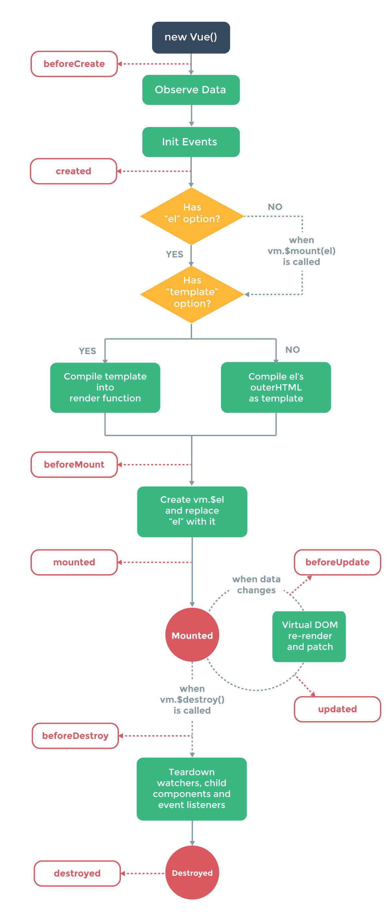

### **✔️ Summary**

1. Vue, React 특징
2. 같은 컴포넌트로 비교(testA+testB 연산해서 total을 도출해내는 간단 로직)
3. 이벤트 사용방법
4. 부모에서 state(변수) 수정 방법
5. 자식에서 부모에게 받은 state를 props 로 넘겨서 수정하는 방법
6. 랜더링하는 시점

### **✔️ Vue React 특징**

1. **React** 라이브러리이고 Vue는 프레임워크이다 (공식문서 참고)
2. 라이브러리의 정의는 일부분만 가져와서 사용 하는게 편리하다는 장점이 있다. 또한 단점에는 redux와 recoil 같은 전역상태 관리 부분이나 react-router-dom 같은 라우팅 부분이 내장 되있지 않다는 점이다. 프레임워크 같은 경우는 부분적으로 사용이 불가능하고 지원 해준데로 따라서 써야된다.(computed나 date 선언 등 ) 다만 더 많은 기능을 default 로 제공해줘서 편하다는 장점이 있다
3. 코드 관점에서 보자면 리엑트는 자바스크립트 기반으로 동작을 하며 JSX 파일안에 함수 형식으로 컴포넌트를 만들어 HTML을 render 해서 동작하게 한다. CSS 파일은 별도 라이브러리 없이는 같이 쓸수 없다. Vue는 HTML CSS JS 영역이 하나의 파일 안에 나눠져있고 별도의 CSS 파일이 존재하지 않는다
4. 초기세팅은 React는 create-react-app, Vue는 vue-cli으로 한다.

### **✔️ 같은 컴포넌트로 비교(testA+testB 연산해서 total을 도출해내는 간단 로직)**

#### **React.jsx**

1. state - 값이 저장되있는 변수

2. props - 부모에서 자식으로 값을 넘길때 사용

3. useEffect - LifeCycle에 따라 화면 랜더링 통제 가능한 훅

4.useState - 값을 변수에 저장할 수 있는 훅, 단 저장할때마다 화면 랜더링

5.useCalback -  특정 함수를 새로 만들지 않고 재사용하고 싶을때 사용합니다.

```java
import {useEffect, useState} from "react";

function App() {
    const [number, setNumber] = useState({ //state에 값널기
        testA:0,
        testB:0
    })
    const [total,setTotal] = useState(0)//총 합 구하는 state

    const handleChange = (e) => {//입력시 동작하는 이벤트 함수
        const {name ,value} = e.target;
        setNumber({...number,[name]:Number(value)});
    }

    useEffect(() => {//testA,testB의 변화가 감지시 total값 변경
        setTotal(number.testA+number.testB);
    },[number])

  return (
    <div>
        <p>덧셈 계산기 만들기</p>
        <p>testA : <input type='number' name='testA' onChange={handleChange} /></p>
        <p>testB :<input type='number' name='testB' onChange={handleChange}/></p>
        <p>total :<span>{total}</span></p>
    </div>
  );
}

export default App;
```

#### **Vue.vue**

1. name - component의 이름 표기

2. components - import 해서 사용하고자 하는 컴포넌트 작성

3. data() - 함수로 정의하여 return을 객체로 하고 그 안에 사용하고자 하는 변수를 쓴다

4. props - 부모에게 전달받은 props는 객체안에 type 과 default를 써준다

5. computed - 변수를 선언 안하고 직접 계산된 값을 사용하던가 들어올때랑 사용할때 상황을 다르게 컨트롤 하고 싶을때 사용한다.(getter, setter)

6. methods - 메서드에 대한 부분은 여기다가 적어준다

7. created, mount 등등 - LifeCycle에 맞춰서 해당하는 요소를 적어주면 그에 맞는 상황에 함수가 실행된다.

8. watch - 변수의 변화를 감지하여 안에있는 handler함수를 실행한다. deep과 immediate를 사용해서 처음 실행과 객체안에 있는 요소까지 감지여부를 할 수 있다.

```html
<template>
  <div id="app">
      <p>덧셈 계산기 만들기</p>
      <p>testA : <input type='number' name='testA' v-model="number.testA"  /></p>
      <p>testB :<input type='number' name='testB' v-model="number.testB" /></p> //v-model로 입력시
                                        				//자동 testB 변수에 값 넣기
      <p>total :<span>{{total}}</span></p>
  </div>
</template>

<script>
export default {
  name: 'App',
  data() {
    return {
      number :{ //변수 세팅
        testA :0,
        testB :0
      },
    }
  },
  computed: {//total 변수를 따로 안만들어도 됩니다.
    total() {
      return Number(this.number.testA) + Number(this.number.testB)
    }
  }
}
</script>

<style>
</style>
```

### **✔️ 이벤트 사용방법**

#### **React**

onChange, onClick 같은 속성으로 콜백함수를 넣어서 동작하겠음 처리해야된다.

handleChange와 addTotalVar는 위에 정의한 함수이고 콜백 형태로 들어가야된다.

(addTotalVar() 이런식으로 쓰려면 () => {addToVar()} 이렇게 써야된다.)

event로 값을 컨트롤 할 수 있고 preventDefault같은 함수로 이벤트를 막을수도 있다.

```javascript
<p>testA : <input type='number' name='testA' onChange={handleChange} /></p>
<button onClick={addTotalVar}>더하기 계산</button>
```

#### **Vue**

v-on:이벤트 (@이벤트) 이런 형식으로 처리 할 수 도 있고 .prevent 나 .stop 같은 수식어로

이벤트 발생 시기를 컨트롤 할수 있다. 이벤트로 변수에대한 컨트롤은 v-modal을 이용하면 된다.

(밑에서 v-modal 양방향 컨트롤이 왜 필요한지 설명하겠다)

```javascript
<p>testB :<input type='number' name='testB' v-model="number.testB" /></p>
<button @click="addTotalVar">더하기 계산</button>
```

### **✔️ 부모에서 state(변수) 수정 방법**

#### **React**

useState 훅으로 사용할수있는 state 변수와 수정할수 있는 setState를 선언하고

setState안에 값을 넣어서 수정 가능하다. state에 값을 바로 넣으려고하면 에러가 난다. (단방향 때문에)

보통 state의 값을 수정하려면 함수 안에다가 넣어서 상황에 맞게 컨트롤 한다.

```javascript
const [test,setTest] = useState(0)//선언
const testHandler = () => {
    setTest(10);//수정
    test = 10; // 에러
}
```

#### **Vue**

this를 붙여서 해당 변수를 가리키게하고 값을 바로 대입해도 에러가 안난다.

```javascript
data() {
    return {
  		test : 0
	}
},
methods :{
    testHandler() { //arrowFunction 으로 선언하면 에러
      	this.test = 10 //바로 값을 넣기
    }
}
```

### **✔️ 자식에서 부모에게 받은 state를 props 로 넘겨서 수정하는 방법**

컴포넌트의 이름은 무조건 대문자로 작성해야된다.

React는 카멜 Vue는 스네이크로 컴포넌트를 사용한다.

#### **React**

위에서 선언한 state 수정 함수를 태그에 이름={함수명 or 변수명} 형식으로 전달해서 자식태그에서

그 함수를 실행한다. setState를 넘겨서 수정할 수 있지만 함수로 전달하는거를 추천한다.

```javascript
//부모컴포넌트
const [child,setChild] = useState(0)
const childChange = (e) => {
    const {value} = e.target;
    setChild( Number(value)+10 )
}
<p>자식에게 props 넘겨서 수정</p>
<ChildCompo childChange={childChange} child={child} ></ChildCompo>

//자식컴포넌트
function childCompo(props) {
    return (
        <div>
            <p>input :<input type='number' name='testB' onChange={props.childChange}/></p>
            <p>{props.child}</p>
        </div>
    );
}

export default childCompo;
```

#### **Vue**

함수는 @이름="함수명" 이런식으로 자식에게 전달할 수 있고  변수는 :이름="변수명" 형식으로 전달할 수 있다.

React는 state를 수정하는 함수를 자식에 내려서 실행하므르 수정했다면 Vue는 자식이 직접 수정을 하지는 못한다.

1. v-bind(:)로 자식한테 props로 넘긴후 $emit으로 수정

```javascript
//부모 컴포넌트

<p>자식에게 props 넘겨서 수정</p>
<ChildCompo @child-change="childChange" :child="child" ></ChildCompo>
<script>
    data() {
        return {
            child:0
       }
    },
    methods :{
        childChange(value){
            this.child = Number(value) +10
        }
    }
</script>
//자식컴포넌트
<template>
    <div>
        <p>input :<input type='number' name='testB' @keyup="childChange"></p>
        <p>{{child}}</p>
    </div>
</template>

<script>
export default {
    name: "ChildCompo",
    props:{
        child:{
            type: Number
        }
    },
    methods:{
        childChange(e) {
            this.$emit("child-change",e.target.value)
        }
    }
}
</script>
```

### **✔️ 랜더링하는 시점**

#### **React**

componentDidMount :첫 랜더링시

componentDidUpdate : 변경될때마다 실행

componentWillUnmount : 컴포넌트가 사라질때 실행

```java
    useEffect(() => {
        setTotal(''); //state가 변경될때마다 랜더링
    },[number]) //[]만적으면 첫 랜더링시만(componentDidMount), 
    //[state]안에 값을 넣으면 변경때마다 랜더링(componentDidUpdate )
```

#### **Vue(총 8개)**

created : 라이프사이클 중 맨 처음에 실행 ,데이터를 맨 처음 불러올때 사용,Dom 접근 않됨

mounted : DOM이 메모리에 생성되고 렌더링 된 이후에 실행됨.

updated : 데이터가 변경되면 재 렌더링 되는데 그 이후에 실행. DOM과 관련된 로직 처리가 가능.

destroyed : Vue 인스턴스 제거 후에 실행. 모든 인스턴스와 디렉티브가 바인딩 해제되고,

모든 이벤트들이 제거됨.



### ***✔️ 참고한것***

<https://nyol.tistory.com/148>

[🔗 리액트(React.js) vs 뷰(Vue.js)](https://nyol.tistory.com/148) — 리액트(React.js) vs 뷰(Vue.js)  2021년 StackOverFlow에서 조사한 웹 프레임워크 사용 순위에서 react.js가 1위를 했다. vue의 사용이 증대되고 있지만 아직까지 크게 순위적인 차이가 나지 않은 것 같다...

<https://erwinousy.medium.com/%EB%82%9C-react%EC%99%80-vue%EC%97%90%EC%84%9C-%EC%99%84%EC%A0%84%ED%9E%88-%EA%B0%99%EC%9D%80-%EC%95%B1%EC%9D%84-%EB%A7%8C%EB%93%A4%EC%97%88%EB%8B%A4-%EC%9D%B4%EA%B2%83%EC%9D%80-%EA%B7%B8-%EC%B0%A8%EC%9D%B4%EC%A0%90%EC%9D%B4%EB%8B%A4-5cffcbfe287f>

[🔗 React와 Vue에서 똑같은 앱을 만들어보고 그 차이점에 대해 썼다.(번역글)](https://erwinousy.medium.com/%EB%82%9C-react%EC%99%80-vue%EC%97%90%EC%84%9C-%EC%99%84%EC%A0%84%ED%9E%88-%EA%B0%99%EC%9D%80-%EC%95%B1%EC%9D%84-%EB%A7%8C%EB%93%A4%EC%97%88%EB%8B%A4-%EC%9D%B4%EA%B2%83%EC%9D%80-%EA%B7%B8-%EC%B0%A8%EC%9D%B4%EC%A0%90%EC%9D%B4%EB%8B%A4-5cffcbfe287f) — 이 글은 https://medium.com/javascript-in-plain-english/i-created-the-exact-same-app-in-react-and-vue-here-are-the-differences-e9a1ae8077fd의…


