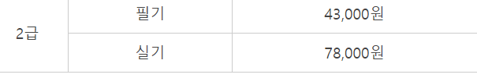
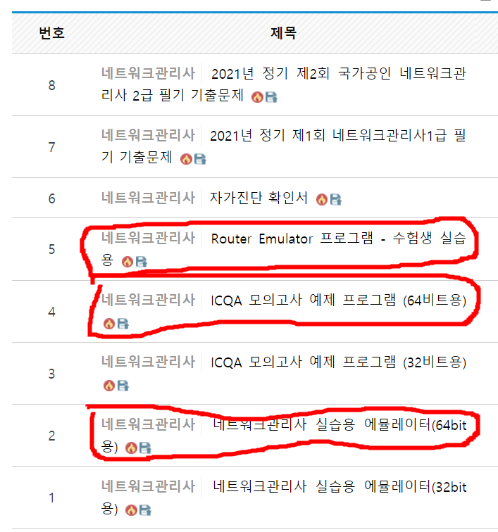

### **후기**

**네트워크 관리사 2급 필기 43000, 실기 78000 ... ㄷㄷ**

**웬만하면 떨어지지 말고 한 번에 합격하자!!!**

### **✔️ Summary**

1. **프로그램 설치 및 준비 사항**
2. **공부해야 될 것 소개**
3. **배점 및 신청 방법**
4. **주의 사항**

### **✔️ 프로그램 설치 및 준비사항**

**ICQA 예제, 실습 프로그램 설치하기**

1. Router Emulator 프로그램 : 라우터 명령어 연습 프로그램
2. ICQA 모의고사 예제 프로그램 : 네트워크 설정 연습 프로그램
3. 네트워크관리사 실습용 에뮬레이터 : 실습 문제

**랜툴 작업도구 구매하기(구글 검색)**

- 랜툴
- 스트리퍼
- 랜 테스터기(선택)
- RJ45(8P) 커넥터
- 랜케이블

### **✔️ 공부해야 될 것 소개**

> **📢 시험 순서 : 랜 케이블 작업 > 네트워크 설정 + 객관식 주관식 문제 > 라우터 설정(명령어 입력)**

> **📢 순서대로 시험 보고 각각 시간이 주어진다.**

> **📢 랜 케이블은 다 보고 나갔을 때 정답 여부를 알려준다.**

**랜 케이블 작업(다이렉트)**

구매한 랜 케이블로 작업을 한다. 다이렉트 케이블, 크로스 케이블이 있는데 주로 다이렉트 케이블 문제가 출제 된다.

**네트워크 설정**

ICQA 모의고사 예제 프로그램으로 연습을 한다. 각 파트별로 선택할 수 있고 해당 문제에 대한 내용을 반복해서 풀어 보면 된다.

**객관식 주관식 문제(이론)**

필기 때 이론을 열심히 공부 했다면 어렵지 않다. 네트워크 ID 설정 및 용어에 대한 주관식 문제, OSI 7계층 문제 등 다양한 문제가 출제된다.

**라우터 명령어**

해당 문제에 대한 명령어 설정하는 문제가 나온다. 예측 가능한 문제가 출제되니까 명령어만 암기하면 다 맞출 수 있다.

### **✔️ 배점 및 신청 방법**

**신청 방법**

1. ICQA 홈페이지 로그인 후 시험 일정 확인해서 접수 일자에 신청한다. (금액 : 78000…..ㄷㄷ)
2. [(사)한국정보통신자격협회](https://www.icqa.or.kr/cn/page/network)
3. 마이페이지에서 장소랑 시간을 확인 한다.

**배점**

케이블 제작에 합격했다면 나머지 문제 중 5개 이하로만 틀리면 된다.

(60점 이상 되야지 합격)

1. 케이블 제작 : 1 문제, 배점 6.5 점
2. 윈도우 설정 : 8 문제, 배점 5.5 점
3. 리눅스 설정 : 2 문제, 배점 5.5 점
4. TCP / IP 장비 : 3 문제, 배점 5.5 점
5. 보안 : 1 문제, 배점 5.5 점
6. 라우터 : 3 문제, 배점 5.5 점

### **✔️참고한 곳**

[햄릿슈닷컴](https://www.hamletshu.com/)

[🔗 햄릿슈닷컴](https://www.hamletshu.com/) — 햄릿슈가 추천하는 실기 공부 순서 1. 케이블 만들기 (기본) 2. Window Server 3. 라우터 4. 단답형, 선택형 (다른 거 다 맞으면 굳이 많이 안 맞춰도 합격입니다) 햄릿슈가 추천하는 수강 순서 입문편(\*

[[네트워크관리사 2급 실기] window server 문제 모음](https://rookie-developer.tistory.com/147?category=1193401)

[🔗 [네트워크관리사 2급 실기] window server 문제 모음](https://rookie-developer.tistory.com/147?category=1193401) — \*\* 제가 공부하려고 만든 문제 모음입니다. 문제/해설 블로그들은 아래 게재해놓았습니다. \*\* <문제 번호별 참고 블로그> 1번 - 하루살 블로그>Win문제 2~9 2번 - 햄릿슈 2017 강의 3번 - 햄릿슈 2018 강

