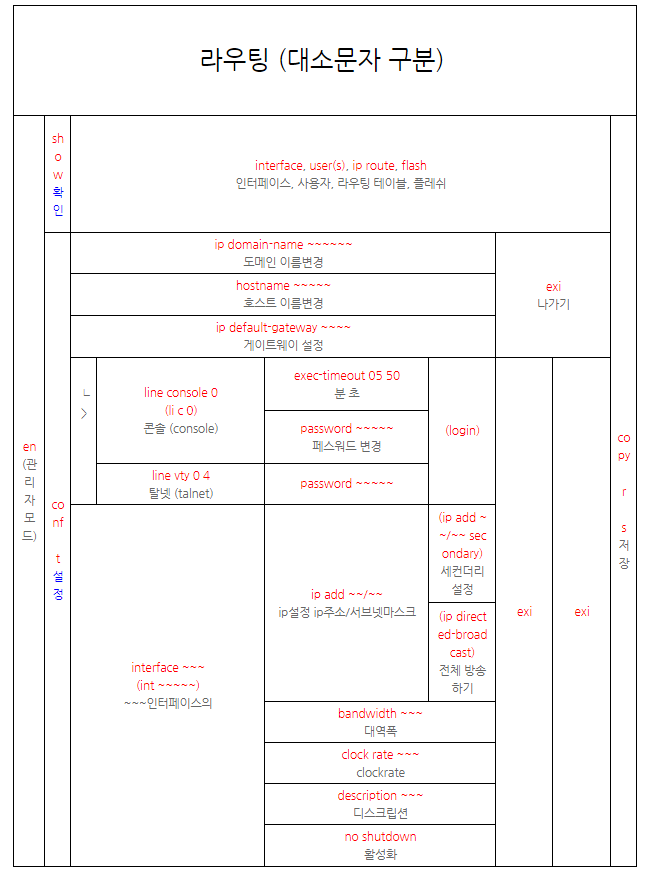

**네트워크 관리사 자격증 신청이나 에뮬레이터를 다운 받지 못했다면**

**아래 링크를 클릭하기!!**

**[네트워크 관리사 설명](https://zibu-story.tistory.com/193)**


*라우터 프로그램*


### **✔️ Summary**

1. **주의사항 및 꿀팁**
2. **문제 총 정리**

### **✔️ 주의사항 및 꿀팁**

**실행방법**

1. 라우터 프로그램 설치
2. [Router Emulator 프로그램 - 수험생 실습용 > 자료실](https://www.icqa.or.kr/cn/board/dataroom/21?page=5)
3. 한국정보통신자격협회 홈페이지에서 다운 받은 프로그램 실행
4. 주의사항 적힌 부분 꼼꼼히 읽어 보고 문제 풀기

**꿀팁**

- 라우터 번호를 잘 확인하고 입력을 한다.
- 명령어를 모른다면 ? 적고 엔터를 누르면 된다.
- ‘startup-config에 저장하시오.’라는 문구가 나오면 ‘copy r s’를 꼭 해야 된다.
- ‘활성화’ 문구가 나오면 no shutdown을 해야 된다.
- 어느 상황에 어떠한 문구를 써야 하는지 순서랑 명령어를 필히 암기를 한다.

### **✔️ 문제 총 정리**

> 📢 **문제 유형 정보 확인, console 설정, Telnet 설정, fastethernet 설정, Serial 설정, dhcp 설정, 게이트웨이 설정, OSPF 설정, 네트워크 설정 문제**

**전체 흐름 사진**



**정보 확인**

1. **인터페이스 정보를 확인하고 저장하시오**
   정답

   ```bash
   > en
   > show interface
   > copy r s
   ```
2. **접속한 사용자 정보를 확인하고 저장하시오**
   정답

   ```bash
   > en
   > show user
   > copy r s
   ```
3. **라우팅 테이블 정보를 확인하고 저장하시오**
   정답

   ```bash
   > en
   > show ip route
   > copy r s
   ```
4. **플레쉬 내용을 확인하고 저장하시오**
   정답

   ```bash
   > en
   > show flash
   > copy r s
   ```
5. **프로세서 내용을 확인하고 저장하시오**
   정답

   ```bash
   > en
   > show process
   > copy r s
   ```
6. **소프트웨어 버전과 IOS 버전 등을 확인하십시오.**
   정답

   ```bash
   > en
   > show version
   > copy r s
   ```

**console 설정 문제**

1. **console 0의 패스워드 icqa로 설정하고 로그인하시오**  
   정답

   ```bash
   > en
   > conf t
   > line console 0
   > password ICQA
   > login
   > exit
   > exit
   > copy r s
   ```
2. **hostname을 network2로 변경하고 console 0의 password를 route5로 변경 후 로그인하시오**
   정답

   ```bash
   > en
   > conf t
   > hostname network2
   > line console 0
   > password route5
   > login
   > exit
   > exit
   > copy r s

   ```
3. **console 0의 도메인 명을 AAA로 설정하시오.**
   정답

   ```bash
   > en
   > conf t
   > line console 0
   > ip domain-name route5
   > exit
   > exit
   > copy r s

   ```

**Telnet 설정 문제**

1. **텔넷 연결 후 3분 50초동안 입력이 없으면 세션이 자동 종료되도록 설정하시오**
   정답

   ```bash
   > en
   > conf t
   > line vty 0 4
   > exec-timeout 03 50
   > exit
   > exit
   > copy r s

   ```
2. **ROUTER1 Telnet에 접근하는 Password를 icqa로 설정하고 로그인 하시오**
   정답

   ```bash
   > en
   > conf t
   > line vty 0 4
   > password icqa
   > login
   > exit
   > exit
   > copy r s

   ```

**Serial 설정 문제**

1. **Router 2의 Serial 2/0의 대역폭을 2048로 설정하시오**.
   정답

   ```bash
   > en
   > conf t
   > interface serial 2/0
   > bandwidth 2048
   > exit
   > exit
   > copy r s

   ```
2. **serial 2/0을 활성화 시키시오**
   정답

   ```bash
   > en
   > conf t
   > interface serial 2/0
   > no shutdown
   > exit
   > exit
   > copy r s

   ```
3. **Router2의 Serial 2/0의 clock 속도를 72K로 설정하시오**.
   정답

   ```bash
   > en
   > conf t
   > interface serial 2/0
   > clock rate 72000
   > exit
   > exit
   > copy r s

   ```
4. **ROUTER1의 Serial 2/0을 사용 가능하게 IP주소를 192.168.0.101/24와 두번째 IP 192.168.0.102/24로 설정하고 활성화하시오**
   정답

   ```bash
   > en
   > conf t
   > interface serial 2/0
   > ip add 192.168.0.101 255.255.255.0
   > ip add 192.168.0.102 255.255.255.0 secondary
   > no shutdown
   > exit
   > exit
   > copy r s

   ```
5. **serial 2/0에 frame relay 방식으로 캡슐화 하시오**
   정답

   ```bash
   > en
   > conf t
   > interface serial 2/0
   > encapsulation frame relay
   > exit
   > exit
   > copy r s

   ```

**Fastethernet 설정 문제**

1. **FastEthernet 0/0의 Description을 설정하시오. Description : ICQA**
   정답

   ```bash
   > en
   > conf t
   > interface fastethernet 0/0
   > description ICQA
   > exit
   > exit
   > copy r s

   ```
2. **ROUTER 1의 FastEthernet 0/0의 IP를 192.168.0.100/24로 설정하시오**.
   정답

   ```bash
   > en
   > conf t
   > interface fastethernet 0/0
   > ip add 192.168.0.100 255.255.255.0
   > exit
   > exit
   > copy r s

   ```
3. **access-list 1이 설정되어 있을 때 FastEthernet 0/0에 적용하시오**
   정답

   ```bash
   > en
   > conf t
   > interface fastethernet 0/0
   > ip access-group 1 in
   > ip access-group 1 out
   > exit
   > exit
   > copy r s

   ```

**dhcp설정 문제**

1. **Router1의 DHCP 네트워크를 192.168.100.0/24 서버 이름은 icqa 로 설정하시오**
   정답

   ```bash
   > en
   > conf t
   > ip dhcp pool icqa
   > network 192.168.100.0 255.255.255.0
   > exit
   > exit
   > copy r s

   ```

**게이트웨이 설정 문제**

1. **기본 게이트웨이를 설정하시오 IP : 192.168.0.10**
   정답

   ```bash
   > en
   > conf t
   > ip default-gateway 192.168.0.10
   > exit
   > copy r s

   ```

**네트워크 설정 문제**

1. **default network를 192.168.0.10으로 설정 하시오**
   정답

   ```bash
   > en
   > conf t
   > ip default-network 192.168.0.10
   > exit
   > copy r s

   ```
2. **RIP 환경이 구성되어 있을 때, 라우팅 테이블에 등록되지 않는 목적지로 향하는 패킷은 192.168.1.1 네트워크 보내도록 Router 1에 디폴트 네트워크를 설정하시오(ip route 0.0.0.0 사용 금지)**
   정답

   ```bash
   > en
   > conf t
   > ip default-network 192.168.1.1
   > exit
   > copy r s

   ```

**ospf 설정 문제**

1. **네트워크가 구성되어 있을 때 ospf를 설정하시오 processID와 Area id는 1이며 설정 완료 시 저장!**
   정답

   ```bash
   > en
   > conf t
   > route ospf 1
   > network 192.70.100.0 0.0.0.255 area 1
   > exit
   > copy r s

   ```
2. **아래와 같이 네트워크가 구성되어 있을 때 Router 1에 OSPF를 설정하시오(Process ID와 Area id는 1이다.) 192.70.100.1/24 → (Fa 0/0) → Router 1(Se 2/0 193.150.60.50/24 —Router 2(Se 2/0 193.150.60.55/24) ← (Fa 0/0) ← 170.150.1.1/16**
   정답

   ```bash
   > en
   > conf t
   > route ospf 1
   > network 192.70.100.1 0.0.0.255 area 1
   > network 193.150.60.50 0.0.0.255 area 1
   > exit
   > copy r s

   ```

### **✔️ 참고한 곳**

[햄릿슈닷컴](https://www.hamletshu.com/)

[🔗 햄릿슈닷컴](https://www.hamletshu.com/) — 햄릿슈가 추천하는 실기 공부 순서 1. 케이블 만들기 (기본) 2. Window Server 3. 라우터 4. 단답형, 선택형 (다른 거 다 맞으면 굳이 많이 안 맞춰도 합격입니다) 햄릿슈가 추천하는 수강 순서 입문편(\*

[[네트워크관리사 2급 실기] window server 문제 모음](https://rookie-developer.tistory.com/147?category=1193401)

[🔗 [네트워크관리사 2급 실기] window server 문제 모음](https://rookie-developer.tistory.com/147?category=1193401) — \*\* 제가 공부하려고 만든 문제 모음입니다. 문제/해설 블로그들은 아래 게재해놓았습니다. \*\* <문제 번호별 참고 블로그> 1번 - 하루살 블로그>Win문제 2~9 2번 - 햄릿슈 2017 강의 3번 - 햄릿슈 2018 강


