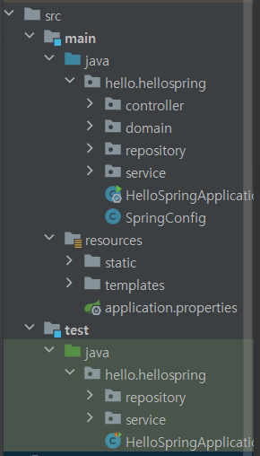
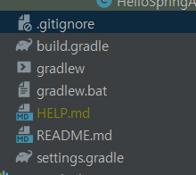
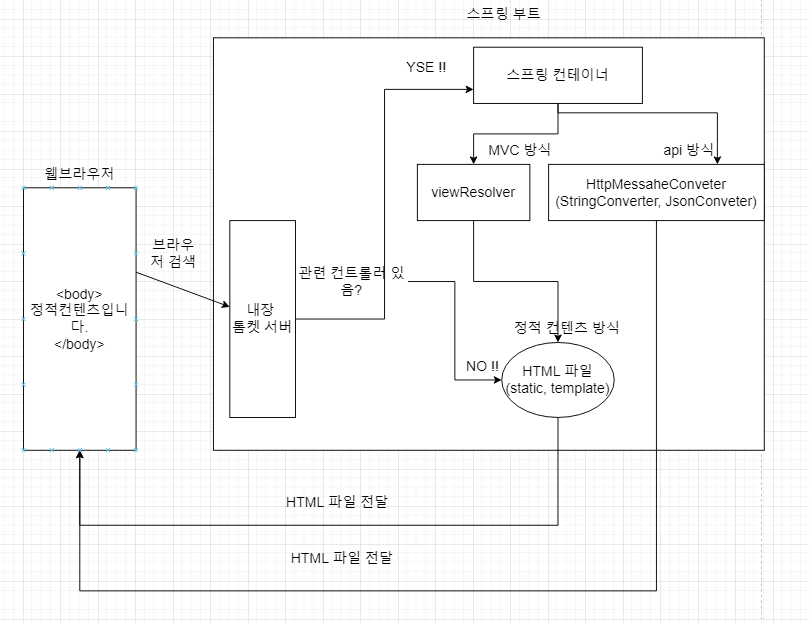

**이해할 때까지 직접 코드를 치는 것이 중요하다**

**코드 내용**

**[깃허브 Repository](https://github.com/seong-ji-sue/springboot-inflearn-kimyounghan-basic)**


**📢 웹 브라우저에 검색했을 때 스프링이 동작하는 방식을 설명할 수 있습니다.**
**📢 static 폴더와 template 폴더의 역할과 우선 순위를 설명할 수 있습니다.**
**📢 Json 데이터를 주고 싶을 때 , 정적 파일에 데이터를 넣고 싶을 때 어떻게 처리하는지 설명할 수 있습니다.**

### **✔️ 스프링 프로젝트 내에서 폴더와 파일 종류**

> **프로젝트를 생성했을 때 이미지입니다. controller domain repository service 부분은 수동으로 생성했습니다.**





1. **src/main/java** 클레스와 인터페이스 등 자바 파일이 위치하는 폴더 입니다.
2. **src/resources/static** 정적 리소스에 관한 파일입니다.
3. **src/resources/templates** HTML내에 데이터를 처리하는 경우 작성하는 파일입니다.
4. **src/resources/application.properties** 웹 어플리케이션을 실행하면서 자동으로 로딩되는 파일입니다. ex) WAS , 데이터베이스 등
5. **src/test/java** main에서 생성하고 작성한 코드를 단위 테스트 할 수 있는 폴더입니다.
6. **BoardApplication.java** SpringApplication.run() 을 통해서 웹 어플리케이션을 실행하는 역할을 합니다.
7. **build.gradle** 사용하는 라이브러리를 추가 관리할 수 있습니다.

### **✔️ 웹 브라우저에 검색했을 때 스프링 동작 방식**

> **해당 내용은 인프런에서 김영한님 강의( 스프링 입문 - 코드로 배우는 스프링 부트, 웹 MVC, DB 접근 기술)의 일부분의 내용을 요약한것입니다.**

**그림으로 표현**



**위에 그림 설명**

1. 브라우저에 localhost:8080/hello-test 검색
2. 톰켓 내장 서버가 hello-test가 관련 빈이 등록되어 있는지 스프링 컨테이너한테 물어봄
3. 않되어 있으면 resources/statics 폴더에 helllo-test.html 파일을 웹 브라우저에게 전달함
4. 빈으로 등록되어 있다면 Response 어노테이션이 있는지 확인, 있다면 api 방식으로 HttpMessageConveter가 String 문자열이나 객체를 전달하고 없다면 viewResolver에게 template 폴더내에 return 되는 문자열과 동일한 html 파일이 있는지 확인 웹 브라우저한테 전달

### **✔️ MVC 방식과 API 방식의 차이점**

**MVC 방식**

**특징**

1. model, view, controller을 통해 역할을 나눠서 데이터를 전달하여 웹상에 표시하는 방식이다.
2. 백엔드 혼자 View 단까지 작업할 때 사용 정적 컨텐츠에서 유동적으로 내용을 변경할 수 있음

**동작 방식**

1. 컨트롤러에서 querystring name에 대한 값을 외부에서 받아와서 names에 저장한다.
2. 모델 객체에 name이라는 key에 대한 value 값인 names를 넘긴다.
3. hello-template을 리턴 하면 html 파일에 모델 객체 전달되어 가져온 값으로 변환 후 웹페이지에 결과 출력해준다.

**파일 추가**

```kotlin
/**
 * MVC 방식
 * @param name
 * @param model
 * @return
 */
@GetMapping("hello-mvc")
public String helloMvc(@RequestParam("name") String name, Model model) {
    model.addAttribute("name", name);
    return "hello-template";
}
```

```html
<!--name에 값 집어 넣어서 보여줌 -->
<!--Thymeleaf 사용중 -->

<html xmlns:th="http://www.thymeleaf.org">
<body>
<p th:text="'hello ' + ${name}">hello! empty</p>
</body>
</html>
```

**API**

**특징**

1. html과 템플릿 엔진을 사용하지 않고 바로 결과를 넘겨주는 것이다.
2. 프론트엔드와 협업할 때 사용한다.

**동작 방식**

1. return 한 문자열을 HttpMessaheConveter에 전달
2. 속해있는 StringConverter 또는 JsonConveter가 웹브라우저한테 전달

**파일 추가**

```dart
/**
 * API 방식
 * 받은 데이터를 문자열 그대로 화면에 출력
 * @param name
 * @return
 */
@GetMapping("hello-string")
@ResponseBody
public String helloString(@RequestParam("name") String name){
    return "hello" +name;
}

/**
 * API 방식(JSON 방식)
 * html이 아닌 데이터 넘기기
 * @param name
 * @return
 */
@GetMapping("hello-api")
@ResponseBody
public Hello helloApi(@RequestParam("name") String name) {
    Hello hello = new Hello();
    hello.setName(name);
    return hello;
}
static class Hello {
    private String name;
    public String getName() {
        return name;
    }
    public void setName(String name) {
        this.name = name;
    }
}
```

### **✔️ 강의 참고**

[스프링 입문 - 코드로 배우는 스프링 부트, 웹 MVC, DB 접근 기술](https://www.inflearn.com/course/%EC%8A%A4%ED%94%84%EB%A7%81-%EC%9E%85%EB%AC%B8-%EC%8A%A4%ED%94%84%EB%A7%81%EB%B6%80%ED%8A%B8/dashboard)

[🔗 [무료] 스프링 입문 - 코드로 배우는 스프링 부트, 웹 MVC, DB 접근 기술 - 인프런 | 강의](https://www.inflearn.com/course/%EC%8A%A4%ED%94%84%EB%A7%81-%EC%9E%85%EB%AC%B8-%EC%8A%A4%ED%94%84%EB%A7%81%EB%B6%80%ED%8A%B8/dashboard) — 스프링 입문자가 예제를 만들어가면서 스프링 웹 애플리케이션 개발 전반을 빠르게 학습할 수 있습니다., - 강의 소개 | 인프런...


