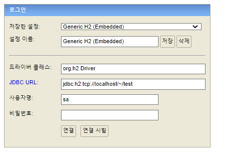
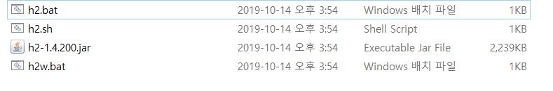

*인프런 로고(홈페이지 캡쳐)*

**코드 내용**

**[깃허브 Repository](https://github.com/seong-ji-sue/springboot-inflearn-kimyounghan-basic)**


**📢 H2 데이터 베이스를 설치하고 테이블을 생성할 수 있다.**

**📢 중복코드 제거한 최신 JDBC 방식을 알고 있습니다.**

**📢 쿼리문을 안쓰고 JPA를 사용하여 데이터베이스에 접근하고  CRUD를 할 수 있습니다.**

**📢 공부용으로 사용하기 위해 용량이 작은 H2 데이터 베이스를 이용합니다.**

**📢 데이터베이스를 사용 안하고 했던 이전 방식에서는 Map에 데이터를 저장했지만 사용을 하는 지금은 연결을 직접적으로 해야 되고 그 부분이 JDBC Template, JPA 방식 2가지가 있다.**

### **✔️ H2 데이터 베이스 설치**

**데이터베이스 설치 및 세팅**

1. 링크로 들어가서 1.4.200 버전으로 설치한다. (링크 :  [Archive Downloads](https://www.h2database.com/html/download-archive.html))
2. 설치 한 폴더로 들어가서 h2.bat을 실행한다  

   
3. 터미널에서 실행과 동시에 접속한 URL에서 아래와 같이 설정 후 접속한다  

   
4. 아래와 같이 작성 후 cntrl + enter 단축키를 누른다
5. `//테이블 생성 쿼리
   create table 테이블 이름
   (
   id bigint generated by default as identity, //데이터 생성 시 id 증가
   name varchar(255),
   age bigInt,
   primary key (id)
   );`

**프로젝트 코드상에서 데이터 베이스 연결 설정**

1. 환경설정(main/resources/application.properties)   

   ```stylus
   //데이터베이스 연결 설정
   spring.datasource.url=jdbc:h2:tcp://localhost/~/test
   spring.datasource.driver-class-name=org.h2.Driver
   spring.datasource.username=sa

   //JPA 사용시에만
   spring.jpa.show-sql=true
   spring.jpa.hibernate.ddl-auto=none
   ```
2. 라이브러리 설치(build.gradle)  

   ```clean
   //JDBC 설치
   implementation 'org.springframework.boot:spring-boot-starter-jdbc'
   //JPA 설치
   implementation 'org.springframework.boot:spring-boot-starter-data-jpa'
   ```

### **✔️ JDBC Template 방식**

> **준비사항 라이브러리 설치 JdbcTemplate 사용**  
> **DataSource 객체 빈 등록**   
>
> ```reasonml
> private final JdbcTemplate jdbcTemplate;
>
> public JdbcTemplateMemberRepository(DataSource dataSource) {
>   jdbcTemplate = new JdbcTemplate(dataSource);
> }
> ```

**장단점**

이전에 Connection, PreparedStatement, Result 객체로 데이터 베이스 연결을 했는데 중복되는 코드를 줄이기 위해 JDBC Template 방식을 도입했다.

하지만 쿼리문은 기존과 동일하게 사용자가 직접 작성을 해야 되는 번거로움이 있다.

**코드(JDBC → JDBC Template )**

```java
//JDBC(20년전 방식)
@Override
 public Personsave(Person person) {
	 String sql = "insert into person(name) values(?)";
	 Connection conn = null;
	 PreparedStatement pstmt = null;
	 ResultSet rs = null;
	 try {
		 conn = getConnection();
		 pstmt = conn.prepareStatement(sql,Statement.RETURN_GENERATED_KEYS);
		 pstmt.setString(1, person.getName());
		 pstmt.executeUpdate();
		 rs = pstmt.getGeneratedKeys();
		 if (rs.next()) {
			 member.setId(rs.getLong(1));
		 } else {
			 throw new SQLException("id 조회 실패");
		 }
		 return person;
	 } catch (Exception e) {
		 throw new IllegalStateException(e);
	 } finally {
		 close(conn, pstmt, rs); //어떤 import를 해야되는지 잘 모르겠음
	 }
 }
```

```java
//JDBC Template 방식
@Override
    public Person save(Person person) {
        SimpleJdbcInsert jdbcInsert = new SimpleJdbcInsert(jdbcTemplate);
        jdbcInsert.withTableName("person").usingGeneratedKeyColumns("id");
        Map<String, Object> parameters = new HashMap<>();
        parameters.put("name", person.getName());

        Number key = jdbcInsert.executeAndReturnKey(new MapSqlParameterSource(parameters));
        person.setId(key.longValue());
        return person;
    }

private  RowMapper<Person> personRowMapper() {
        return ((rs, rowNum) -> {
            Person person = new Person();
            person.setId(rs.getLong("id"));
            person.setName(rs.getString("name"));
            person.setAge(rs.getInt("age"));
            return person;
        });
    }
```

### **✔️ JPA 방식**

> **준비물   
> 라이브러리 설치**  
> **EntityManager 를 사용**  
> **domain class에서 @Entity 추가 id에 내용 추가**  
> **(@Id @GeneratedValue(strategy = GenerationType.IDENTITY))**  
> **환경 변수 추가**
>
> ```stylus
> //resources/application.properties
> spring.jpa.show-sql=true //JPA가 생성하는 SQL을 출력한다
> spring.jpa.hibernate.ddl-auto=none 
> //: JPA는 테이블을 자동으로 생성하는 기능을 제공하는데 none 를 
> //사용하면 해당 기능을 끈다.
> ```
>
> **EntityManager 를 사용**
>
> ```cpp
> private EntityManager em;
>
>     public JpaPersonRepository(EntityManager em) {
>         this.em = em;
>     }
> ```

**장단점**

기존 JDBC에서 반복적인 코드를 줄이고 쿼리문을 직접 작성하지 않아도 JPA 에서 직접 만들어준다.

**코드**

```inform7
@Override
    public Person save(Person person) {
        em.persist(person);
        return person;
    }
```

### **✔️ 강의 참고**

[스프링 입문 - 코드로 배우는 스프링 부트, 웹 MVC, DB 접근 기술](https://www.inflearn.com/course/%EC%8A%A4%ED%94%84%EB%A7%81-%EC%9E%85%EB%AC%B8-%EC%8A%A4%ED%94%84%EB%A7%81%EB%B6%80%ED%8A%B8/dashboard)

[🔗 [무료] 스프링 입문 - 코드로 배우는 스프링 부트, 웹 MVC, DB 접근 기술 - 인프런 | 강의](https://www.inflearn.com/course/%EC%8A%A4%ED%94%84%EB%A7%81-%EC%9E%85%EB%AC%B8-%EC%8A%A4%ED%94%84%EB%A7%81%EB%B6%80%ED%8A%B8/dashboard) — 스프링 입문자가 예제를 만들어가면서 스프링 웹 애플리케이션 개발 전반을 빠르게 학습할 수 있습니다., - 강의 소개 | 인프런...


