**Validation Check와 인증 인가**

**소셜 로그인, 이메일 인증 등 많은 것이 있지만**

**우선 기본적인 동작과 회원 정보를 처리하는 방법에 대해**

**공부하였습니다.**

**원티드 첼린지 강의를 통해 배운 내용 바탕으로 작성하였고**

**신성환 개발자님의 강의 PPT 이미지를 캡쳐해서 가져왔습니다.**

**문제 발생 시 쪽지 주시면 삭제하겠습니다.**

**후기 TIL도 작성하고 있습니다.**


**📢 로그인 동작 방식에 대해 설명할 수 있습니다.**

**📢 쿠키와 세션 방식의 차이점과 각각의 문제점에 대해 이야기 할 수 있습니다.**

**📢 클라이언트에서 쿠키와 같은 정보를 저장하는 방식에 대해 알고 있습니다.**

**📢 소셜 로그인(OAuth)가 어떻게 동작하는지 알고 있습니다.**

### **✔️Summary**

1. **로그인이란 무엇?!**
2. **JWT 처리 방식(클라이언트 관리)**
3. **세션 방식(서버 관리)**
4. **클라이언트에서 데이터를 저장하는 방법**
5. **쇼셜 로그인** **OAuth**

### **✔️로그인이란 무엇?!**

**정의**

- 시스템 접근을 하기 위한 하나의 인증 수단
- 권한을 부여하여 시스템에 제한된 파일 및 프로그램에만 접근하도록 유도
- 로그를 남겨 사고에 대처하기 위함
- 사용자가 시스템에 접근하거나 동작 수행하는 것을 제어하고 기록하기 위함

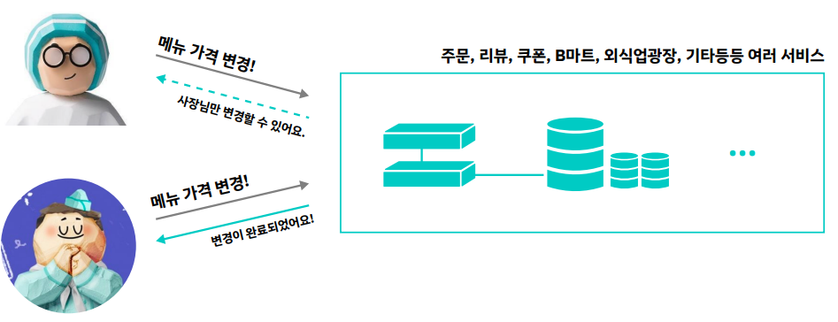

*출처 : 원티드 첼린지 강의 중 신성환 개발자님이 만드신 PPT 내용에서 캡쳐*

**구현하기 위해 필요한 기능**

**프론트**

- 권한이 없는 페이지에 접근 하지 못하도록 하는 구조 만들기
- Setting 같은 버튼에는 특정 사용자한테만 보여질 수 있게 만들기
- 자동 로그인, 로그인 후 상태 유지
- 로그인했는데 다시 로그인 페이지로 가려고 하면 404 페이지 만들어서 접근 못하도록 하기
- 로그인을 하지 않았는데 마이페이지로 가려고 하면 Redirect 처리

**백엔드**

- 사용자 식별할 수 있는 수단 만들기(Token, Session 등
- 사용자마다 권한을 생성하고 관리
- 사용자의 접근 및 동작을 제어하는 수단 만들기
- Validation Check

**최소한의 구현사항**

로그인 페이지, 로그인 인증 관련 데이터 관리, 상태에 따른 화면/기능 제어, 로그아웃

**그냥 로그인을 하게 되면 문제점**

- 로그인 유지 불가능
- 다음 요청 때 회원 정보를 넘겨줘야 함
- 회원 정보가 요청 Body에 노출 되어 있음

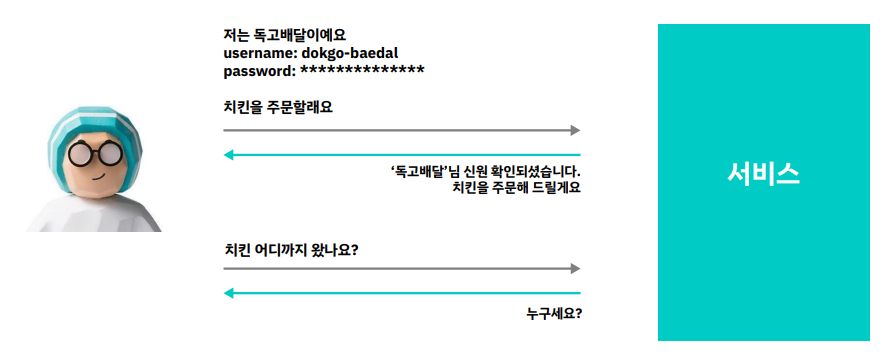

*출처 : 원티드 첼린지 강의 중 신성환 개발자님이 만드신 PPT 내용에서 캡쳐*

### **✔️JWT 처리 방식(클라이언트 관리)**

**정의**

- JSON WEB TOKEN
- 신원 증명 혹은 마패(캠프릿지 사전 참고)
- 요청할 때마다 회원 정보를 넘겨줘야 하는데 서버로부터 회원 정보를 암호화하여 클라이언트에서   
  보관하게 되면 원할 때마다 요청해서 쓸 수 있음
- 클라이언트에서 보관하는 이유는 http는 stateless 하기 때문에 서버에서 식별할 수 없음
- 토큰을 보관해서 요청

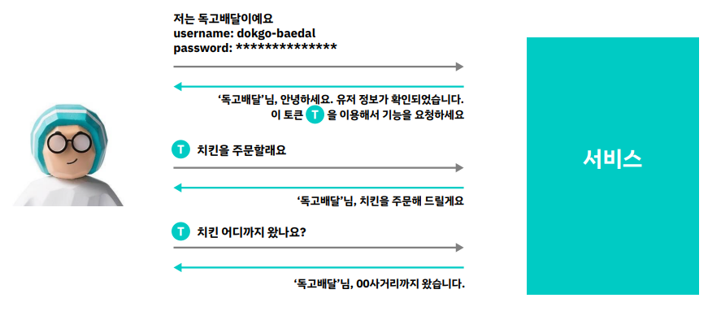

*출처 : 원티드 첼린지 강의 중 신성환 개발자님이 만드신 PPT 내용에서 캡쳐*

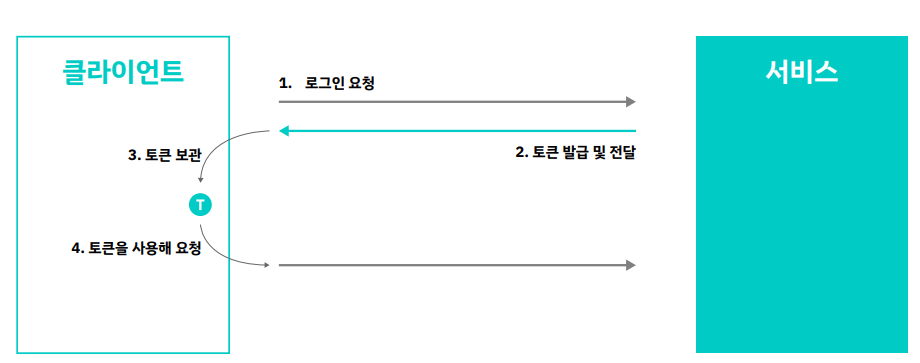

*출처 : 원티드 첼린지 강의 중 신성환 개발자님이 만드신 PPT 내용에서 캡쳐*

**동작 방식**

1. 클라이언트가 로그인 정보를 서버에게 전달함
2. 서버는 로그인 정보 확인 후 클라이언트가 사용할 수 있도록 해싱으로 암호화된 Token을 전달함
3. 클라이언트는 암호화된 Token으로 어떤 액션을 취하더라도 인증을 받을 수 있음   
   단, Token을 보관하고 있어야 함(방법은 아래 설명)

**내부 구조**

> 정확하게 몰라도 됨, 백엔드에서 해야 될 일

> 참고 사이트(JWT 공식 홈페이지) : <https://jwt.io/>

- HEADER : 암호화 규칙(해싱), 토큰 타입
- PAYLOAD : 데이터(클레임)
- SIGNATUAL : 암호화를 위한 데이터, base64(인코딩 규격), 복호화 불가능

```1c
{ "alg" : "HS256", "type" : "JWT" }//HEADER
{ "sub" : "123456", "name": "John", "lat": 1516239022}//PAYLOAD

HMACSHA256(
	base64UrlEncode(header) + "." +
	base64UrlEncode(payload),
	MY_SECRET_KEY_1234!@#
)//SIGNATURE
```

**헤싱이란?**

- 헤더의 암호화 규칙과 페이로드의 데이터, 시크릿 키로 암호화 하는 방법
- 특정 규격으로 데이터를 변환하는 것, 단방향
- 시크릿 키는 무조건 있어야 함
- 서버에서 유효한지 해쉬 키로 비교함

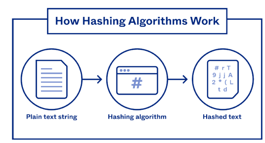

*출처 : 원티드 첼린지 강의 중 신성환 개발자님이 만드신 PPT 내용에서 캡쳐*

**문제점**

- secret key 가 노출되면 그 값으로 로그인 시도 가능
- 데이터 복호화로 인한 정보 유출, Header와 Payload는 복호화 가능하기 때문
- 물리적인 이유로 탈취하는 방법은 없지만 사용자로 인하여 탈취를 당할 수 있음
- 쿠키와 저장하면 악성 브라우저 방문 시 브라우저에 있는 정보를 탈취 당함(CSRF)
- 로컬스토리지 저장하면 localStorage.get에서 정보 탈취 후 코드로 script 태그를 주입 가능(XSS)
- 함수 스코프에 저장하면 로그인 유지 불가

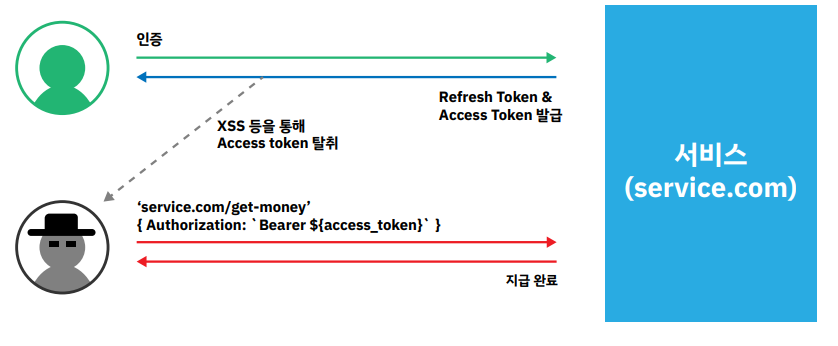

*출처 : 원티드 첼린지 강의 중 신성환 개발자님이 만드신 PPT 내용에서 캡쳐*

**해결 방법 : Access Token Refresh Token**

**일단 무엇인지 파악**

- Access Token : 서버로부터 짧은 유효 기간을 가지고 메모리에 발급되는 Token
- Refresh Token : 서버에서 가지고 있는 Token, HttpOnly Cookie로 발급(JS로 접근 불가)

**흐름**

1. 클라이언트가 서버로 로그인 요청
2. 서버는 Access Token 을 짧은 시간으로 설정하고 클라이언트한테 전달 Refresh Token은 서버가 가지고 있음
3. Access Token 를 전달하여 인증 만약 만료 되면 서버에서 Refresh Token을 체크해서 Access Token 새로 발급하여 클라이언트에게 전달

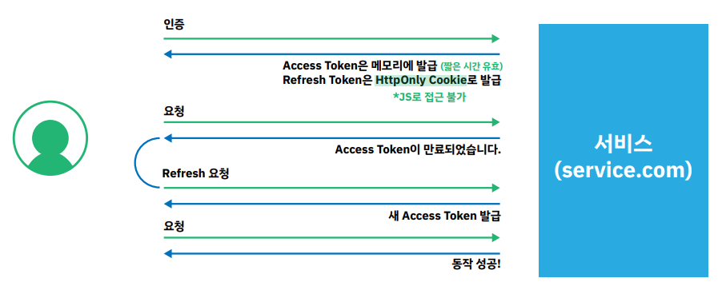

*출처 : 원티드 첼린지 강의 중 신성환 개발자님이 만드신 PPT 내용에서 캡쳐*

→ Access 자체가 만료되서 타이밍 맞게 Refresh 가 털리면 어쩔 수 없음 프론트 혼자서 할 수 있는 것은 없고 절대적인 보안은 없고 최대한 안털리게 하는 것

### **✔️세션 방식(서버 관리)**

**정의**

> 세션스토리지와 세션은 다릅니다.  
> 세션 아이디는 어디다가 저장? HTTP 쿠키

- 실체가 없는 추상적인 무언가
- 사용자의 로그인 이후 로그아웃 혹은 로그인 만료까지 시간
- 서버에 유저 정보를 저장하고 클라이언트에게 세션 아이디를 줘서 가지고 있게 함
- 용량 제한이 없음
- 쿠키를 사용해서 세션ID를 클라이언트에게 전달
- 웹 브라우저가 종료되면 세션 쿠키는 삭제

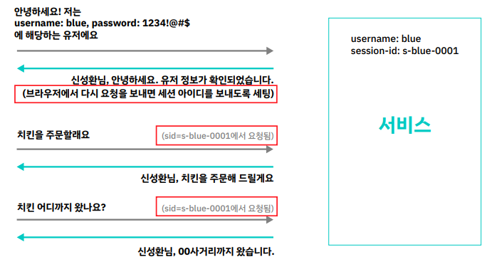

*출처 : 원티드 첼린지 강의 중 신성환 개발자님이 만드신 PPT 내용에서 캡쳐*

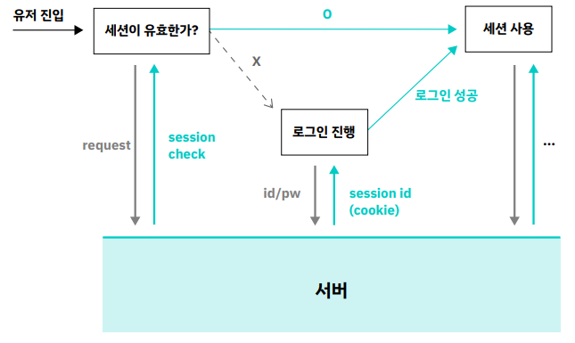

*출처 : 원티드 첼린지 강의 중 신성환 개발자님이 만드신 PPT 내용에서 캡쳐*

**HTTP 쿠기란? 먹는거 아님**

- 웹 브라우저에 전송하는 작은 데이터 조각
- 동일 요청시 브라우저에 저장한 조각들과 저장된 데이터와 함께 전송
- 로그인 상태 유지 가능 HTTP 프로토콜에서는 Stateless 이기 때문에 엄청난 장점
- 세션 관리, 개인화, 트래킹 목적으로 사용
- 따로 암호화 하지 않음
- 모든 요청마다 쿠키가 함께 전송되기 때문에 성능 저하에 원인이 됨
- 세션이 만료될 때 삭제 됨

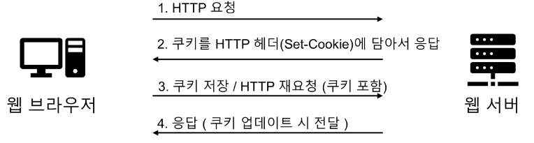

*출처 :&nbsp;https://noahlogs.tistory.com/38*

**쿠키 관련 정책**

> 프론트에서는 쿠키를 별도로 설정하지 않기 때문에 이 정도만 알아도 된다. 자세한 부분은 MDN을 참고 바란다.  
> [MDN 쿠키 정책 설명](https://developer.mozilla.org/ko/docs/Web/HTTP/Cookies)

- Secure 쿠키 : HTTPS 프로토콜 상 암호화된 요청일 경우에만 전송, 민감한 정보는 절대 쿠키 저장하면 안됨
- HttpOnly 쿠키: XSS 공격을 방지하기 위해 JavaScript의 API에 접근 못함(JavaScript 값을 못 가지고 옴
- SamSite 쿠키 : CSRF 공격에 보안되는 방법

**JWT 방식 세션 방식 어떤거 사용?**

- JWT는 프론트에서 저장하고 관리하기 때문에 백엔드 비용이 감소 되고 세션은 그 반대임
- JWT는 보안에 취약한 반면 세션은 그나마 덜 위험함
- 동시 접속자 수나, 서비스 규모등 여러가지 측면을 생각해서 더 나은 방향을 찾아야 함
- 세션은 하나의 서버에서 관리하기 때문에 재부팅하면 메모리에 있는 것들이 모두 날라감

**CORS 란? 해결방법**

다른 환경에서 요청이 들어올 때 문제 없도록 막아주는 것

프론트에서는 로컬 환경에서 검증을 해제할 수 있지만 배포 환경에서는 백엔드가 처리해줘야 함

쿠키 정책과 별개

```lsl
//로컬 환경에서 CORS 검증 해제 (터미널 환경에서 실행)
"C:\\Program Files\\Google\\Chrome\\Application\\chrome.exe" 
--disable-web-security --user-data-dir="C:\\chrome"
```

### **✔️클라이언트에서 데이터 저장하는 방법**

📢 브라우저에 저장하는 방식(종류) : Cookies, Local Storage, Session Storage

**Local Storage**

- key/value로 데이터를 저장한다.
- Javascript를 통해서만 데이터에 접근 가능
- 직접 지울때까지 사라지지 않음
- 5MB의 저장 공간을 가짐
- 서버에 전송이 불가능 (client 에서만 저장 데이터 조회 가능)
- String으로 타입이 제한된다. 용이하게 사용하려면 직렬화가 필요

**Session Storage**

- Session은 기간을 의미하고 Session Storage는 저장 공간을 의미함
- 브라우저가 꺼진다면 데이터는 소실 (보안 측면에서 유리)
- 5-10 MB의 저장 공간을 가짐
- 서버에 전송이 불가능 (client 에서만 저장 데이터 조회 가능)
- 같은 주소의 URL의 창을 여러 개 열어도 각각의 창은 별도의 Session Storage를 갖음

**Cookies**

- expiration date는 각 데이터마다 설정된 기간 동안으로 지정
- 4KB 이하의 저장 공간을 가짐
- SSR에서 사용되는 데이터를 주로 저장함
- api 요청마다 서버로 함께 전송됨. (header에 Access-Control-Allow-Credentials를 true로 설정해야 함)
- HttpOnly flag를 통해 각 Cookie를 클라이언트에서 접근으로부터 보호할 수 있음

**확인 방법**

F12(개발자 도구) → 애플리케이션

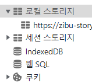

### **✔️소셜 로그인 과정 OAuth**

**정의**

- 허가된 다른 서비스를 통해 구글 카카오 로그인 권한을 위임하는 것
- 권한에 따라 원본 서버(구글)의 유저 정보를 가져와 사용하거나 권한을 위임 받은 동작을 할 수 있으며
- 인증 자체만 사용할 수 있음

**과정 설명**

**클라이언트에서 보는 과정**

서비스에서 구글 로그인 클릭 → 구글 로그인 모달 뜸 → 아이디 비번 입력 → 구글 승인되면 로그인 성공!

**전체 설명**

1. 클라이언트가 서버로 구글 계정 로그인 요청
2. 구글로 리디렉션 후 클라이언트가 구글에 로그인 요청
3. 구글 서버가 클라이언트에서 임시 값을 주고 주소 접근을 허용함
4. 클라이언트가 서버로부터 임시 값과 허용한 주소 값을 전달함
5. 서버는 클라이언트에게 받은 정보로 구글에 접근 허용 요청을 보냄 이때 서버는 서비스 등록 전에   
   받은 구글 시크릿 키도 같이 보냄
6. 구글이 서버로부터 받은 시크릿 키와 클라이언트로 받은 임시 값, 주소를 통해 확인하고 접근 승인을 함

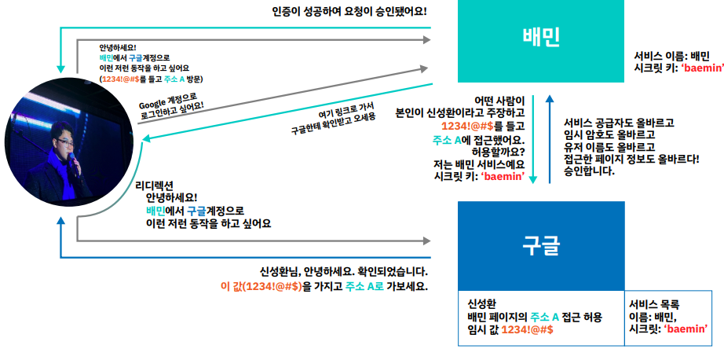

*출처 : 원티드 첼린지 강의 중 신성환 개발자님이 만드신 PPT 내용에서 캡쳐*

**참고한 곳 : 신성한 강사님 PPT, MDN 사이트**


