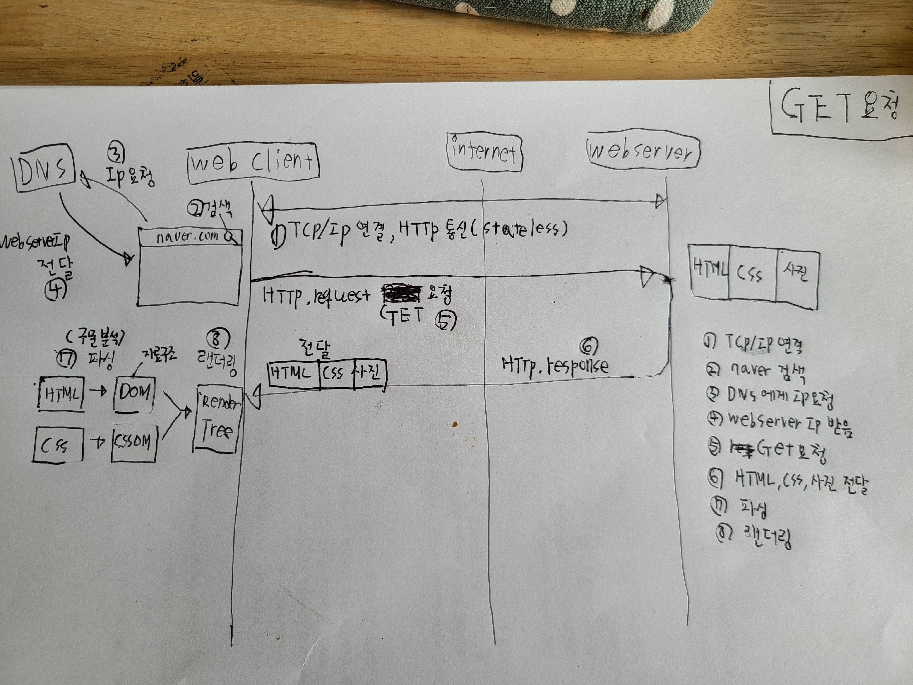
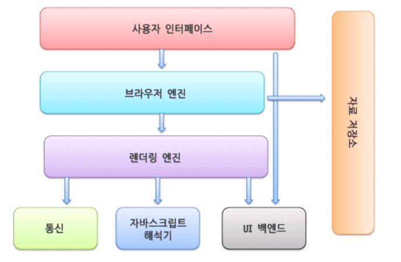
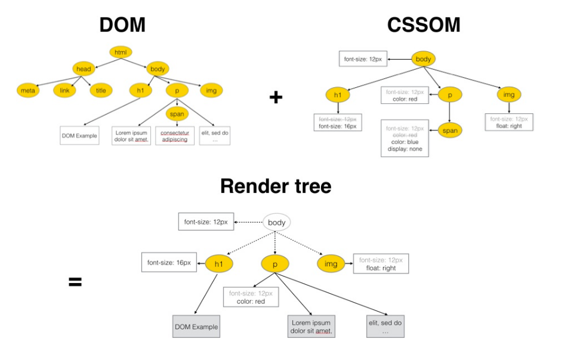
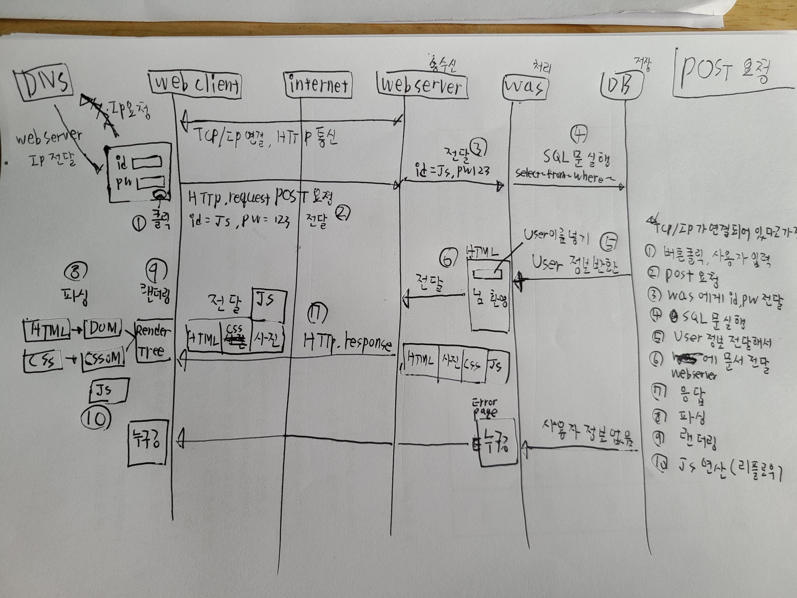
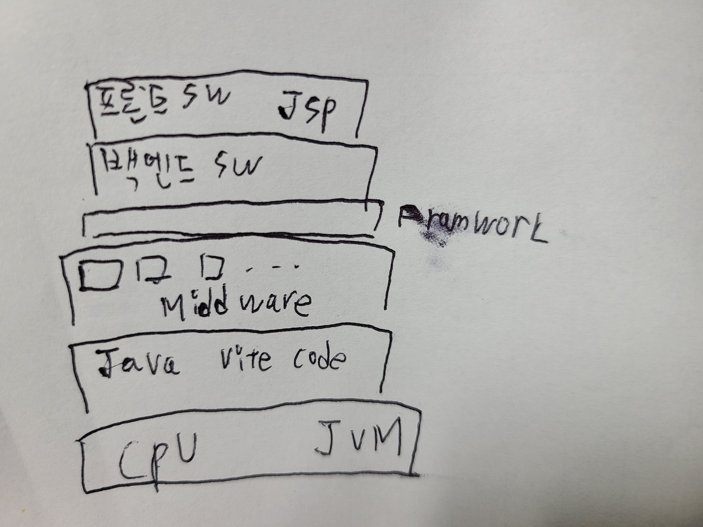

**해당 기술의 Stack을 쌓는 것도 중요하지만**

**웹의 전체적인 동작 방식을 이해하는 것이 중요하다.**

**컴퓨터 공학에 관한 내용을 공부하거나 짧게나마 정리하고 싶으면**

**아래 링크 널널한 개발자 유튜브를 추천한다.**

**(면접 볼 때 하도 많이 물어봐서 찾아봤지만 내용 정리가 않되었던 부분 중에 하나이다.)**

**참고**

**웹브라우저 동작 방식 TIL**

**<https://d2.naver.com/helloworld/59361>**

**널널한 개발자 유튜브**

**<https://youtu.be/4Sfned8HLzk>**


**📢 면접 예상 질문 : naver.com 검색 시 일어나는 동작, 웹 브라우저 랜더링 과정**

**📢 GET POST 요청 시 Client, Server, WAS, DB에서 무슨 동작이 일어나는지 알고 있다.**

**📢 CSS, JavaScript, DB, WAS, Front Framework, RestfulAPI가 왜 생겨났는지 알고 있다.**

### **✔️Summary**

1. **중요! (들어가기 전)**
2. **GET 요청 시 과정(READ)**
3. **웹 브라우저 랜더링 동작 원리(Client)**
4. **POST 요청 시 과정(WRITE**
5. **컴퓨터의 구조(USER)**

### **✔️중요 !(들어가기 전)**

**📢 3가지 내용을 바탕으로 공부하면 웹 흐름을 쉽게 파악할 수 있음**

**웹 서비스 특징**

- HTML과 HTTP 통신 방식을 기본으로 함
- TCP/IP 연결 가정하고 시작하면 HTTP 통신이 됨
- HTTP는 Stateless 함
- 연결과 상태는 같이

**문서를 다루는 프로그램 3가지 요소(따로 구성)**

- **자료구조**(HTML,비선형)
- **UI**(CSS)
- **제어**(JavaScript)

**클라이언트 웹 브라우저를 구성하는 3요소**

- 구문 분석하는 **Parser**
- 그래픽 **랜더링** 엔진
- 연산할 수 있는 **스프립트** 엔진

### **✔️GET 요청 시 과정 (READ)**

📢 **DNS(domain name server)** 사람이 이해하기 쉬운 도메인과 실제 주소를 가리키는 IP를 매핑해놓은 서버

**키워드**

- HTML, CSS, 사진 정적 파일 전송
- 초창기 웹 구성 시 사용(원격지 문서 뷰어)
- 단 방향 작용(Web Server → Client)

**동작 순서**

1. HTTP 통신 기반 TCP/IP 연결   
   (HTTP 통신이 연결될 때 Web Server HDD 에 저장된 HTML을 Client에게 전달 하도록 세팅)
2. 주소에 URL을 검색
3. DNS 서버에 URL을 전달하여 Web Server의 IP를 Client Server에게 알려줌
4. 받은 IP 정보로 http.request Get 요청을 보냄
5. 요청이 잘 왔으면 http.response 응답으로 Html + CSS + 사진 + JS을 전달함
6. 클라이언트는 받은 Html + CSS + JS 순으로 파싱(구문 분석)을 하고 비선형 자료구조로 DOM 을 생성함  
   (**웹 브라우저 구조 참고**)
7. 생성한 DOM을 화면에 랜더링함



### **✔️웹 브라우저 랜더링 동작 원리(WEB Client)**

**📢 주제와 벚어난 이야기여서 여기까지만 다루고 자세한 내용은 따로 TIL 작성하겠음**

**브라우저 구조**

- **User Interface** : 주소 표시줄, 이전/다음 버튼, 북마크 메뉴 등 제외한 웹페이지, 사용자와 상호작용함
- **Browser Engine** : User Interface 와 Rendering Engine을 연결함
- **Rendering Engine** : HTML, CSS를 파싱하여 요청한 웹페이지를 표시함
- **Networking** : 각종 네트워크 요청을 수행
- **Javscript Interpreter :** 자바스크립트 코드를 해석하고 실행. 크롬에서는 V8 엔진을 사용.
- **UI Backend** : 체크 박스나 버튼과 같은 기본적인 위젯을 그려줌
- **Data Persistence** : localStorage나 Cookie와 같은 보조 기억장치에 데이터를 저장함



**DOM 생성 과정(프론트 관점 웹 랜더링)**

> **아래 적은 순서대로 동작**

**HTML, CSS 파싱해서, DOM, CSSOM 트리 구축**

랜더링 엔진이 HTML, CSS 문서를 파싱함, 브라우저가 이해할 수 있는 DOM, CSSOM으로 생성

**Render 트리 구축**

DOM 과 CSSOM 을 결합해서 랜더 트리 만듬, meta나 display:none 속성은 랜더와 관계없기 때문에 포함되지 않음

**자바스크립트 파싱과 실행**

script 태그 실행하여 Javascript 파일 파싱하고 Javascript 엔진이 해석 후 AST 생성

AST 를 기반으로 인터프리터가 실행, 중간 코드인 바이트 코드를 생성해 실행

**레이아웃 작업 (트리 배치, 리플로우)**

브라우저 화면의 어느 위치에 어느 크기로 출력될지 계산하는 단계

비용이 발생하는 작업

**계산된 위치와 크기 등의 스타일을 실제 픽셀로 표현하는 작업 (Paint)**

리플로우가 발생한 레이아웃을 실제 화면에 그려주는 작업

텍스트, 색, 이미지 ,그림자 효과등이 모두 처리됨



**Reflow 최적화 방법**

**스타일을 변경할 경우 가장 하위 노드부터 변경**

버블링이나 캡쳐링 때문에 상위 or 하위 노드에 영향을 미칠 수 있음.

**인라인 스타일 ㄴㄴ**

파싱할 때 레이아웃에 영향을 받아서 리플로우가 추가로 발생함

**애니메이션이 있는 노드는 position : fixed or absolute로 지정**

애니메이션 효과는 많은 reflow가 발생함,   
이렇게 속성을 주면 전체 노드와 분리되어 해당 노드만 reflow가 발생할 수 있게 제한할 수 있음

**table 레이아웃을 피함**

각각 랜더링이 되지 않고 계산 작업이 수행 후 모든 태그가 로드되면 화면에 그려짐   
따라서 작은 변경만 일어나도 테이블 너비가 다시 계산되고 모든 노드들이 reflow가 됨

**CSS 하위 선택자를 최소화**

CSS 하위 선택자가 많아지면 CSSOM 트리의 깊이가 깊어지게 되고 렌더트리를 만드는 시간이 오래 걸림

```css
/* 잘못된 예 */
.reflow_box .reflow_list li .btn{
  display:block;
}
/* 올바른 예 */
.reflow_list .btn {
  display:block;
}
```

**DOM 사용을 최소화 함**

createDocumentFragment 를 사용하여 한 번에 DOM 을 추가하여 DOM 접근을 최소화 할 수 있음

**캐시 사용**

브라우저는 레이아웃 변경을 큐에 저장했다가 한 번에 실행하여 reflow를 최소화 함   
하지만 offset, scrollTop 과 같은 계산된 스타일 정보를 요청할 때마다 큐를 비우고 모든 변경 사항을 적용함

스타일 정보를 변수에 저장하고 직접적으로 값을 사용하는 것을 최소화 해야함

```nix
let top = el.offsetTop, left = el.offsetLeft, elStyle = el.style;
```

### **✔️POST 요청 시 과정 (WRITE)**

**키워드**

- 양방향 순작용( Client ↔ Web Server)
- 사용자의 입력에 따라 화면이 변화(동적)
- 처리 담당을 하는 WAS의 등장(WEB Server는 송수신만 처리 가능)
- 상태의 전이(변경)을 기억하는 DB의 등장(HTTP는 무상태)
- 상황에 따라 HTML을 동적으로 변경하는 JavaScript의 등장(GET 요청은 정적 파일 받음)
- WEB Sever에서 상태가 전이(변경) 되는 부분을 기억하는 Cookie의 등장(범위와 기간 중요)
- WAS에서 구성한 MVC 패턴 등장(MVC는 따로 TIL 작성)
- Web Service, WAS, DB 3가지를 가리켜서 3 tier Web Solution이라고 부름
- 성능 이슈 제어할 때 : DB 응답 시간, WAS에서 처리연산(Service), 네트워크 속도
- 성능 이슈 해결 방법 : DB 튜닝, 모니터링 하는 APM(Scouter, 제니퍼 솔루션)

**동작 순서**

1. HTTP 통신 기반 TCP/IP 연결 (HTTP 통신이 연결될 때 Web Server HDD 에 저장된 HTML을 Client에게 전달 하도록 세팅)
2. 클라이언트가 id, password를 입력하고 로그인 버튼 클릭
3. http.request POST 요청 id = tester 데이터 전달
4. WEB Server가 받자마자 WAS에게 넘김
5. WAS가 SQL문으로 DB한테 데이터 있는지 물어봄(Select~From~Where id=taster)
6. 찾은 데이터를 WAS에서 만든 HTML Form에 넣어서 새로운 HTML을 만듬(동적으로 생성됨)
7. 새로 만든 HTML을 WEB Server에게 전달
8. http.response 응답으로 Html + CSS + 사진 + JS을 전달함
9. 클라이언트는 받은 Html + CSS + JS 순으로 파싱(구문분석)하고 비선형 자료구조로 DOM 을 생성함
10. 상황에 따라 JS가 다른 DOM을 랜더링 해서 클라이언트한테 보여줌



### **✔️JSON 데이터 전달 시 과정**

📢 위에 GET, POST 요청과 과정은 동일하나 WEB Server에서 HTML이 아닌 JSON으로 데이터만 넘겨줍니다.

**키워드**

- WEB Client가 점점 발전하면서 UI가 다양해져서 JSON 데이터만 보내고 WEB Client 에서 만듬
- 다양한 UI를 컨트롤 하기 위해 Front Framework 등장(React, Vue)
- 요청이 주로 Create(생성) Read(읽기) Update(덮어or수정 쓰기) Delete(삭제) 이기 때문에   
  이것을 method로 만듬RestfulAPI 등장
- Internet과 WEB Server 사이에 보안 문제 IPS, SSL, WAF (차후에 공부)

**동작 순서**

- WEB Client RestfulAPI 요청(CRUD)
- WEB Server에서 JSON 데이터 전달
- DOM Tree 구성
- 받은 JSON 데이터로 WEB Client 데이터 삽입 후 리랜더링

### **✔️컴퓨터의 구조(UESER)**

📢 컴퓨터 구조는 3가지(HW, 커널, User) 로 구성된다

📢 HW부터 커널(OS)까지 플랫폼이라고 함

📢 강의에서 다룬 내용만 작성했고 나머지 부분은 컴퓨터 구조 TIL 작성하려고 함

**USER의 구성**

1. **JVM** : 소프트웨어에서 CPU를 자바로 구현
2. **Java vite code** : 사용자가 입력한 코드를 기계어로 해석하는 역할
3. **Middle ware** : 백엔드 소프트웨어가 동작할 수 있게 해주는 역할을 함, WAS가 있음
4. **Framework** : 사용자의 코드 실수 방지를 위해 미리 형식을 맞춤, Spring이 있음
5. **백엔드 소프트웨어**
6. **프론트 소프트웨어** : JSP가 있음




