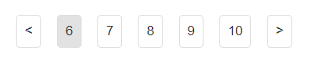

**Pagination은 게시판을 구현할 때 꼭 필요한 기능이고**  
**어떻게 동작하는지 정도는 알고 있어야 한다.**



**Github Repository**

<https://github.com/seong-ji-sue/react-project-board>


**📢 Typescript, React, React Hook로 코드를 작성했기 때문에 코드에 대한 전반적인 이해 필요**

**📢 게시물 구현 시 필요한 것 : Pagination, List Page, Create Page, Update Page**

**📢 이 TIL은 오직 Page를 구하는 방법과 동작 방식을 다루는 블로그임**

### **✔️Summary**

1. **페이지마다 해당하는 게시물 구하기**
2. **전체 페이지 개수 구하기**
3. **페이지 마다 표시할 페이지 구하기**
4. **< or > 표시 여부와 클릭 했을 때 눌러질 페이지**
5. **< or > 를 누를 때 이벤트**

### **✔️페이지마다 해당하는 게시물 구하기**

- **페이지 당 게시물 개수**: a
- **현재 페이지** : n
- **현재 페이지의 마지막 게시물 번호** : a \* n = lastPost
- **현재 페이지의 첫 번째 게시물 번호** : a \* (n-1) = firstPost
- **현재 페이지에 표시할 게시물** : posts.slice(firstPost, lastPost)

```javascript
const _postPerPage: number = 5;//1페이지에 게시물 몇개?

//컴포넌트
export default function NoticeBoard({postList}:NoticeBoardProps) {
	//현재 페이지 구하는 state
	const [currentPage, setCurrentPage] = useState<number>(1);

	//게시글의 첫번째 index와 마지막 index를 구하고 현재 페이지에 맞는 게시글 5개
	const indexOfLastPostNum = _postPerPage * currentPage;
	const indexOfFirstPostNum = _postPerPage * (currentPage - 1) ;
	const currentPosts: Post[] = postList.slice(indexOfFirstPostNum, indexOfLastPostNum);
```

### **✔️전체 페이지 개수 구하기**

- **페이지 당 게시물 개수** : a
- **전체 게시물 개수** : posts.length = totalPost
- **전체 페이지 개수** : Math.ceil(totalPost / a) = totalPage

```cpp
const totalPages = Math.ceil(totalPosts/postPerPage)//페이지 갯수
```

### **✔️페이지 마다 표시할 페이지 구하기**

**📢** Array.from 을 사용한 이유는 totalPage만큼 page가 n+1로 늘어나기 때문이다.

- **표시할 페이지 그룹** : g
- **페이지 그룹 당 페이지 개수** : n
- **전체 페이지 개수** : totalPage
- **페이지 배열** : Array.from({length: totalPage},(, i) ⇒ i + 1) = pages → [1, 2, 3, … n]
- **표시할 페이지 그룹에 첫 번째 페이지** : n \* g - 5 = startPage
- **표시할 페이지 그룹에 마지막 페이지** : n \* g - 1 = lastPage
- **표시할 페이지** : pages.slice( startPage, lastPage) = visiblePage

```php
/**
 * 페이지 네이션 만들기
 * @param paginate 클릭한 페이지 바꾸는 함수
 * @param totalPosts 총 게시글 수
 * @param postPerPage 5(표시해야될 페이지 수)
 * @param currentPage 현재 페이지
 * @constructor
 */
export default function Pagination({paginate,totalPosts,postPerPage,currentPage}:PaginationProps){
	const totalPages = Math.ceil(totalPosts/postPerPage)//페이지 갯수
	const [pageGroup, setPageGroup] = useState(1);//표시할 페이지 그룹

	//전체 페이지 얕은 복사 ex) totalPages 10 -> [1, 2, ..., 10]
	const pages = Array.from({length: totalPages}, (_, i) => i+1);

	const startPage = 5 * pageGroup - 5; //페이지 앞
	const endPage = 5 * pageGroup - 1; //페이지 끝
	const visiblePages = pages.slice(startPage, endPage + 1);//보여지는 페이지
```

### **✔️< or > 표시 여부와 클릭 했을 때 눌러질 페이지**

- **페이지 그룹 당 페이지 개수** : n
- **< 는 첫 페이지 그룹 때 표시 안함, > 는 마지막 페이지 그룹 때 표시 안함**   
  ex) 첫 페이지 그룹 —> (1, 2, 3, 4, 5 >)  
        마지막 페이지 그룹 —- > (< 11, 12, 13, 14, 15)
- **마지막 페이지 그룹** : Math.ceil(totalPages / n)
- **< 누를 때 눌러질 페이지** : n \* pageGroup - 5 = prevPage   
  ex) (6, 7, 8, 9, 10) → < 클릭 → prevPage : 5
- **> 누를 때 눌러질 페이지** : n \* pageGroup + 1 = nextPage   
  ex) (6, 7, 8, 9, 10) → > 클릭 → nextPage : 11

```javascript
//이전 버튼 레이아웃 이전 페이지 계산
const prevButton = () => {
    if(pageGroup === 1){
        return null;
    }
    const prevPage = 5 * pageGroup - 5;//눌러질 페이지
    return (
        <button onClick={() => handlePageClick(prevPage)}>
            {'<'}
        </button>
    )
}

//다음페이지 계산
const nextButton = () => {
    if(pageGroup === Math.ceil(totalPages/5)) {
        return null;
    }
    const nextPage = 5 * pageGroup + 1;//눌러질 페이지
    return (
        <button onClick={() => handlePageClick(nextPage)}>
            {'>'}
        </button>
    )
}
```

### **✔️< or > 를 누를 때 이벤트**

- **페이지 그룹 당 페이지 개수** : n
- **눌러질 페이지** : clickPage
- **현재 페이지 업뎃** : setCurrentPage(clickPage)
- **페이지 그룹 업뎃** : setPageGroup(Math.ceil(clickPage/n))

```javascript
//버튼 클릭시 페이지 번호를 담기 위함
const paginate = useCallback((pageNumber:number):void => {setCurrentPage(pageNumber)},[])

//버튼을 클릭할 때 보여지는 페이지 그룹과 선택되어지는 페이지 랜더링
const handlePageClick = (clickPage:number):void => {
    if(clickPage<=0 || clickPage>totalPages) {
        return;
    }
    paginate(clickPage)//현재 페이지 업뎃 함수
    const newPageGroup = Math.ceil(clickPage/5);//페이지 그룹
    setPageGroup(newPageGroup);//페이지 그룹 업뎃
}
```


