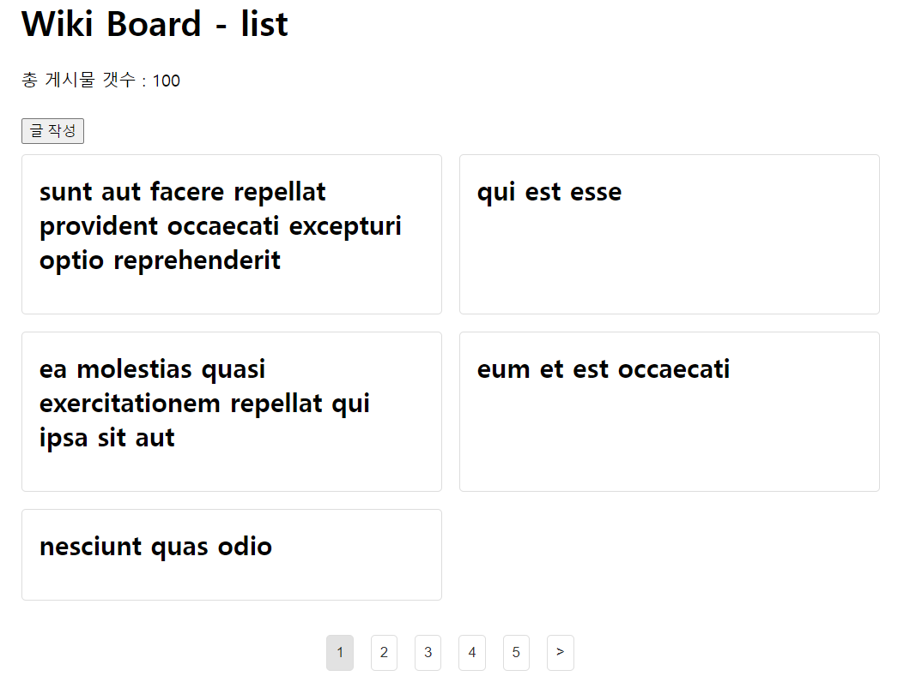
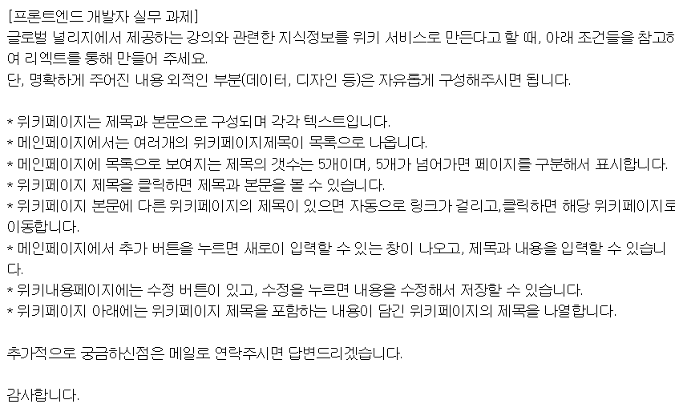

**프로젝트를 구현하면서 후기를 적어봤다.**

**API를 SpringBoot로 구현하려고 한다.**



**Context 사용 방법 참고**

<https://react.vlpt.us/using-typescript/04-ts-context.html>

<https://react.vlpt.us/mashup-todolist/02-manage-state.html>


**📢 CRUD와 React에 대한 이해 필요**

**📢 차후에 댓글 사용자에 따라 공계 비공계 설정 추가 예정**

### **✔️프로젝트를 진행한 이유**

- 이력서 지원한 회사에서 과제를 줌
- SI 업체에 취업을 하면 대부분 초반에 테이블 짜는거 많이 한다고 함
- 테이블 구현하는 것이 CRUD의 기본이라고 함
- 게시물을 다 보여줄 수 없기 때문에 pagination도 구현해야 함
- Javascript로 구현하면 타입 오류를 파악 불가능해서 Typescript 실습하기 위함
- React Hooks를 언제 사용하는지 파악하기 위함

### **✔️사용한 스택 및 기술**

Javascript, Typescript, React, React Hooks, React Router, webpack, babel

### **✔️미션 내용 요약**

- 실제 있는 Wiki 서비스 같은 게시판을 만들어야 함
- framework는 React 사용할 것
- 데이터나 디자인은 자유롭게 사용(레이아웃)
- Wiki 서비스의 데이터는 제목과 본문으로 구성되며 전부 텍스트
- 메인 페이지는Wiki 게시물 5개로 구성된 List 페이지
- pasination 구현하기
- 게시글을 클릭하면 detail 페이지로 이동하고 제목과 본문이 나옴
- 메인 페이지에서 추가 버튼을 누르면 글 작성 페이지가 나옴
- detail 페이지에서는 글 수정도 가능함



### **✔️Routing**

#### **페이지 구성**

- list page url : ‘/’
- detail page url : ‘detail/postNumber’
- create page url : ‘create/postNumber’
- update page url : ‘update/postNumber’

```javascript
<Switch>
    <Route exact path={'/'} render={()=><NoticeBoard />}/>
    <Route path={'/:page/:postId'} render={()=><BulletinBoard />} />
</Switch>
```

#### **페이지 라우팅 과정**

- 글 생성 : list page → create 버튼 클릭 → create page → 완료 버튼 클릭 → detail page
- 글 수정 : list page → 게시글 클릭 → detail page → 수정 버튼 클릭 → update page → 수정 완료 버튼 클릭 → detail page
- 리스트 이동 : detail page → 리스트 페이지로 이동 클릭 → list page

### **✔️깨닭은 것**

📢 **pasination 처리 TIL** : <https://zibu-story.tistory.com/205>

#### **리스트 데이터 요청 및 상태관리 Reducer**

처음에는 App.js(최상단 컴포넌트)에서 구현하고 props로 전달했는데 Context에서 전역으로 관리함

→ useReducer, useContext 사용

**props로 하다가 갈아탄 이유**

list → detail → create/update로 페이지가 4개나 되다 보니 게시글 데이터를 계속 props로 내려야 했음. 중간에 라우팅만 담당하는 컴포넌트도 그냥 데이터를 다음 자식한테 넘겨주는 역할만 하게 되서, 필드 하나 추가할 때마다 관계 없는 컴포넌트까지 다 손대야 되는 상황이 됨. 그래서 데이터를 쓰는 곳에서 바로 꺼내 쓰게 Context로 옮김.

Context를 사용하면 라이브러리 설치가 없지만 목적마다 Context를 만들어야 됨

그래서 Redux나 Recoil을 사용하지만 해당 프로젝트는 과제 하나짜리라 규모가 작아서 내장 훅을 사용했음. 라이브러리 설치하고 세팅할 시간에 그냥 useReducer + useContext로 짜는게 더 빠르다고 판단함

**App.js 관리**

```javascript
//App.js
const [postList, setPostList] = useState<post[]>([]) //게시글 데이터
//데이터 요청
useEffect(() =>{
	fetch('<https://jsonplaceholder.typicode.com/posts/>')
		.then((res) => res.json())
		.then((data) => setPostList(data))
},[])
//게시글 추가
const addPostList = (post:Post) => {
	setPostList([...postList,post])
}
//게시글 수정
const editPostList = (editPost:Post) => {
	setPostList(
		postList.map((post) =>
			post.id === editPost.id ? editPost : post
		)
	)
}
```

**Context 관리**

```groovy
import React, {useReducer, useContext, createContext, Dispatch, useEffect} from 'react';
import {Post} from "../type/post";

interface State {
	loading: boolean,
	data: any | null,
	error: any | null,
}
//action 타입
type Action =
	|{ type: 'FETCH_INIT' }
	| { type: 'FETCH_SUCCESS', payload: Post[] }
	| { type: 'FETCH_FAILURE', payload: any }
	| {type: 'ADD_POST', payload: Post}
	| {type: 'UPDATE_POST', payload: Post}
//dispatcher 타입
type PostDispatch = Dispatch<Action>

const PostStateContext = createContext<State | null>(null);
const PostDispatchContext = createContext<PostDispatch | null>(null);

function reducer(state:State, action:Action):State {
	switch (action.type) {
		case "FETCH_INIT":
			return {...state, loading: true}
		case 'FETCH_SUCCESS' :
			return {...state, loading:false, data: action.payload, error:null}
		case "FETCH_FAILURE":
			return {...state, loading:false, data: null, error:action.payload}
		case 'ADD_POST':
			return {...state, loading:false, data: state.data.concat(action.payload), error:null}
		case 'UPDATE_POST':
			const updateData = state.data.map((post:any) =>//userId가 포함됨
				post.id === action.payload.id ? action.payload : post)
			return {...state, loading:false, data: updateData, error:null}
		default:
			throw new Error('Unhandled action')
	}
}
```

```javascript
//컴포넌트 Provider
export function PostProvider({children}:{children:React.ReactNode}) {
	const [state, dispatch] = useReducer(reducer, {
		loading: false,
		data: null,
		error: null,
	});
	//데이터 요청
	useEffect(() =>{
		dispatch({type: 'FETCH_INIT'})
		fetch('https://jsonplaceholder.typicode.com/posts/')
			.then((res) => res.json())
			.then((data) => {dispatch({ type: 'FETCH_SUCCESS', payload: data });})
			.catch((error) =>{dispatch({ type: 'FETCH_FAILURE', payload: error });})
	},[])
	//로딩체크
	if(state.loading || !state.data) {
		return <div>Loading....</div>
	}
	//Error 체크
	if(state.error) {
		return <div>Error: {state.error.message}</div>
	}

	return (
		<PostStateContext.Provider value={state}>
			<PostDispatchContext.Provider value={dispatch}>
				{children}
			</PostDispatchContext.Provider>
		</PostStateContext.Provider>
	)
}

export function usePostState() {
	const state = useContext(PostStateContext);
	if (!state) throw new Error('Cannot find PostStateContext');
	return state;
}

export function usePostDispatch() {
	const dispatch = useContext(PostDispatchContext);
	if (!dispatch) throw new Error('Cannot find PostDispatchContext');
	return dispatch;
}
```

**사용**

```pf
const state = usePostState();//state 가져오기
const dispatch = usePostDispatch();//state 변경
dispatch({type:'ADD_POST', payload: newPost})
```

#### **페이지 타입을 관리하는 enum 과 이동하는 hook 만들기**

페이지 같은 경우에는 지정 되어있는 경우가 많기 때문에 enum 같은 타입으로 두면 좋고

각 컴포넌트마다 useHistory를 사용하여 페이지 이동을 할 수 없기 때문에 hook을 따로 만들었다.

**enum**

```routeros
export enum Page {
	list='list',
	detail='detail',
	create='create',
	update='update'
}
```

**usePageNavigation**

```typescript
import {Page} from "../type/page";
import {useHistory} from "react-router";

const pageUrl = (page:Page, postId?:number) =>{
	switch (page) {
		case Page.create:
			return `/${page}/${postId}`;
		case Page.detail:
			return `/${page}/${postId}`;
		case Page.update:
			return `/${page}/${postId}`;
		case Page.list:
			return '/';
	}
}

export function usePageNavigation() {
	const history = useHistory()
	const navigateTo = (page:Page,postId?:number) => {
		history.push(pageUrl(page, postId))
	};
	return {navigateTo}
}
```

**사용**

```reasonml
const {navigateTo} = usePageNavigation(); //선언
navigateTo(Page.detail, newPost.id) //페이지 이동 함수 사용
```

#### **함수나 변수 캐싱, 상수는 useRef 로 관리**

**📢 참고** : <https://zibu-story.tistory.com/203>

useState만 사용하면 state가 변경될 때마다 화면이 랜더링 되고 컴포넌트 자체가 함수이기 때문에 호출 시(랜더링 시) 함수와 변수가 재 할당 된다. 이 부분을 해결하기 위해 React는 useRef나 useCallback, useMemo 등을 제공해준다. 그리고 useEffect 훅은 요청 로직을 제외하고는 가급적 사용하지 않는 것이 좋다.

```typescript
//페이지 그룹 ex)1, 2, 3, 4, 5 -> 1그룹
const pageGroup = useRef<number>(1)
//props로 넘기는 페이지 변경 함수
const paginate = useCallback((pageNumber:number):void => {setCurrentPage(pageNumber)},[])
```

### **✔️ 느낀 점**

혼자 처음부터 끝까지 CRUD를 짜보니까 팀 프로젝트할 때는 몰랐던 부분들이 많이 보임. 특히 상태 관리를 어디서 할지 미리 안 정하고 시작하면 나중에 갈아엎어야 된다는 걸 직접 겪음(App.js props → Context로 갈아탄 것). 다음에 비슷한 규모 프로젝트하면 처음부터 전역 상태를 어디까지 쓸지 정하고 시작할 것 같음.


