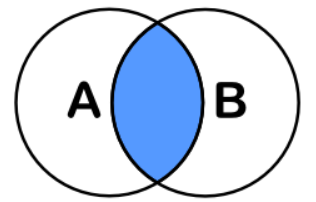
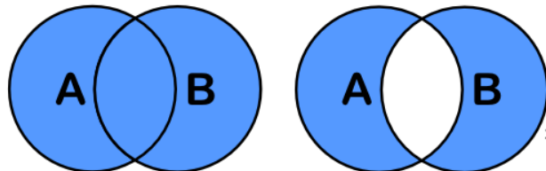
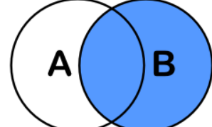
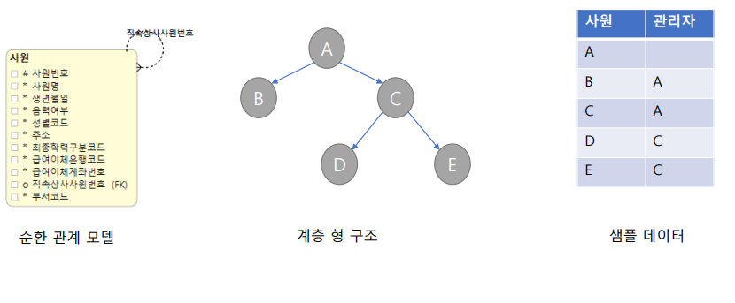
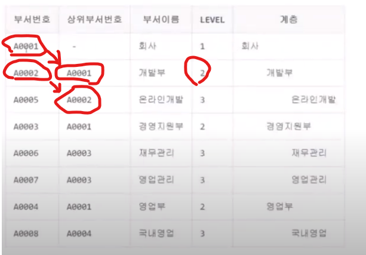
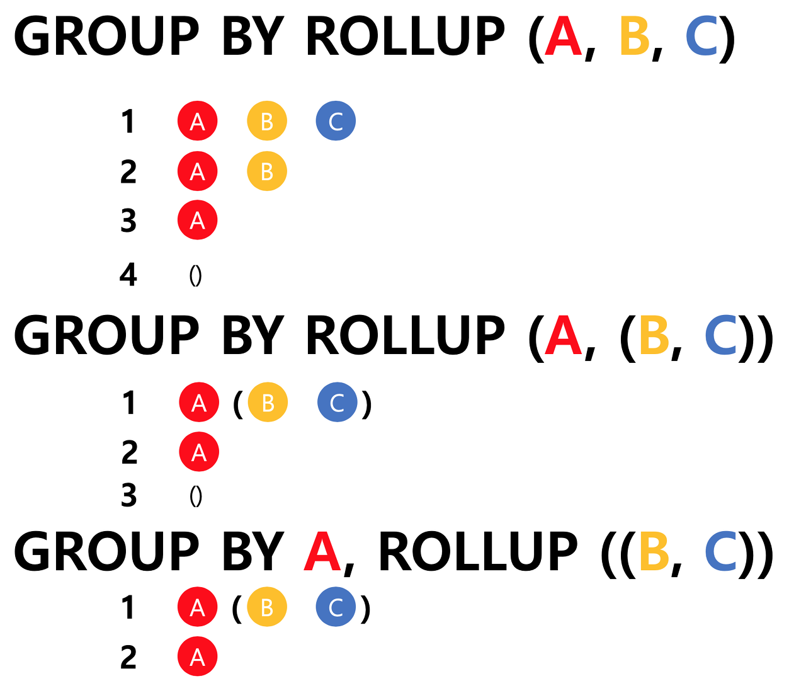
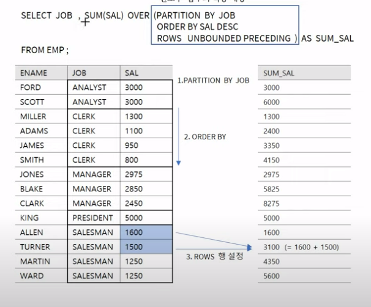
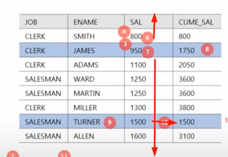

**SQL 개발자 자격증을 공부하면서 이 부분에 대한 이해가 필요하다.**

**잘 이해가 안된다면 아래 링크를 참고 부탁한다.**

**참고한 곳**

<https://www.youtube.com/watch?v=JxyMJNX24LY>


**📢 테이블 간의 Join에대해 설명하고 관계를 정의할 수 있다.**

**📢 윈도우 그룹 계층 함수를 통해 SQL을 다룰 수 있다.**

### **✔️Summary**

1. **집합 연산자**
2. **조건절**
3. **JOIN 종류**
4. **계층 구조(LEVEL) 쿼리**
5. **그룹함수**
6. **윈도우 함수**
7. **서브 쿼리**

### **✔️ 집합 연산자**

#### **UNION, UNION ALL**

여러 개의 SQL의 결과에 대한 합집합

UNION은 중복된 행은 한 개의 행만 출력(정렬됨)

UNION ALL은 중복된 행 그대로 출력(성능 더 좋음)

```n1ql
SELECT 조회할컬럼
FROM A
UNION (ALL)
SELECT 조회할컬럼 
FROM B
```

#### **INTERSECT**

교집합이고 중복된 행은 하나로 표시

실무에서 자주 쓰지 않음

```n1ql
SELECT 조회할컬럼
FROM A
INTERSECT
SELECT 조회할컬럼 
FROM B

SELECT 조회할컬럼
FROM A
WHERE EXISTS
(SELECT 조회할컬럼
FROM A);
```

#### **EXCEPT(MINUS)**

빼고 남은 행

중복되는 행 제거

```n1ql
SELECT 조회할컬럼
FROM A
MINUS
SELECT 조회할컬럼 
FROM B
```

#### **DIFFERENCE 연산**

- 차집합으로 공통되는 부분을 제외한다.
- 대다수는 EXCEPT를 Oracle은 MINUS를 사용

#### **PRODUCT 연산**

- 곱집합으로 JOIN 조건이 없는 경우 생길 수 있는 모든 데이터의 조합
- CROSS JOIN 기능으로 구현
- M \* N 건의 데이터 조합이 나옴

### **✔️ 조건절**

#### **USING 조건절**

- FROM 절에 USING 절을 이용하면 같은 이름을 가진 칼럼 중에서 원하는 칼럼만 선택적으로 교집합 조인을 할 수 있음
- ALIAS를 쓸 수 없음

```sql
SELECT 
a.emp_no,
a.emp_nm,
a.addr,
dept_cd,
b.dept_nm
FROM sqld.tb_emp a 
JOIN sqld.tb_dept b USING (dept_cd)
WHERE a.addr LIKE '%수원%'
ORDER BY a.emp_no;
```

#### **ON 조건절**

- ON 조건절에 JOIN 조건을 기제 가능
- 칼럼 명이 다르더라도 JOIN 조건을 사용할 수 있는 장점
- ALIAS를 반드시 사용해야 함

```mipsasm
SELECT 
a.emp_no,
a.emp_nm,
a.addr,
b.dept_cd,
b.dept_nm
FROM sqld.tb_emp a
JOIN sqld.tb_dept b
ON a.dept_cd = b.dept_cd
AND a.addr LIKE '%수원%'
ORDER BY a.emp_no;
```

### **✔️ JOIN 종류**

**📢 부모 테이블이 중심이 되고 그 기준으로 조인이 일어남 부모에 데이터가 있고 자식에 없으면**

**INNER JOIN은 데이터 안 보여줌 OUTER JOIN은 데이터 보여줌**

#### **Inner Join, Natural Join(내부 조인)**

```pgsql
SELECT 조회할 컬럼
FROM A, B
[WHERE 조건문]

SELECT *
FROM A
NATURAL JOIN B
```

- Inner는 Join 조건에서 동일한 값이 있는 행만 반환
- Natural은 두 테이블 간의 동일한 이름을 갖는 모든 칼럼들에 대해 Join 수행
- Natural은 ALIAS를 주면 안됨, 자동으로 조인함



#### **Full Outer Join(전체 외부 조인)**

```pgsql
SELECT 조회할 컬럼
FROM A 
FULL OUTER JOIN B
ON 조건문
[WHERE 추가조건문]
```

- MySQL에서는 FULL Outer Join이 존재하지 않기 때문에 Left 와 Right를 Union 해서 사용해야 한다.
- 공통되지 않는 행도 유지한다.



#### **Left Outer Join, Right Outer Join(외부 조인)**

```sql
--LEFT
SELECT 조회할 컬럼
FROM A, B
[WHERE 추가조건문]
AND A칼럼 = B칼럼(+)

SELECT 조회할 컬럼
FROM A 
LEFT OUTER JOIN B
ON 조건문
[WHERE 추가조건문]

--RIGHT
SELECT 조회할 컬럼
FROM A
RIGHT OUTER JOIN B
ON 조건문
[WHERE 추가조건문]

SELECT 조회할 컬럼
FROM A, B
[WHERE 추가조건문]
AND A칼럼(+) = B칼럼
```

- MySQL에서는 FULL Outer Join이 존재하지 않기 때문에 Left 와 Right를 Union 해서 사용해야 한다.
- 공통되지 않는 행도 유지한다.



### **✔️ 계층 구조(LEVEL) 쿼리**

**📢 순환 관계 모델 : 하나의 엔터티 내에서 계층 형식으로 존재하는 것**

**📢 오라클만 지원한다.**

#### **정의**

계층 형 데이터가 존재하는 경우 조회하기 위해 계층 형 질의를 사용

계층적으로 상위와 하위 데이터가 포함된 데이터

- LEVEL : 각 계층 표시
- NODE : 각 데이터
- ROOT : 가장 첫 번째 노드
- Leaf : 가장 아래 노드



#### **구문**

```sql
SELECT 컬럼리스트
 FROM 테이블
 WHERE (조건)
 START WITH (시작위치조건)
 CONNECT BY <NOCYCLE> PRIOR 하위코드 = 상위코드
 ORDER SIBLINGS BY (정렬기준)
```

**START WITH 조건**

- 어떤 행을 최상위 위치(LEVEL1, 루트)로 정할지 결정
- 서브 쿼리 사용 가능

**CONNECT BY PRIOR A AND B**

- 다음 전개될 자식 데이터 지정
- 서브쿼리 사용 불가
- 실제로는 부모에서 자식이 역방향임 하지만 책은 순방향이라고 함
- 부모 칼럼 LEVEL 상위, 자식 칼럼 LEVEL 하위

```pgsql
CONNECT BY PRIOR 자식칼럼 = 부모칼럼 --부모에서 자식(순방향)
CONNECT BY 자식칼럼 = PRIOR 부모칼럼 --자식에서 부모(역방향)
CONNECT BY PRIOR 부모칼럼 = 자식칼럼 --자식에서 부모(역방향)
CONNECT BY 부모칼럼 = PRIOR 자식칼럼 --부모에서 자식(순방향)
```

**ORDER SIBLINGS BY 컬럼**

- 형제 노드(동일 LEVEL) 사이에서 정렬을 수행

**NOCYCLE**

- 계층 구조를 돌 다 보면 무한 사이클이 될 수 도 있는 부분을 한번만 돌게 함

#### **키워드(SELECT 뒤에 씀)**

- **CONNECT\_BY\_ROOT** : 계층구조에서 가장 최상위 값을 표시
- **CONNECT\_BY\_ISLEAF** : 계층구조에서 가장 최하위를 표시, 해당 데이터가 리프 데이터 이면 1 그렇지 않으면 0
- **SYS\_CONNECT\_BY\_PATH** : 계층 구조의 전체 전개 경로를 표시
- **CONNECT\_BY\_ISCYCLE** : 가상 칼럼, 해당 노드 1 아니면 0
- **LEVEL :** 가상 칼럼, 루트면 1 그 아래 2
- **LPAD(' ', 4(LEVEL-1))\*** : 왼쪽기준으로 지정된 문자, 공백을 채운다는 의미입니다
- **NTILE** : 행 데이터를 그룹별로 나누어 차례대로 행 번호를 부여하는 분석 함수

#### **예시**

상위부서번호가 NULL인 행(회사)가 START WITH 속성으로 LEVEL 1이 되었고 A0001(LEVEL1)   
인 행과 같은 값(상위부서번호)인 개발부, 경영지원부, 영업부가 LEVEL 3이 된다.

```sql
SELECT 
부서번호, 상위부서번호, 부서이름, level, 
LPAD(' ', 5*(LEVEL-1)) || 부서이름 AS 계층
FROM dept
START WITH 상위 부서번호 IS NULL
CONNECT BY PRIOR 부서번호 = 상위부서번호;
```



### **✔️ 그룹함수**

**📢 GROUP BY 는 그룹 합계, 아래 함수를 붙이면 소그룹 집계**  
**📢그룹함수를 이용하여 특정 집합의 소계 중계 합계 구할 수 있다.**

**📢 SELECT GROUPING(A) : A에 대해서 그룹핑이 일어났는지 체크 일어나면 1 아니면 0**

#### **ROLLUP**

해당 칼럼에 대한 소그룹으로 집계를 계산해줌, 내가 보고 싶은 소그룹 집계는 볼 수 없음

```routeros
--전체 합계, 칼럼 A 조회
GROUP BY ROLLUP(A)
--전체 합계, 칼럼 A 조회, 칼럼 A, B 조합해서 조회
GROUP BY ROLLUP(A,B)
--전체 합계, 칼럼 A 조회, 칼럼 A와 B 조합해서 조회, 칼럼 A와 B와 C 조합해서 조회, 
GROUP BY ROLLUP(A,B,C)
-- A 별로 그룹핑 -> 전체 합계, 칼럼 B 조합해서 조회
GROUP BY A ROLLUP(B)
```

#### **CUBE**

가능한 모든 조합의 소계를 생성, 시스템에 무리 갈 수 있음, 너무 많음

```routeros
--전체 합계, 칼럼 A 조회
GROUP BY CUBE(A)
--전체 합계, 칼럼 A 조회, 칼럼 B 조회, 칼럼 A, B 조합해서 조회
GROUP BY CUBE(A,B)
```

#### **GROUPING SETS**

내가 보고 싶은 칼럽의 소그룹 집계만 보여줌

```routeros
--칼럼 A 조회
GROUP BY GROUPING SETS(A)
--칼럼 A 조회, 칼럼 B 조회
GROUP BY GROUPING SETS(A,B)
```



### **✔️ 윈도우 함수**

#### **정의**

테이블 중에서 특정 칼럼에 대해서 특정 행들을 연산하는 것

다른 함수들처럼 중첩해서 사용할 수는 없지만 서브쿼리에서는 사용 가능하다

테이블 스캔 횟수 감소

#### **함수 생김새**

```sql
SELECT WINDOW 함수() 
OVER([PARTITION BY 컬럼] [ORDER BY 컬럼] [ROWS OR RANGE])
FROM 테이블명;
```

- WINDOW : 특정 칼럼에게 윈도우 함수를 쓴다.
- PARTITION BY(행 분할) : 행을 기준으로 나눔
- ORDER BY 절(행 정렬 : 정렬 기준
- ROWS OR RANGE (대상 행 지정): 범위, ROWS는 행, RANGE는 값



#### **대상 행 지정 함수**

- UNBOUNDED PRECEDING : 맨 위에 행부터 지금까지 연산
- PRECEDING : 이전 행부터 지금까지 연산
- CURRENT ROW : 현재 행
- FOLLOWING : 바로 다음 행까지 연산
- UNBOUNDED FOLLOWING : 맨 아래까지 연산

```pgsql
--현재 칼럼의 값을 기준으로 작은 값들을 모두 선택
RANGE UNBOUNDED PRECEDING
--현재 칼럼의 값을 기준으로 150 이하로 차이나는 행
RANGE 150 PRECEDING
```

#### **순위 함수**

- RANK : 동등한 순위 있으면 다음 순번을 건너뜀
- DENSE\_RANK : 동등한 순위가 있어도 다음 순번을 매김
- ROW\_NUMBER : 동등한 순위가 있으면 먼저 나온 행을 순위로 부여함, 동등 순위 없음
- PERCENT\_RANK : 제일 먼저 나오는 것을 0, 제일 늦게 나오는 것을 1로 해서 각 칼럼의 백분율 부함, 같은 값인 행이 나오면 하나의 백분율로 구함
- CUME\_DIST: 각 행 갯수에 맞게 백분율을 구함, 같은 값인 행이 나오면 합한 백분율이 나옴
- NTILE(N) : 전체 테이블을 N 등분하여 각각에 맞는 타일 번호를 부여함
- RATIO\_TO\_REPORT : 현재 행의 값 / 전체 값
- RANL : 특정항목 및 파티션에 대해서 순위를 계산, 동일한 순위는 동일한 값이 부여
- FIRST\_VALUE : 처음에 나온 행만 가져온다.(MIN 함수와 동일)
- LAST\_VALUE : 마지막에 나온 행만 가져온다.(MAX 함수와 동일)
- LAGE : 이전 값을 반환
- LEAD : 다음 값을 반환

#### **예시**

SAL의 합계를 구하는 칼럼인데 SAL칼럼을 오름차순 정렬하고 계산하려는 현재 칼럼과 이전 칼럼의 차이가   
150이하이면 이전 행들과 현재 행을 모두 더함.

```sql
SELECT JOB, ENAME, SAL, SUM(SAL) OVER(ORDER BY SAL RANGE 150 PRECEDING) AS CUME_SAL
FROM EMP
WHERE JOB='CLEAR' OR JOB='SALESMAN';
```



### **✔️ 서브 쿼리**

#### **정의**

하나의 SQL문 안에 또 다른 SQL문이 있는 것

메인은 서브쿼리 칼럼을 사용하지 못함

ORDER절에는 사용 못함

#### **가능한 위치**

- SELECT 절
- FROM 절
- WHERE 절
- HAVING 절
- INSERT문의 VALUES 절
- UPDATE문의 SET 절

#### **다중행 서브 쿼리 연산자**

**ANY**

메인 쿼리의 비교조건이 서브 쿼리의 결과중 하나 이상 동일하면 참

서브쿼리를 출력한 후 메인쿼리에 같은 칼럼이 1개이상 있으면 출력

**IN**

메인 쿼리의 비교 조건이 서브 쿼리의 결과 중 하나만 동일하면 참

서브쿼리를 출력한 후 메인쿼리에 같은 칼럼이 1개라도 있으면 출력

**ALL**

메인 쿼리와 서브 쿼리가 모두 동일하면 참

```angelscript
--DNPTNO 가 20 30 보다 작은 것 즉 30보다 작은것
SELECT * FROM EMP
WHERE DEPTNO <= ALL (20, 30)
```

**EXISTS**

메인 쿼리와 서브 쿼리의 결과가 하나라도 존재하면 참

#### **서브 쿼리 종류**

**Correlated Subquery 상호 연관 쿼리**

메인쿼리 값을 서브쿼리 사용, 서브 쿼리의 값을 받아 메인쿼리 계산

```n1ql
Select * From A Where ?? = (Select~~)
```

**스칼라 서브 쿼리(단일)**

```n1ql
Select (Select~) From A
```

**인라인 서브 쿼리(동적뷰)**

```n1ql
Select * From (Select ~ )
```


