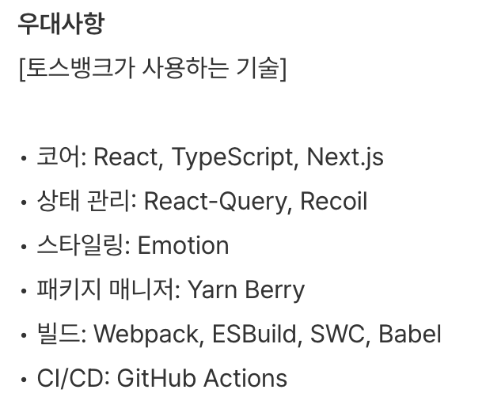

*원티드 캡쳐*

**요즘 javascript 취업시장에 typescript는 필수가 되었다.**

**이는 런타임에서 버그를 예방하기 위함이다.**

**하지만 제대로 인지를 못하고 사용하면**

**쓰는 이만 못하기 때문에 꼭 제대로 알고 있자!**

**(타입 종류, interface type 차이)**

**(이 내용은 필자의 생각이며 잘 못 된 부분이나 개인적인 의견이**

**있다면 자유롭게 댓글 달아줘)**

### **✔️ Summary**

1. **기본상식**
2. **타입종류(무조건 이해)**
3. **type과 interface**
4. **class 사용 예시**
5. **몰랐던 것**

### **✔️ 기본 개념**

#### **트랜스 파일 VS 컴파일**

트랜스파일 : 코드가 비슷한 언어로 바꾸는 것 (TS → JS)

컴파일 : c언어를 기계어로 바꾸는 것, 다른 추상화 언어(.java → .class)

#### **TS를 쓰는 이유**

- 타입 에러 사전 방지(트랜스파일에서 잡음)
- 자바스크립트는 문자와 숫자 연산 자동으로 변환하기 때문에 에러를 잡기 힘듬
- 최신 자바스크립트 문법도 지원
- TS 는 정적 타이핑, JS는 동적 타이핑

#### **구조적 타입, 명목적 타입**

자바는 객체의 네임스페이스를 비교하고 자바스크립트는 객체의 구조를 비교함

```angelscript
//JAVA
class A {
	String name
}
class B {
	String name
}

A a = new B(); //ERROR

//JS
class A {
	name:string

}
class B {
	name:string;
}

A a = new B();
```

#### **TS Config 속성**

**Modules, Emit**

```1c
"compilerOptions": {
	"watch" : //바뀔 때마다 자동 컴파일
	"target": "es2016", //해당 버전으로 컴파일
	"outDir": "./",//컴파일 된 js 파일을 저장
	"lib": []//해당 버전으로 인식함
}
```

**type Checking**

```1c
"compilerOptions": {
	"onEmitOnError" :, //에러가 있을 때 컴파일 안 됨
	"noImplicitAny":,//암묵적으로 any 타입을 가지는 것을 허락하지 않습니다.
	"strictNullChecks":,//null, undefined 타입에 이상한 조작하면 에러를 띄우는 설정
	"strictFunctionTypes":,//함수 매개변수가 더 정확하게 확인
	"strictPropertyInitialization":,//클래스 속성이 선언되었지만 생성자에 설정되지 않은 경우 오류를 발생
	"noImplicitReturns":,//함수의 모든 코드 경로를 확인하여 값을 반환하는지 확인
}
```

#### **TS 배포할 때 주의**

1. TS 파일을 JS 파일로 트랜스파일
2. webpack rollup을 사용해서 main.js 파일로 번들링
3. <script>로 단일 main.js 파일 Run(JS엔진)

#### **d.ts파일**

타입을 정의하기 위한 모듈,

Library 는 JS 환경에서 동작하는 것을 생각하고 TS 프로젝트에서도 실행하기 위해 타입을 정의함,

tsconfig에서 declaration true로 넣으면 JS로 트랜스 파일할 때 .d.ts 파일도 생성됨,

declare 옵션을 붙이면 JS 파일로 트랜치파일 안되고 TS 컴파일러에게 정보만 제공함

```fsharp
// 예시
//node_modules/@types/react/index.d.ts
declare namespace React {
    //
    // React Elements
    // ----------------------------------------------------------------------

    type ElementType<P = any> =
```

### **✔️ 타입 종류 (많이 헷깔림)**

#### **any**

모든 타입을 허용하는 타입, 반대로 모든 타입에 할당 가능, 사이드 이팩트, 사용 안하는 것을 추천

```nix
let a :any = 123
let str:string = a;
a = '123'
```

#### **unkown**

아직 타입이 지정되지 않는 상태, 어떤 값이든 할당은 가능하나 다른 타입 변수에 대입할 때는 타입을 지정해야 함, 사용 권장, 타입을 계속 체크 해줘야 함

```typescript
let a :unknown = 123
let str:string = a; //ERROR
let b:number = a-1;//ERROR
let c:number = a as number //타입을 지정해서 넣어줘야 함

함수 (a:unknown) {
	if(typeof a === number) {
		a +1
}
```

#### **never**

예외가 발생하는 로직일 때, 무한루프, 특정 타입을 사용 못하게 할 때, 모든 타입의 하위, 타입 추론이 되지 않을 때 사용, 조건문에서 else 나올 때 Error 나오게 가능

```typescript
//Error 발생
function ErrorMs(a:string):never {
    throw new Error(a);
}

console.log(ErrorMs('asdasd'))

//무한루프
function Loops():never {
    while (true) { }
}

console.log(Loops())

//특정 타입 제외
type NonString<T> = T extends string ? never : T;

const c: NonString<string> = '1' //Error.
```

#### **void**

반환 값이 존재하면 안될 때, 어떠한 값이 와도 상관 없지만 사용하지 않을 때

(사용하는 경우가 있는데 좀 더 찾아보기)

```actionscript
function ErrorMs(a:string):void {
    console.log(a)
}

//js는 기본적으로 undefinded임
function func(): void {
  return; // 성공
}
function func2(): void {
  return undefined; // 성공
}
```

### **✔️ type, interface (코드 다시 봐라!)**

#### **type 과 interface 차이점**

1. type : 트랜스 포함 안됨, 모든 타입에 가능, 확장 불가능
2. interface : 트랜스에 포함, 합집합 교집합 안됨, 객체 타입에만 가능, extend 로 확장

→ 단순히 한 곳에서 쓸껀지 다양한 곳에서 재활용해서 사용할껀지 파악(type이 더 가벼움)

```angelscript
//function
type FType = (a:string) => void;
interface FInter {(a:string):void}

//array
type AType = string[]
interface AInter{[index:number]:string}

//intersection
interface ErrorHandle {
    success:boolean;
    error?:{message:string};
}
interface ErrorData {
    data?: object
}
type TResponseType = ErrorHandle & ErrorData;
interface TResponseInter extends ErrorHandle, ErrorData{}

//union(interface 는 불가)
interface Bird{
    fly():void
}
interface Dog{
    talk():void
}
type AnimalType = Bird | Dog;

//Merge(type은 불가)
interface Ainter {
    a:string
}
interface Ainter {
    b:string
}
interface Ainter {
    a:string
		b:string
}

//오버로딩
//정의
함수(a:number)
함수(a:number |string)
//사용
함수(a:number|string){
	console.log(a)//number|string
}
```

#### **type 사용 시 주의**

문제 : 이름이 다른데 구조가 같으면 같은 타입으로 인식하는 문제

해결방안 : 독단적인 PersonId1 타입을 만들면 됨

unique symbol 고유한 속성을 부여하기 위해 사용

```cs
type PersonId1 = string & {readonly brand(ㅂ자유롭게): unique symbol}
const person1: PersonId1 = 'js'//error
```

#### **타입 가드 typeof, instanceof**

특정 타입이나 객체가 올 때 경우로 나눌 수 있음, 경우에 따라 로직을 실행할 수 있음 애매한 것은 never로 지정

```javascript
class Student {
  name: string;
}
class School {
  location: string;
}

function testFunc(arg: Student | School) {
  if (arg instanceof Student) {
		console.log('학생')
  } else {
		console.log('학교')
  }
}
const student = new Student();
testFunc(student);
```

```scala
class MyError extends Error {}

function getMyError(value:number):number|MyError {
    if(value<0) return new MyError();
    else value
}

function main() {
    const num = getNumber(-10)
    if(num instanceof MyError){return}
    num
}
```

#### **서브타입 슈퍼타입**

함수의 매개변수 타입만 같거나 슈퍼타입인 경우 할당 가능

객체는 같거나 서브타입인 경우 할당 가능

```zephir
//object
let A: Array<{a:string, b:string}> = [{a:'1', b:'1'}]
let B: Array<{a:string|number, b:string}> = A

//function(Person> Develop>Stru
class Person {}//서브
class Develop extends Person {}
class StudentDevelop extends Develop{}//슈퍼

function fuc(f: (d:Develop) => Develop) {}

fuc(function dFuc(d:Develop):Develop{
    return new Develop();
})
fuc(function pFuc(d:Person):Develop{
    return new Develop();
})
fuc(function sFuc(d:StudentDevelop):Develop{//ERROR
    return new Develop();
})
```

### **✔️ Class 에서 사용시 주의!**

#### **주의**

생성자 안에서만 타입

```kotlin
class A {
    a:number;
    constructor(a:number){
        this.a = a
        this.init(a);//생성자 안에서만 할당가능
    }
    init(a:number){
        this.a = a
    }
}
```

#### **private protected public static 예시**

아래 코드의 잘 못 된 부분을 고칠 수 있어야 함

- 정답
- static은 class 범위에 있어서 맴버 변수보다 먼저 생성됨 그래서 three() 에 publicN, privateN 이 접근 못함, private는 클래스 안에서만 사용 가능하기 때문에 사용하려면 getter setter로 확장해야 함

```angelscript
class e {
    public publicN:number;
    private privateN:number;
    static staticN:number;

    constructor(publicN:number, privateN:number, staticN:number) {
        this.publicN = publicN;
        this.privateN = privateN;
        this.staticN = staticN;//ERROR

    public one() {//ERROR:이거는 왜나는지 모르겠음
        this.publicN = 1;
        this.privateN = 1;
        this.staticN = 1;//ERROR
    }

    private two() {
        this.publicN = 2;
        this.privateN = 2;
        this.staticN = 2;//ERROR
    }

    static three() {
        this.publicN = 3;//ERROR
        this.privateN = 3;//ERROR
        this.staticN = 3;
    }
}

const obj = new e(0,0,0);

console.log(obj)

obj.one;
obj.two;//ERROR
obj.three//ERROR
```

#### **타입스크립트에서 싱글톤 만들기**

여러개의 인스턴스를 사용하는 것이 아니라 다양한 하나의 인스턴스로 공유해서 쓰겠다는 말

```cs
class Singleton {
  private static instance: Singleton | null = null;
  private url:string;

  private constructor() {this.url = ''}

  public static getInstance(): Singleton {
    if (!Singleton.instance) {
      Singleton.instance = new Singleton();
    }
    return Singleton.instance;
  }

  public setUrl(url:string):void {
    this.url = url
  }

  public getUrl():void {
    console.log(this.url)
  }
}

// 사용 예시
const instance1 = Singleton.getInstance();
const instance2 = Singleton.getInstance();

console.log(instance1 === instance2); // true
instance1.setUrl('asd')
instance2.setUrl('ddd')

instance1.getUrl()//[LOG]: "ddd" 
instance2.getUrl()//[LOG]: "ddd"
```

### **✔️ 몰랐던 내용**

#### **객체 const 지정 방법**

```angelscript
//일반적 const
const obj = {
    a : 1,
    b : 2
}

obj = {a: 1, b: 2}; //ERROR

obj.a = 10 //정상동작

//읽기전용 
const objConst = {
    a : 1,
    b : 2
} as const

objConst.a = 1//ERROR

//개별 부여
interface read {
    readonly a:number;
    readonly b:number
}

const objReadonly: read = {
    a : 1 ,
    b : 2
}
```

#### **!: 사용할 때**

해당 변수에 값이 무조건 오니까 걱정 말라는 의미, ?: 는 해당 변수에 타입이 안올 수도 있다는 의미

```sas
let x!:number;
console.log(x + x)
```

### **✔️ 참고 링크**

<https://www.youtube.com/live/ViS8DLd6o-E?si=ETqGXVRUC07q_XxA>


