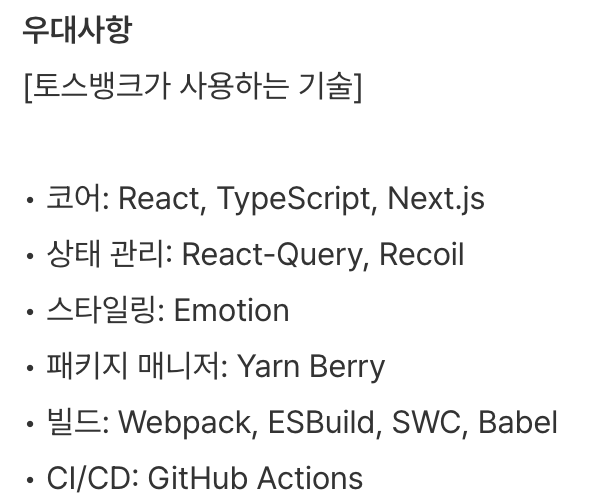

**요즘 javascript 취업시장에 typescript는 필수가 되었다.**

**이는 런타임에서 버그를 예방하기 위함이다.**

**하지만 제대로 인지를 못하고 사용하면**

**쓰는 이만 못하기 때문에 꼭 제대로 알고 있자!**

**(타입 종류, interface type 차이)**

**(이 내용은 필자의 생각이며 잘 못 된 부분이나 개인적인 의견이**

**있다면 자유롭게 댓글 달아줘)**

### **✔️ Summary**

1. Enum
2. extends, keyof, infer
3. Generic
4. 내장 Conditional type
5. 프로젝트에 도입하면 좋은 것

#### **헷깔리는 것**

1. as : 타입을 강제하는 것
2. infer : 타입을 추론하는 것
3. !: : null 또는 undefined가 아니라고 단언하는 것
4. in : 객체의 속성(프로퍼티)이 존재하는지 확인할 때 사용
5. is : 해당 타입이 맞는지 런타임 전에 체크 ex) value is number
6. instanceof : 객체가 특정 클래스 또는 생성자 함수의 인스턴스인지 확인할 때 사용

### **✔️ Enum ???**

#### **enum의 특징**

- 일정 수의 상수로 구분되는 집합, 기본값 0에서 시작
- 특정 수를 제한 하고 싶을 때 사용

#### **문자형, 숫자형 열거형 사용시 주의**

- 숫자형 표현식 값이 NaN 이거나 Infinity 이면 컴파일 시점에 오류
- 숫자형의 기본값은 0이고 할당을 안 해주면 자동으로 1, 2 …로 세팅
- 열거형 자체에서 프로퍼티로 모든 멤버에 접근하며, 열거형의 이름을 사용해 타입을 선언
- 문자형 열거형에서 각 멤버들은 문자열 리터럴 또는 다른 문자열 열거형의 멤버로 상수 초기화 해야 함
- 문자형은 값이 불안정한 경우 사용
- 같이 사용하는 경우(문자+숫자) 런타임에서 장점을 취하려는 것이 아니라면 이렇게 사용하지 않는것을 권장함

```crystal
enum DirectionString {
  MIDDLE,  // 0으로 할당
  UP = "up",
  DONW = "down",
  RIGHT = "right",
  CENTER, // error
  LEFT = "left",
  CENTER, // error
}
```

#### **enum을 왜 사용하지 말라고 하는지**

값 변경 못하고 추가도 못함

key value 바꿔서 사용가능(reverse mapping 가능)

enum은 객체에 비해 트랜스파일 될 때 코드량이 많음 (reverse mapping 때문)

```actionscript
//enum
enum WeekdaysEnum  {
  Monday = 1,
  Tusesday=2,
}
var Weekdays;
(function (Weekdays) {
    Weekdays[Weekdays["Monday"] = 1] = "Monday";
    Weekdays[Weekdays["Tusesday"] = 2] = "Tusesday";
})(Weekdays || (Weekdays = {}));

//객체
const WeekdaysConst = {
  Monday = 1,
  Tusesday=2,
} as const
```

### **✔️ extends, keyof, infer**

#### **typeof**

개체 유형을 사용하고 해당 키의 문자열 또는 숫자 리터럴 합집합을 생성

```rust
//'x' | 'y'
type Point = { x: number; y: number };
type P = keyof Point;

//'x' | 'y'
let Point = { x: 1, y: 2 };
type P = keyof typeof Point;

//number | string
let Point = { x: 1, y: 's' };
type P =  typeof Point[keyof typeof Point];
```

#### **extends**

T extends U 가 있을 때 T는 U에 포함되는 T ≤ U 로 생각하면 됨

```typescript
64 extends number//true
number extends 64//false
string[] extends any//true
string[] extends any[]//true
never extends any//true
any extends any//true
```

#### **infer**

잘 이해가 안 되어서 쉬운 예시를 GPT에게 물어봄

쉬운 예시 : 우리가 공장에서 상자를 생산하는 라인을 가정해봅시다. 이때, 상자에는 다양한 물건들을 담을 수 있습니다. 하지만 라인을 따라서 상자를 만들 때, 어떤 물건이 담길지 미리 알지 못합니다. 이때, 상자를 만들기 위해 사용되는 물건의 종류를 자동으로 판단하고 추론하는 장치가 있다면 유용할 것입니다. 여기서 'infer'는 이러한 장치와 비슷한 역할을 합니다.

```rust
type Box<T> = {
  item: T;
};

type Unbox<T> = T extends Box<infer U> ? U : never;

const stringBox: Box<string> = { item: "Hello, TypeScript!" };
const numberBox: Box<number> = { item: 42 };

type UnboxedString = Unbox<typeof stringBox>; // 'string'
type UnboxedNumber = Unbox<typeof numberBox>; // 'number'

const str: UnboxedString = "Hello, TypeScript!";
const num: UnboxedNumber = 42;
```

### **✔️ 제네릭 Generic**

#### **특징**

- 원하는 타입에 맞게 로직을 구성할 수도 있음
- 객체 인스턴스를 통합하고 싶을 때 사용함

#### **활용 예시**

**함수의 파라미터로 사용 예제**

```gradle
function getText<T>(text: T): T {
  return text;
}
getText<string>('hi');
getText<number>(10);
getText<boolean>(true);
```

**3항으로 조건문 처리**

```typescript
//예시 타입
type StringContainer = string | string[]
type NumberContainer = number | number[]

//기본 3항
type ItemType<T> = {
    id:T
    pw:T extends string ? StringContainer : NumberContainer
}
//never로 else 처리
type ItemTypeNever<T> = {
    id:T extends string | number ? T : never
    pw:T extends string ? StringContainer 
    : T extends number ? NumberContainer : never
}

const item : ItemType<string> = {
    id:'asdsasd',
    pw:['qwe','qweqwe']
}
```

**배열 filter**

```typescript
//array filter
type ArrayFilter<T> = T extends any[] ? T : never
type StringArray = ArrayFilter<string | string[]>//string[]
```

**객체 인스턴스 통합**

```scala
class Person{
  name:string;
}

class Employee extends Person{
  department:number;
}
//오류없음
class Animal{
  name:string;
}

const work:Array<Person> = [new Person(), new Employee(),new Animal()];

work.map((person) => {
  if(person instanceof Person) {
    return '사람'
  }
})
```

**interface 통합**

```typescript
//예시 타입
interface People { 
    id:string
    pw:string[]
}
interface Employee {
    id:number
    pw:number
}
//통합 인스턴스
interface World {
    getInfo<T extends string|number>(id:T):T extends string ? People : Employee
}

let world:World = null as any

const people = world.getInfo('123123')
const employee = world.getInfo(123123)
```

**배열 객체 Flatten**

```rust
//T  === [] -> number[] | number , T === {} -> key[] , else -> T 
type Flatten<T> = T extends any[] ? 
									T[number] : T extends object ? 
									T[keyof T] : T;

const numbers = [1, 2, 3]

//number[]?
type NumberArrayFlattened = Flatten<typeof numbers>

const obj = {
    name: 'qwe',
    age: 20
}

// name | age , T[name] | T[age] -> string | number
type ObjectFlattened = Flatten<typeof obj>

const bool = true
//true
type BoolFlatten = Flatten<typeof bool>
```

**함수 return 타입**

```typescript
type ReturnTypeOfFunction<T> = T extends (...args: any) => infer R ? R : any;

function add(a: number, b: number): number {
  return a + b;
}

function greet(name: string): string {
  return `Hello, ${name}!`;
}

type AddReturnType = ReturnTypeOfFunction<typeof add>;     // number
type GreetReturnType = ReturnTypeOfFunction<typeof greet>; // string
```

**Promise 객체 확인**

```typescript
type UnpackPromise<T> = T extends Promise<infer K>[] ? K : any;
const promise = [Promise.resolve("Mark"), Promise.resolve(38)]

type Expected = UnpackPromise<typeof promise>//string | number
```

### **✔️ **ReadonlyArray<T>, as const 차이점**

#### **ReadonlyArray<T>**

- 타입스크립트에서 제공하는 내장 타입으로, 배열의 모든 요소를 읽기 전용
- 배열을 선언할 때 타입 뒤에 []를 붙여서 사용
- 배열의 요소를 수정할 수 없게 만들어, 불변성을 강제하는 역할
- 배열에만 사용
- 배열의 모든 타입 추출, 각각은 안됨

```angelscript
const numbers: ReadonlyArray<number> = [1, 2, 3];
numbers[0] //readonly number[]
numbers.push(4); // error
numbers[0] = 10; // error
```

#### **as const**

- 타입스크립트에서 리터럴 타입(string, number)을 사용하는데 도움을 주는 문법
- 변수 또는 객체의 값 뒤에 as const를 붙여서 사용
- 해당 값을 수정할 수 없게 만들어 불변성을 강제하는 역할
- 변수나 객체의 값에 사용
- 각 요소의 타입 추출 가능

```actionscript
const person = {
  name: "John",
  age: 30,
} as const;

person.name = "Alice"; //error

const weekdays = ["Monday", "Tuesday", "Wednesday"] as const;
weekdays[0] //Monday
weekdays.push("Thursday"); //error
```

#### **DeepReadonly**

```dts
type DeepReadonly<T> = T extends (infer R)[] 
  ? ReadonlyArray<DeepReadonly<R>> 
  : T extends object 
  ? { readonly [K in keyof T]: DeepReadonly<T[K]> } 
  : T; 

const obj = {
  name: "John",
  age: 30,
  address: {
    city: "New York",
    postalCode: "10001",
  },
};

const arr = [{ name: "Alice" }, { name: "Bob" }];

const deepReadonlyObj: DeepReadonly<typeof obj> = obj;
const deepReadonlyArr: DeepReadonly<typeof arr> = arr;

deepReadonlyObj.name = "Jane";//error
deepReadonlyObj.address.city = "Los Angeles";//error
deepReadonlyArr.push({ name: "Charlie" });//error
```

### **✔️ **내장 Conditional type**

#### **Partial<User>**

제공된 타입의 모든 속성을 선택적으로 만드는 타입

즉, 모든 속성이 선택사항이 되어 해당 속성을 포함하지 않아도 되는 상

```routeros
interface User {
  name: string;
  age: number;
  email: string;
}

type PartialUser = Partial<User>;

const partialUser: PartialUser = {};
const partialUser2: PartialUser = { name: "John" };
```

#### **Required<User>**

제공된 타입의 모든 속성을 필수로 만드는 타입

모든 속성이 반드시 포함되어야 하는 상태가 됩

```routeros
interface User {
  name?: string;
  age?: number;
  email?: string;
}

type RequiredUser = Required<User>;

const requiredUser: RequiredUser = { 
	name: "Alice", 
	age: 30, 
	email: "alice@example.com" 
};
```

#### **Readonly<User>**

제공된 타입의 모든 속성을 읽기 전용으로 만드는 타입

한 번 값을 할당하면 수정할 수 없는 상태가 됩

```routeros
interface User {
  name: string;
  age: number;
}

type ReadonlyUser = Readonly<User>;

const user: ReadonlyUser = { name: "Bob", age: 25 };
user.name = "Alice";
```

#### **Record<K, T>**

주어진 키 타입(K)에 해당하는 모든 속성을 값 타입(T)으로 매핑하는 타입

```rust
type Weekday = "Monday" | "Tuesday" | "Wednesday" | "Thursday" | "Friday";

type WeekdaySchedule = Record<Weekday, string>;

const schedule: WeekdaySchedule = {
  Monday: "Work from home",
  Tuesday: "Meeting at 3 PM",
  Wednesday: "Gym at 6 PM",
	//..
};
```

#### **Pick<T, K>**

제공된 타입(T)에서 특정 키 타입(K)에 해당하는 속성만 선택하여 새로운 타입을 만드는 타입

```routeros
interface User {
  name: string;
  age: number;
  email: string;
  address: string;
}

type UserBasicInfo = Pick<User, "name" | "email">;

const userBasicInfo: UserBasicInfo = { 
	name: "John", 
	email: "john@example.com" 
};
```

#### **Omit<T, K>**

제공된 타입(T)에서 특정 키 타입(K)에 해당하는 속성을 제외하고 새로운 타입을 만드는 타입

```dts
interface User {
  name: string;
  age: number;
  email: string;
  address: string;
}

type UserWithoutAddress = Omit<User, "address">;//2개 제외시  |

const userWithoutAddress: UserWithoutAddress = {
  name: "Alice",
  age: 30,
  email: "alice@example.com",
};
```

#### **Exclude<T, K>**

제공된 타입(T)에서 특정 타입(K)에 해당하는 유니온 타입을 제외한 새로운 타입을 만드는 타입

```routeros
type NumberOrString = number | string;

type OnlyNumber = Exclude<NumberOrString, string>;

const num: OnlyNumber = 42;
```

#### **NonNullable<T>**

제공된 타입(T)에서 null 또는 undefined를 제거한 새로운 타입을 만드는 타입

```typescript
type NullableString = string | null | undefined;

type NonNullableString = NonNullable<NullableString>;

function printMessage(message: NonNullableString) {
  console.log(message);
}

printMessage("Hello, TypeScript!"); //Hello, TypeScript!
printMessage(null);//error
```

#### **Parameters<T>**

제공된 함수 타입(T)의 매개변수 타입들을 튜플로 가져오는 타입

```typescript
type AddFunc = (a: number, b: number) => number;

type AddFuncParams = Parameters<AddFunc>;

function add(a: number, b: number): number {
  return a + b;
}

const params: AddFuncParams = [10, 5];
const result = add(...params); // 15
```

#### **Constructor<T>**

클래스 타입(T)의 생성자 함수 타입을 가져오는 타입

```typescript
class Person {
  constructor(public name: string, public age: number) {}
}

type PersonConstructor = Constructor<Person>;

const personConstructor: PersonConstructor = Person;
const personInstance = new personConstructor("Alice", 30);
console.log(personInstance); // Person { name: 'Alice', age: 30 }
```

#### **InstanceType<T>**

제공된 클래스 타입(T)의 인스턴스 타입을 가져오는 타입

```typescript
class Car {
  constructor(public brand: string) {}
}

type CarInstance = InstanceType<typeof Car>;

const carInstance: CarInstance = new Car("Toyota");
console.log(carInstance); // Car { brand: 'Toyota' }
```

#### **ReadonlyArray<T>**

제공된 타입(T)의 모든 속성을 읽기 전용 배열로 만드는 타입

```qml
interface Todo {
  id: number;
  task: string;
}

type ReadonlyTodoArray = ReadonlyArray<Todo>;

const todos: ReadonlyTodoArray = [
	{ id: 1, task: "Buy groceries" }, 
	{ id: 2, task: "Clean the house" }
];

// 아래 코드는 오류 발생
todos.push({ id: 3, task: "Go for a walk" });
todos[0].task = "Buy fruits";
```

### **✔️ 참고 링크**

<https://www.youtube.com/live/ViS8DLd6o-E?si=ETqGXVRUC07q_XxA>


