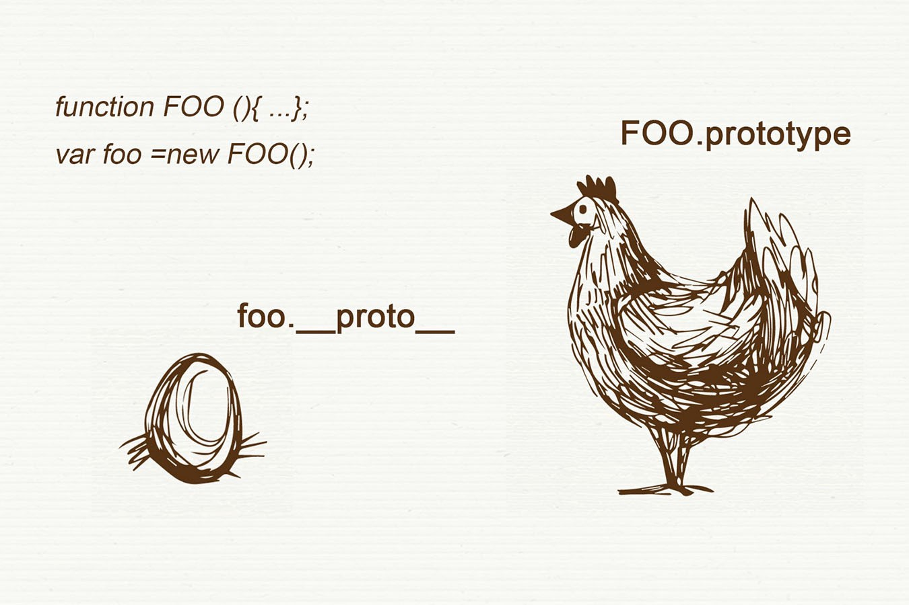

*https://velog.io/@adam2/%EC%9E%90%EB%B0%94%EC%8A%A4%ED%81%AC%EB%A6%BD%ED%8A%B8-Prototype-%EC%99%84%EB%B2%BD-%EC%A0%95%EB%A6%AC*

**자바스크립트를 사용하면 누구나 프로토타입를 들어봤을 것이고 유튜브에도 설명이 많다.**

**하지만 내부 로직을 이해하는 사람은 많지 않고 대략적인 면접 개념정도는 알 것 이다.**

**도대체 상속은 무엇이고 new로 객체를 생성시 어떻게 동작하는지 설명할 수 있을 것이다.**

**모르면 유튜브 찾아봐~!**

**(이 내용은 필자의 생각이며 잘 못 된 부분이나 개인적인 의견이**

**있다면 자유롭게 댓글 달아줘)**

### **✔️ **Summary**

1. **일급객체와 프로토타입 정의**
2. **프로토타입 객체 종류**
3. **프로토타입 객체 생성과 원리**
4. **프로토타입 체인**
5. **Prototype 교체**

### **✔️ **일급객체와 프로토타입 정의**

#### **자바스크립트는 일급 객체이다?(함수가 객체와 동일한 값으로 사용가능)**

**일급객체란?**

다른 객체들에 일반적으로 적용 가능한 연산을 모두 지원하는 객체를 가리킨다. 보통 함수에 인자로 넘기기, 수정하기, 변수에 대입하기와 같은 연산을 지원할 때 일급 객체

**조건**

객체는 호출이 안되지만 함수는 호출 가능

함수는 고유의 프로퍼티를 소유함

자바스크립트를 이루고 있는 것이 모든 것이 객체임(원시 타입 제외)

```javascript
//1. 런타임에도 함수 객체를 생성하고 할당함.
const increase = function(num) {
    return ++num
}

//2. 변수나 객체, 배열에 저장이 가능(함수를 변수에 저장, 함수를 객체에 저장)
const group = {increase}

//3. 함수를 반환 값으로 사용 가능
function makeCounter(group) {
    let num = 0;
    return function () {
        num = group(num);
        return num;
    }
}
//4. 함수를 매개변수로 전달 가능
const increaser = makeCounter(group.increase);
console.log(increaser())
console.log(increaser())
```

#### **프로토타입(prototype) 이란??**

원본 객체를 복사하여 새로운 객체를 만들고 상속되어 자식 객체의 프로퍼티처럼 사용할 수 있음

arguments, caller, length, name, prototype는 모두 함수 객체의 데이터 프로퍼티임

```reasonml
//함수의 프로퍼티 어트리뷰티 확인
//__proto__는 함수의 프로퍼티가 아님, Object.prototype 객체로부터 상속 받음
console.log(Object.getOwnPropertyDescriptors(함수))
```

### **✔️ **프로토타입 객체 종류**

#### **arguments**

> 유사 배열 객체란? key와 value로 이루어져 있는 배열, length도 가지고 있음

함수의 인자로 받은 정보를 담고 있는 순회 가능한 유사 배열 객체, 이터러블

함수의 파라미터와 인수의 갯수를 체크하지 않음

함수 선언 시 매개변수가 선언되고 undefined로 초기화 됨

인수가 전달 안되면 undefined, 더 많이 전달되면 초과된 인수는 무시

```javascript
function mul(x, y) {
    console.log(arguments)
    return x * y
}

console.log(mul())
console.log(mul(1))
console.log(mul(1,2,3))
```

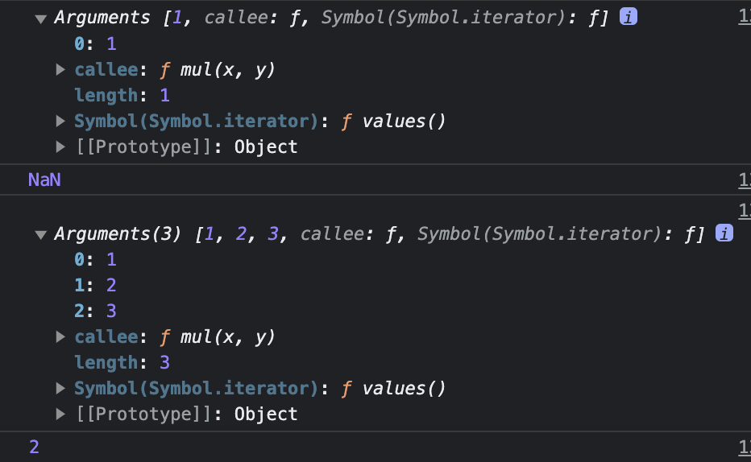

#### **prototype**

생성자 함수로 호출할 수 있는 함수 객체

constructor만이 소유하는 프로퍼티

```delphi
(function(){}).hasOwnProperty('prototype')//true
({}).hasOwnProperty('prototype')//false
```

#### **\_\_proto**

모든 객체는 [[Prototype]]이라는 내부 슬롯을 갖음 객체지향을 구현하기 위함

프로토타입 객체에 간접적으로 접근하기 위함

내부에 getter, setter 라고 부르는 함수가 있어서 프로퍼타입 호출 할당 가능

상호 참조를 방지하기 위해 접근자를 이용해 프로퍼타입에 접근

코드내에 직접 사용하기 보다는 object메서드 사용

```javascript
const obj = {a:1}
console.log(obj.__proto__ === object.prototype)//true

console.log(obj.hasOwnProperty('a'))//true(상속 받은 프로퍼티인지 체크)
console.log(Object.getPrototypeOf(obj))//프로퍼티 가져오기
```

#### **name**

ES5에서는 빈 문자열의 값을 갖고 ES6에서는 함수 객체를 가리키는 변수 이름을 값으로 갖음 주의!

```autoit
var func = function(){}
console.log(func.name)//ES5 - 빈 문자열, ES6 - func
```

### **✔️ **프로토타입 객체 생성과 원리**

> non-constructor, 화살표 함수, 객체의 축약 메서드는 prototype 프로퍼티를 소유하지 않으며   
> 프로토타입을 생성하지 않아 제외, Function 객체말고 객체 리터럴이나 Object.create도 prototype이 있음

#### **사용 이유**

여러개의 인스턴스는 new 로 생성시 다른 메서드와 다른 변수를 할당받음

```javascript
//prototype 사용 안했을 때
function Example(str) {
	this.text = str;
	this.console = function() {
		console.log(str)
	}
}
const example1 = new Eample('example1')
const example2 = new Eample('example2')
console.log(example1.console === example2.console)//true

//prototype 사용 할 때
function Example(str) {
	this.text = str;
}
Example.prototype.console = function() {
	console.log(str)
}
const example1 = new Eample('example1')
const example2 = new Eample('example2')
console.log(example1.console === example2.console)//false
```

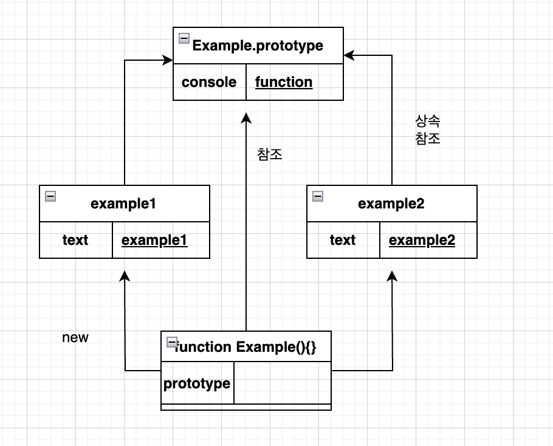

#### **동작 방식(중요)**

> 모든 객체의 프로퍼티는 object 프로퍼티를 상속받음

> constructor, \_proto 는 object 프로퍼티임, 생성 시 [[Prototype]] 에 할당 됨

**큰 그림**

원본 함수의 prototype → 프로토타입 함수([[Prototype]]

프로토타입 함수의 constructor → 원본 함수

인스턴스의 **proto** → 프로토타입 함수([[Prototype]]

**과정**

1. 함수를 정의하게 되면 Person 객체를 복사하여 프로퍼타입 객체([[Prototype]])를 만들고 prototype 속성으로 복사한 객체를 가리킴
2. new 키워드로 인스턴스를 생성할 때 constructor가 Person 객체를 가리킴
3. 변수에 할당하면 **proto** 속성으로 복사된 프로퍼티 객체([[Prototype]])를 가리킨킴

```reasonml
function Persion(){} //Person객체
let name = new Person('jisue') //jisoo인스턴스 생성
Person.protorype //[[Prototype]] 객체가 찍힘(constructor 포함)
```

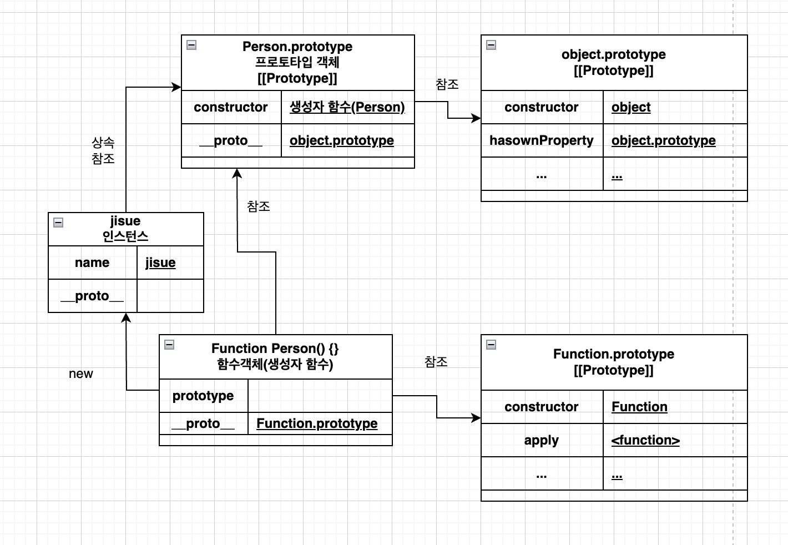

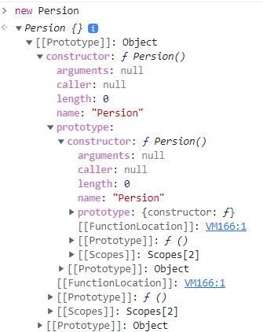

### **✔️ **프로토타입 체인과 활용**

#### **프로토타입 체인과 정적 메서드**

내부 슬롯의 참조를 따라 자신의 부모 역할을 하는 프로토타입의 프로퍼티를 순차적으로 검색하는 것

단방향이어야 함

프로토타입 메서드는 인스턴스 메서드에 의해 가려짐(새도잉)

프로토타입 메서드는 하위 객체를 통해 삭제가 불가능

```javascript
const Person = (function(){
	function Person(name) {
		this.name = name
	}
	//프로토타입 메서드
	Person.prototype.call = function(){
		console.log('haha' + name)
	}
	return Person;
}())

Person.staticMethod = function(){//정적 메서드
	console.log('static')
}

const me = new Person('jisue')
//새도잉
me.call = function(){
	console.log('hihi' + name)
}
me.call() //hihi jisue
delete me.call
me.call() //haha jisue
delete Person.call
me.call() //error
```

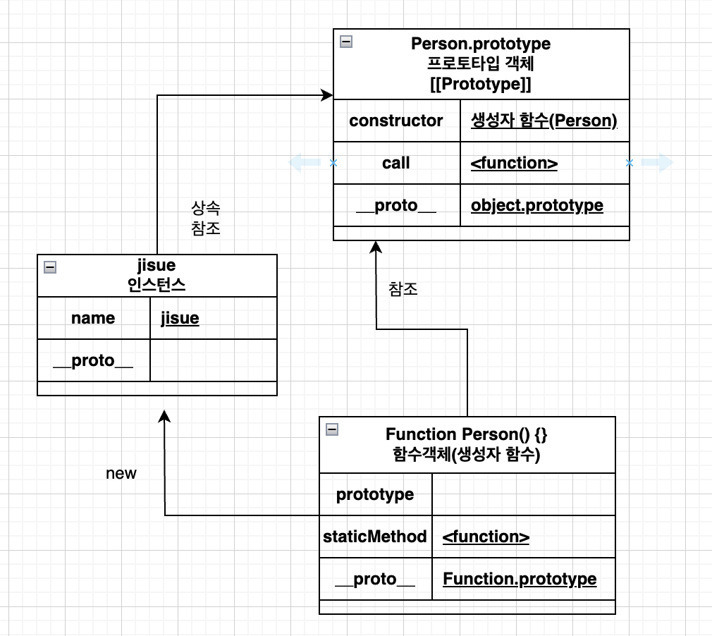

#### **instanceof, in, for…in 원리**

객체의 프로퍼티 체인상에 존재하는지 안하는지 체크

대상 객체가 상속받은 모든 프로토타입의 프로퍼티 인지 확인 필요

for…in문은 [[Enumerable]] : true인 것만 열거함

for…in문 말고 for of나 forEach를 사용하라고 함

Object.prototype.hasOwnProperty 처리 필요

### **✔️ **Prototype 교체**

#### **생성자 교체**

prototype이 참조는 하지만 constructor가 함수로 교체됨

```javascript
const Person = (function(){
	function Person(name) {
		this.name = name
	}
	//프로토타입 메서드
	Person.prototype = call(){
		constructor:Person, //직접적으로 연결
		console.log('haha' + name)
	}
	return Person;
}())
```

#### **이미 생성된 객체 프로퍼티 교체**

prototype이 constructor를 참조안함

```reasonml
function Person(name) {
	this.name = name;
}

const me = new Person('jisue')

const person = {call(){
	constructor:Person, //직접적으로 연결
	console.log('haha' + name)
}}

Person.prototype = person
Object.setPrototypeOf(me, person)
```

### **✔️ **프로토타입 응용**

> ## 잠깐!! [[Prototype]] 하고 prototype 차이점  
> - prototype는 객체 정의 시 복사된 Prototype 객체를 가리키기 위해 사용!   
>    즉 생성된 인스턴스(jisoo)는 가지고 있을 수 없음  
> - prototype 안에 [[Prototype]] 이름으로 복사된 Person 함수가 들어가 있음  
> - 모든 객체는 자신의 프로토타입 객체를 가리키는 [[Prototype]]를 갖음.

#### **[[Prototype]] 객체에 값 추가 방법**

1. 인스턴스 객체는 prototype 속성이 없어서 [[Prototype]] 객체의 속성을 추가 변경 삭제 하지 못한다.
2. 인스턴스 객체 자체에서 변경한 값은 [[Prototype]] 객체에 영향을 미치지 않는다.
3. 인스턴스는 [[Prototype]] 객체에 직접적인 접근하지 못한다.

```lua
---[[Prototype]] 에 추가
Person.prototype.age = 20 //[[Prototype]] 에 age 추가
Person.prototype // [[Prototype]] 을 가리키며 age와 constructor가 출력
jisoo //[[Prototype]] 으로 링크 되있어서 age와 constructor가 출력

---인스턴스에 추가
jisoo.prototype.age = 10 //undefined 직접적인 접근 불가
jisoo.age = 10 //인스턴스에 값 추가 프로토타입에는 영향 없음
```

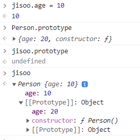

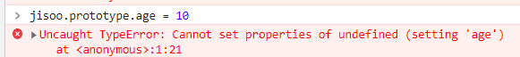

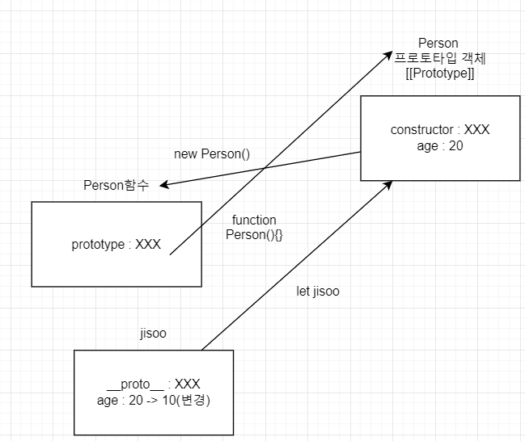

#### **인스턴스 객체가 [[Prototype]] 객체에 접근 방법**

인스턴스 객체마다 **proto** 속성으로 접근이 가능하다. 값을 조회할때 쓰면된다.

```reasonml
jisoo.__proto__.age = 50 //__proto__ 으로 값 수정
Person.prototype //프로토 타입 객체 직접 수정
```

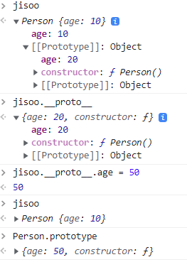

#### **프로토타입 공유**

**prototype만 지정**

자식 객체에서 값 변경해도 변하지 않고 부모한테 물려받은 그대로 사용

```javascript
function Person(name){
	this.name = name || '혁준'
}
Person.prototype.getName = function(){
	return this.name;
}
function Korea(name){
	Korea.prototype = new Person()
}
let kor = new Korea("지수")// kor.getName --> "혁준"
```

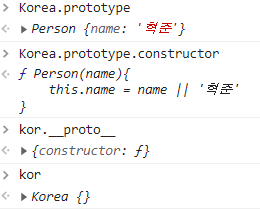

**부모의 생성자 빌려주기**

this 로 바인딩 된 name만 사용가능

```javascript
function Person(name){
	this.name = name || '혁준'
}
Person.prototype.getName = function(){
	return this.name;
}
function Korea(name){//Person 생성자 복사, getName은 사용 불가
	Person.apply(this,arguments);
}
let kor = new Korea("지수")// kor.getName --> "지수"
```

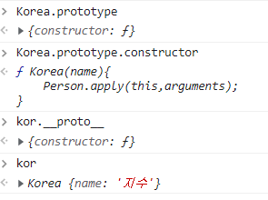

**생성자 빌려주고 prototype 지정**

연결은 잘 되는데 부모 생성자를 두번 호출해야됨

```javascript
function Person(name){
	this.name = name || '혁준'
}
Person.prototype.getName = function(){
	return this.name;
}
function Korea(name){
	Person.apply(this,arguments);
}
Korea.prototype = new Person();
let kor = new Korea("지수")// kor.getName --> "지수"
```

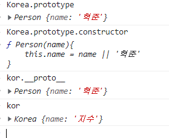

**프로토타입 공유**

직접적인 프로토타입으로 공유해야 함

```javascript
function Person(name){
	this.name = name || '혁준'
}
Person.prototype.getName = function(){
	return this.name;
}
function Korea(name){
	this.name = name
}
Korea.prototype = Person.prototype;
let kor = new Korea("지수")// kor.getName --> "지수"
```

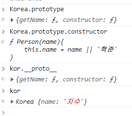

### **✔️ 참고**

[JavaScript : 프로토타입(prototype) 이해](https://www.nextree.co.kr/p7323/)

[🔗 JavaScript : 프로토타입(prototype) 이해](https://www.nextree.co.kr/p7323/) — JavaScript는 클래스라는 개념이 없습니다. 그래서 기존의 객체를 복사하여(cloning) 새로운 객체를 생성하는 프로토타입 기반의 언어입니다. 프로토타입 기반 언어는 객체 원형인 프로토타입을 이


