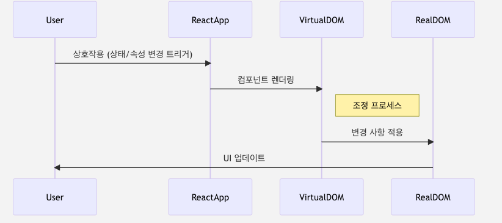
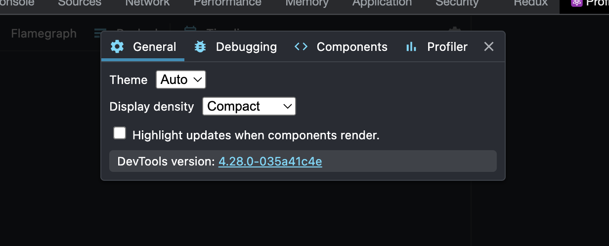
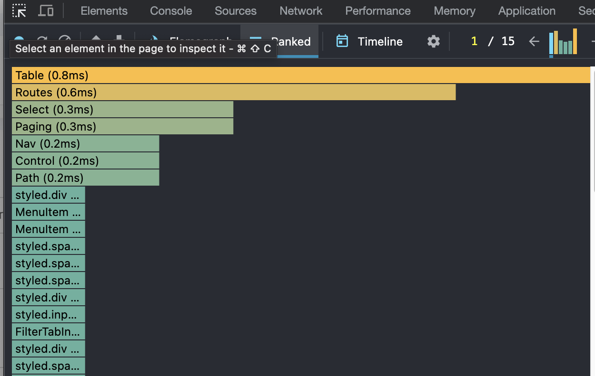
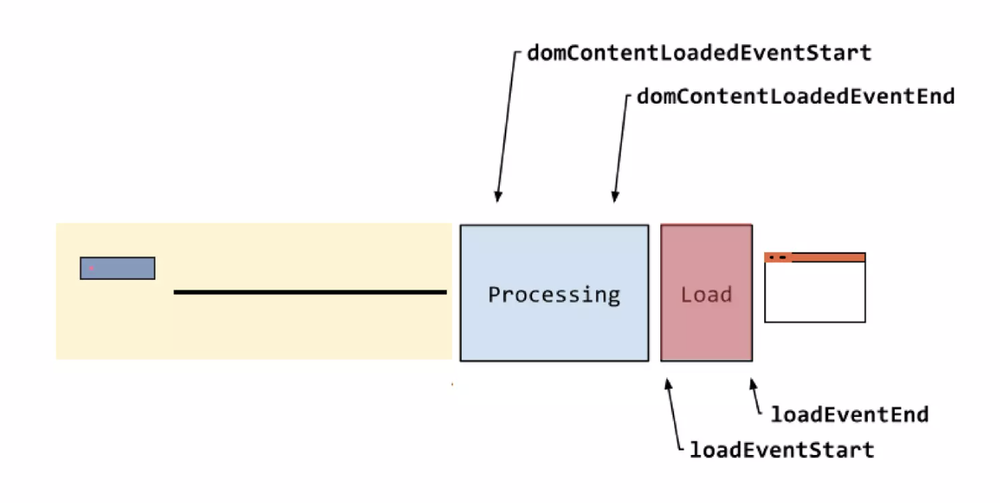
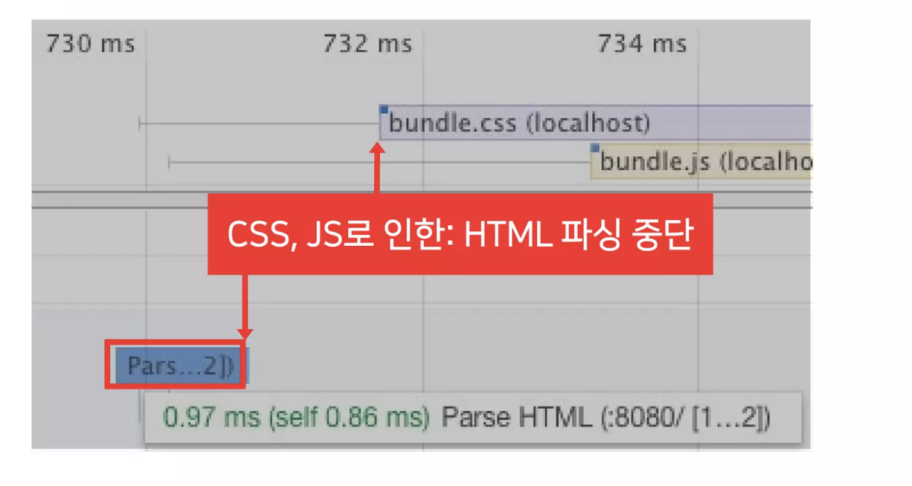
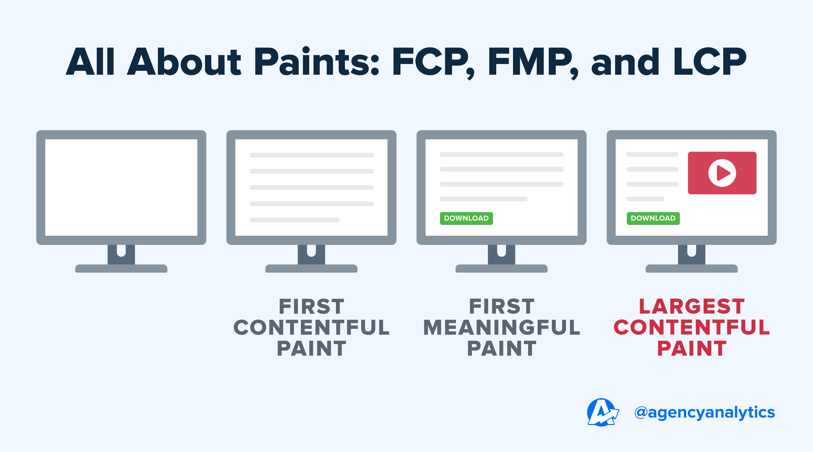
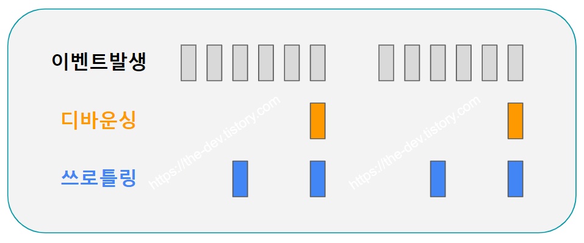

**리엑트에서 랜더링 최적화는 중요한 문제이다.**

**아래 내용을 보고 프로젝트를 봐라~!**

**(이 내용은 필자의 생각이며 잘 못 된 부분이나 개인적인 의견이**

**있다면 자유롭게 댓글 달아줘)**

### **✔️ Summary**

1. **최적화 하는 이유와 랜더링 과정**
2. **랜더링 체크 방법**
3. **프론트에서 할 수 있는 최적화**
4. **방법 1. Hook 개선**
5. **방법 2. lazy suspense**
6. **방법 3. 디바운싱(Debouncing)과 스로틀링(Throttling)**
7. **방법 4. 비동기 automatic batching**
8. **방법 5. useTransition과 useDeferredValue**

### **✔️ 최적화를 하는 이유와 랜더링 과정**

#### **이유**

사용자는 3초만 지나만 페이지를 떠난다.

#### **랜더링이 되는 경우**

- 부모 컴포넌트 랜더링
- props 값이 변경 되었을 때
- 나의 state가 변경 되었을 때

#### **주의 사항**

- props 넘겨줄 때 객체 형태 변경 x
- 컴포넌트를 매핑할 때에는 key값으로 index를 사용하지 않는다.
- state 변경 시 함수 콜백으로 하면 의존성 배열에 추가 안해도 됨(테스트 좀만 더 해보고)

#### **리엑트에서 랜더링되는 과정**

1. React가 DOM 트리를 구성하는 초기 렌더링 단계입니다.
2. 상태(state) 또는 속성(props) 변경으로 인해 재렌더링이 발생합니다.
3. React는 조정(reconciliation)을 통해 변경된 부분을 확인합니다.
4. React는 DOM을 업데이트하여 변경 사항을 반영합니다.

#### **조정이란?**

컴포넌트의 상태나 속성(props)이 변경될 때 React는 실제 DOM 업데이트가 필요한지 여부를 판단해야 합니다.

이를 위해 새로운 가상 DOM을 생성하고 이전 가상 DOM과 비교하는 "diffing" 과정을 거칩니다. 가상 DOM

서 변경된 컴포넌트만이 실제 DOM에 다시 렌더링됩니다.



### **✔️ 랜더링 체크 방법**

#### **크롬 개발자도구 Performance Tab**

해당 페이지가 랜더링 될 때 걸리는 시간 및 어느 구간에서 병목이 나타나는지를 분석해준다.

#### **React Tool Profiler**

브라우저에서 React DevTools에 있음 프로파일러는 컴포넌트 렌더링의 타임라인 보여줌.

아래와 같이 체크하면 어떤 요소가 랜더링 되는지 깜빡임으로 표시 됨





### **✔️ 프론트에서 할 수 있는 최적화**

> 💡 블록 리소스란?  
> 웹 페이지의 렌더링이 중단되거나 지연되는 것을 일으킬 수 있는 외부 리소스 이러한 리소스는 브라우저가 페이지의 다른 컨텐츠를 렌더링하는 동안 기다려야 하므로 웹 페이지의 성능에 부정적인 영향을 미칠 수 있습니다.  
> ex) 외부 스크립트 파일, 스타일 시트 파일, 이미지 및 미디어 파일, 폰트 파일:

#### **종류**

**로딩 최적화**: 블록 리소스 대처, TTFB 줄이기

**랜더링 최적화**: 랜더링이 많이 될 것 같은 요소 캐싱(hook 사용)



#### **로딩 바가 나오기 전에 흰 화면이 나오는 이유**

자바스크립트와 CSS 가 블록 리소스라서 HTML이 다 파싱 되고 난 후에 CSS,JS 파싱하는 것이 아니라 HTML 파싱 중단하고 함

**해결방법**

TTFB: HTTP 요청을 했을때 처음 byte (정보) 가 브라우져에 도달하는 시간

- head에 js 넣지 말기 넣고 싶으면 async, defer사용
- body 끝에 넣기 (순서상 HTML이 다 파싱 끝나고 JS 파싱
- 외부 스타일(link)로 받지 말고 인라인 스타일(style 태그) 로 사용해서 CSS 파싱 (TTFB 줄이기)



—> **DOMContentLoaded 도 빠르게 하면 로딩바만 빠르게 나오고 사용자 기준에서 최적화가 안되었다.**

#### **사용자 측면의 개선**

1. **First Meaningful Paint (FMP)**
   - **정의**: 웹 페이지가 로딩되고 사용자에게 의미 있는 콘텐츠가 화면에 나타나는 시점을 측정하는 지표입니다. 즉, 처음 나오는 컨텐츠가 중요
   - **중요성**: 사용자가 웹 페이지를 빠르게 인식하고 콘텐츠를 사용할 수 있도록 하는 데 중요하며, 초기 로딩 성능에 대한 지표로 사용됩니다.
   - 확인방법 : Chrome DevTools 또는 Lighthouse 등의 웹 개발 도구를 사용하여 FMP를 확인할 수 있습니다.
2. **Largest Contentful Paint (LCP)**
   - **정의**: 웹 페이지에서 가장 큰 콘텐츠 요소가 화면에 완전히 랜더링되는 시점을 측정하는 지표입니다. 이 요소는 일반적으로 이미지, 비디오, 텍스트 블록 등의 큰 콘텐츠입니다.
   - **중요성**: LCP는 웹 페이지의 주요 콘텐츠가 사용자에게 제공되는 시점을 반영하며, 사용자가 페이지를 더 빨리 인식하고 상호작용할 수 있도록 돕습니다.
   - 확인방법 : Chrome DevTools의 Performance 탭에서 LCP를 확인할 수 있습니다. "Largest Contentful Paint" 항목을 찾아볼 수 있습니다.



**→ 사용자에게 로딩이 끝나고 난 후 어떤 컨텐츠를 먼저 보여줄건지 사용자 측면에서 중요**

### **✔️ 방법 1. Hook 개선**

#### **React 성능 저하 원인**

> useMemo, useCallback는 commit phase에는 실행이 안 되지만 render phase에는 실행 됨

의도한 바와 다르게 전체적으로 불필요한 랜더링이 일어남

랜더링을 줄이기 위해 useMemo, useCallback, React.memo 를 사용하지만 과도한 메모리 사용량

불필요한 함수나 컴포넌트로 인해 시간 딜레이가 생기는 경우

#### **해결 방법**

메모이제이션은 비용이 많이드는 함수나 변수일 때만 사용

컴포넌트는 props가 바뀔 때만 랜더링 하고 싶을 때 React.memo 사용

useRef를 사용해 리랜더링 안되게 하는 것, 변수는 초기화 됨

한번 짤 때 잘 짜자

**React.memo 예시**

```javascript
import React from 'react';

const ExampleComponent = React.memo(({ text }) => {
  console.log('Component re-rendered');
  return <h1>{text}</h1>;
});

export default ExampleComponent;
```

**useRef 예시**

```angelscript
//변경 전, 단순위 범위의 값을 저장함
const [range, setRange] = useState(0);
setRange(2);

//변경 후
const contentRange = useRef(0);
contentRange.current = 2;
```

### **✔️ 방법 2. lazy suspense**

> 💡 코드 스플리팅(코드 분할)이란?   
> 애플리케이션 번들을 여러 개의 작은 조각으로 나누는 기술로, 애플리케이션 초기 로딩 시간을 줄이고,   
> 필요한 코드만 로드하여 사용자 경험을 최적화하는 데 도움

#### **문제**

컴포넌트가 랜더링 될 때 동적인 import 가 전부 랜더링 됨

로딩 시간이 걸릴 때 화면에 컨텐츠가 없음

#### **해결방법**

**lazy**

동적 import를 일반 컴포넌트로 렌더링할 수 있음

사용자가 특정 라우트로 이동할 때 해당 라우트에 필요한 컴포넌트만 로드

이로써 초기 로딩 시간이 줄어들고, 애플리케이션의 성능이 향상

**suspence**

지연 로딩된 컴포넌트가 준비될 때까지 대체 콘텐츠를 렌더링

fallback prop을 사용하여 로딩 중에 보여줄 대체 콘텐츠를 정의

**예시**

```javascript
import React, { lazy, Suspense } from 'react';
import LightComponent from './LightComponent';

const HeavyComponent = lazy(() => import('./HeavyComponent'));

function App() {
  return (
    <div>
      <Suspense fallback={<div>Loading...</div>}>
        <HeavyComponent />
      </Suspense>
      <LightComponent />
    </div>
  );
}

export default App;
```

### **✔️ 방법 3. 디바운싱(Debouncing)과 스로틀링(Throttling)**



#### **디바운싱**

요청이 연속적으로 들어온 경우 delay 시간 뒤에 마지막 요청을 실행하는 것

ajax검색에 자주 쓰임

사용자 입력에 대한 중복 요청을 방지하여 서버 부하를 줄임

설정한 타이머 안에 요청이 지속적으로 들어올 경우 모든 요청을 무시 무한정 무시

**예시**

한번에 모든 메뉴를 주문함

**사용하는 곳**

사용자 창 크기 조정을 멈출 때까지 기다렸다라 반영

사용자의 키보드 입력을 중지할 때까지 기다렸다가 실행

**함수 구현**

```reasonml
//loadash를 사용해서 구현 가능
function debounce(fn) {
  let timerId;//클로져를 이용한 함수내부 변수 선언
  return (e) => {
		if(timerId){
			clearTimeout(timerId);//타이머가 없기에 그냥 넘어감
		}
    timerId = setTimeout(func(e),500)//500ms 후에 collAajax 실행하는 타이머 실행
  };
}

const debouncedSearch = debounce(searchFunction);

// 사용자가 검색 입력을 할 때 호출
searchInput.addEventListener('input', debouncedSearch);
```

1. 입력 시 타이머 없기 때문에 setTimeout(func(e),500) 실행
2. 입력 시 기존에 있던 타이머 초기화 setTimeout(func(e),500) 실행
3. 마지막 요청 후 더이상 입력 없으면 500ms 기다리고 종료

#### **스로틀링**

출력을 조절함, 이벤트를 일정 주기마다 발생하도록 하는 기술

설정 시간을 주게 되면 그 시간 동안에는 한번만 실행

성능 개선 부화를 줄임

지속적인 요청이 들어올 경우 정해진 타이머 시간이 지날 때 요청을 허용

**예시**

주문을 하고 30분 안에 주문하러 오면 무시

**사용하는 곳**

무한 스크롤 일정 주기마다 발생

리사이징 이벤트일 때 주기적으로 실행

**함수 구현**

```javascript
//loadash를 사용해서 구현 가능
function throttle(fn) {
   let timeId;//클로져를 이용한 함수내부 변수 선언
  return () => {
    if (!timeId) {
			timerId = setTimeout(() => {//없을 때만 실행
	      timeId = null;
				fn();
	    }, 1000);//1000가 지난 후에 초기화 
		}
  };
}

const throttledScroll = throttle(scrollFunction);

// 스크롤 이벤트에 대한 핸들러로 사용
window.addEventListener('scroll', throttledScroll);
```

1. setTimeout 할당
2. 이벤트 발생
3. timeId 값이 있기 때문에 실행을 하지 않음
4. 1000ms 경과 timeId 초기화 지정해놓은 함수 실행
5. 다시 실행

### **✔️ 방법 4. 비동기 automatic batching**

#### **automatic batching**

React에서 여러 state나 prop 변경에 대한 렌더링을 최적화하기 위해 변경된 내용을 한 번에 처리

이 메커니즘은 React 업데이트를 그룹화하여 효율적으로 처리합니다.

- 여러 상태나 프로퍼티가 동시에 변경되는 경우, 이러한 변경 사항을 한 번에 처리하여 중복된 렌더링을 방지하고 성능을 향상
- Automatic Batching이 없다면 각각의 상태나 프로퍼티 변경에 대해 별도의 렌더링이 실행되어 비효율

#### **문제**

```reasonml
function asyncFunction() {
  setTimeout(() => {
    setState1(newValue1); // automatic batching이 적용되지 않음
    setState2(newValue2); // automatic batching이 적용되지 않음
  }, 1000);
}
```

#### **해결**

```arcade
function asyncFunction() {
  setTimeout(() => {
    setState1(prevState => newValue1); // automatic batching이 작동함
    setState2(prevState => newValue2); // automatic batching이 작동함
  }, 1000);
}
```

### **✔️ 방법 5. useTransition과 useDeferredValue**

#### **문제**

서비스에서 무거운 계산을 하는 로직이 실행되면 메인 스레드가 거기서 블록되기 때문에 다음 작업을 처리하지

하게 됨 극단적으로 매우 무거운 작업을 하게 될 때 다음 입력을 받지 못할 정도로 프레임이 저하되는 현상이 발생

이 문제를 근본적으로 해결하기 위해서 상태 변화의 우선순위를 나누고, 우선순위가 높은 이벤트가 발생하면 그

업을 먼저 핸들링하고, 이후에 우선순위가 낮은 상태를 핸들링하게 됨

#### **useDeferredValue**

상태 값에 우선순위를 낮추는 hook

deferredValue 는 마지막에 실행됨

```javascript
import { useDeferredValue, useState } from "react";

export default function Home() {
  const [count1, setCount1] = useState(0);
  const [count2, setCount2] = useState(0);
  const [count3, setCount3] = useState(0);
  const [count4, setCount4] = useState(0);

  const deferredValue = useDeferredValue(count2);

  const onIncrease = () => {
    setCount1(count1 + 1);
    setCount2(count2 + 1);
    setCount3(count3 + 1);
    setCount4(count4 + 1);
  };

  console.log({ count1 });
  console.log({ count2 });
  console.log({ count3 });
  console.log({ count4 });
  console.log({ deferredValue });

  return <button onClick={onIncrease}>클릭</button>;
}
```

#### **useTransition**

상태 변화를 일으키는 함수의 우선순위를 낮추는 hook

함수를 낮은 우선순위로 실행될 때 사용

```javascript
import { useState, useTransition } from "react";

export default function Home() {
  const [text, setText] = useState("");
  const [value, setValue] = useState("");
  const [isPending, startTransition] = useTransition();

  const onChange = (e: React.ChangeEvent<HTMLInputElement>) => {
    startTransition(() => {
      setText(e.target.value);
    });
    setValue(e.target.value);
  };

  console.log({ text, isPending });
  console.log({ value });

  return <input type="text" onChange={onChange} />;
}
```

### **✔️ 참고**

[[10분 테코톡] 앨버의 리액트 렌더링 최적화](https://youtu.be/1YAWshEGU6g?si=crBprlaf4v0Te4EU)

[06) 코드 분할과 지연 로딩](https://wikidocs.net/197644)

[디바운싱과 쓰로틀링 이해하기](https://medium.com/%EC%98%A4%EB%8A%98%EC%9D%98-%ED%94%84%EB%A1%9C%EA%B7%B8%EB%9E%98%EB%B0%8D/%EB%94%94%EB%B0%94%EC%9A%B4%EC%8B%B1%EA%B3%BC-%EC%93%B0%EB%A1%9C%ED%8B%80%EB%A7%81-%EC%9D%B4%ED%95%B4%ED%95%98%EA%B8%B0-e02f6bb14627)

[Code splitting with React.lazy and Suspense](https://web.dev/code-splitting-suspense/)

[A custom React Hook for a debounced click handler with a given callback and delay.](https://gist.github.com/mudge/eb9178a4b6d595ffde8f9cb31744afcf)


