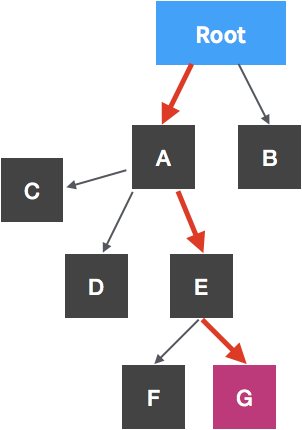

**Context, Redux, Recoil 은 요즘 시장에서 필수인 것 같다.**

**각자의 차이랑 왜 Recoil까지 오게 되었는지 알고 있어야 한다.**

**(이 내용은 필자의 생각이며 잘 못 된 부분이나 개인적인 의견이**

**있다면 자유롭게 댓글 달아줘)**

### **✔️ Summary**

1. **Recoil 사용 이유**
2. 초기 **세팅**
3. **Recoil 기본 문법**
4. **Selector 활용**
5. **리턴하는 팩토리 함수**

### **✔️ Recoil 사용 이유**

#### **전역상태를 사용이유**

- props 로 필요한 부분까지 내려서 관리해야된다
- 불필요한 랜더링을 줄일수 있다.



#### **이전 전역 상태의 문제점**

**Context 의 문제점**

- 컴포넌트가 리렌더링될 때마다 모든 하위 컴포넌트가 다시 렌더링되기 때문에 성능 문제가 발생할 수 있다.
- 복잡한 상태 관리에는 한계가 있다.

```javascript
//js 파일 안에 Context 사용 선언 초기값 설정 가능
export const ThemeContext = createContext(null);

//최상위 계층에 감싸주면 됨, state도 최상위에 선언하면 됨
const [isDark, setIsDark] = useState(false);

//index에 설정해야 함
<ThemeContext.Provider value={{isDark, setIsDark}}>
  <PageContext isDark={isDark} setIsDark={setIsDark} />;
</ThemeContext.Provider>

//사용
const {isDark} = useContext(ThemeContext);
```

**Redux의 문제점**

- React 전용 라이브러리가 아니다! React 관점에선 외부요인으로 Store가 취급되며 동시성 모드를 구현하기에 호환성이 부족하다.
- 복잡한 Boiler Plate 초기세팅이 요구된다! Store, Action, Reducer 등 다양한 구성요소가 필요해 비효율적이며 러닝커브가 높다.
- 비동기 데이터에 추가 리소스가 요구된다! Redux-saga 등 전역상태에 비동기 데이터를 호출하기 위한 서드파티 라이브러리가 필요하다.

```pf
//action 정의
export const addCart = (item) => {
  return {
    type : "ADD_ITEM",
    payload : item
  } 
}
//reducer 정의
const cartReducer = (state = INITIAL_STATE,action) => {
  switch(action.type) {
    case "ADD_ITEM":
      return [...state, action.payload]
    case "DELETE_ITEM":
      return [...action.payload]
    default:
      return state
  }
}
//combineReducers 로 reducer 병합
export default combineReducers({cartReducer});

//store 생성 및 Provider의 속성으로 넘기기
const store = createStore(rootReducer)
...(생략)
ReactDOM.render(
  <React.StrictMode>
    <Provider store={store}>
      <Routes />
      <GlobalStyle />
    </Provider>
 ...(생략)

//useSelector hook 을 활용하여 state 값 읽어오기
const cartItems = useSelector((store) => store.cartReducer);

//useDispatch hook 을 활용하여 state 값 수정하기
const dispatch =useDispatch()
  return (
    <Card>
      ...(생략)
      <AddCartBtn onClick={() => dispatch(addCart(item)) }>
      ...(생략)
```

### **✔️ 초기 세팅**

#### **Recoil 사용 이유**

- 우선 React 전용 라이브러리인 만큼 React 내부 접근성이 용이
- React 동시성 모드, Suspense 등을 지원하기 때문에 사용자 경험 관점에서도 매우 유리한 웹 어플리케이션을 만들 수 있음
- 전역상태의 설정/정의가 매우 쉬우며, Recoil이 지원하는 Hooks로 이를 get/set 하기 때문에 React 문법과 매우 유사

#### **설치**

```crystal
// npm(yarn)
npm install recoil
yarn add recoil

// CDN
<script src="https://cdn.jsdelivr.net/npm/recoil@0.0.11/umd/recoil.production.js"></script>
```

#### **index 설정**

```xquery
const root = ReactDOM.createRoot(
    document.getElementById('root') as HTMLElement,
);
root.render(
    <React.StrictMode>
        <Router />
    </React.StrictMode>,
);
```

### **✔️ Recoil 기본 문법**

> 💡 atoms (공유 상태)에서 selector(순수 함수)를 거쳐 React 컴포넌트로 내려가는 data-flow graph

#### **atom 에 저장 값 사용**

Recoil 상태의 단위를 의미

atom의 상태가 업데이트되면, 이를 구독하던 컴포넌트들이 모두 리렌더링

default 값은 Promise 객체도 설정가능하나, atom에서 바로 비동기 요청을 할 순 없다

- **key** : 고유한 key 값 (보통 해당 atom을 생성하는 변수 명으로 지정합니다.)
- **default** : atom 의 초기값을 정의합니다. 정적인 값(int, string...), promise, 다른 atom 의 값으로 설정할 수 있습니다.

```groovy
//store/atom.js
export const todoListState = atom({
    key: 'todoListState',
    default: [
        {id: 1, text: 'clean', status: false},
        {id: 2, text: 'door', status: true},
    ],
});
```

#### **Hooks 종류**

전역상태(Atoms, Selector)를 get/set 하기 위해 Recoil에서 제공하는 Hooks들을 사용

- useRecoilState() : useState() 와 유사하다. [state, setState] 튜플에 할당하며, 인자에 Atoms(혹은 Selector)를 넣어준다.
- useRecoilValue() : 전역상태의 state 상태값만을 참조하기 위해 사용된다. 선언된 변수에 할당하여 사용하면 된다.
- useSetRecoilState() : 전역상태의 setter 함수만을 활용하기 위해 사용된다. 선언된 함수변수에 할당하여 사용하면 된다.
- useResetRecoilState() : 전역상태를 default(초기값)으로 Reset 하기 위해 사용된다. 선언된 함수변수에 할당하여 사용하면 된다.

```angelscript
//사용
const todoList = useRecoilValue<TodoType[]>(todoListState);
const setTodoList = useSetRecoilState<TodoType[]>(todoListState);
const [todoList, setTodoList] = useRecoilState<string>(todoListState);
```

#### **Selector 값 핸들링**

atom 혹은 다른 Selector 상태를 입력받아 동적인 데이터를 반환하는 순수함수

참조하던 다른 상태가 변경되면 이도 같이 업데이트, 바라보던 컴포넌트들이 리렌더링

- **key** : 고유한 key 값
- **get** : \*\*\*\*Selector 순수함수. 사용할 값을 반환하며, 매개변수인 콜백객체 내 get() 메서드로 다른 atom 혹은 selector를 참조한다.

```typescript
//atom.js
const listCountState = selector({
  key: 'listCountState',
  get: ({get}) => {
    const list = get(todoListState);
    return list.length;
  },
});

//사용
const listCount = useRecoilValue<numver>(listCountState);
```

### **✔️ Selector 활용**

> 💡 selector는 값 자체를 캐싱함

#### **쓰기 가능한 Selector**

읽기 모드가 아니라 쓰기모드도 가능하다

selector 안에서 직접 수정이 안되고 setListCount로 수정해야 함

setListCount 로 수정한 새로운 값이 newValue로 세팅 되어서

다른 atom들을 새로운 값으로 세팅

```typescript
//atom.js
const listCountState = selector({
  key: 'listCountState',
  get: ({get}) => {
    const list = get(todoListState);
    return list.length;
  },
  set: ({set}, newValue) => set(todoListState, newValue),
});

//사용
const [listCount.setListCount] = useRecoilState<numver>(listCountState);
setProxy('새로운 값!');
```

#### **비동기 Selector**

비동기 요청을 한 데이터를 전역상태에 바로 넣는 경우 사용

비동기 Selector만 사용하면 아래와 같이 에러가 발생

async await 만 사용하면 안되고 suspense 처리를 해줘야 함

```dart
//atom.js
const myQuery = selector({
  key: 'MyQuery',
  get: async ({get}) => {
    return await api(get(queryParamState));    // 비동기 호출 부분
  },
});

//index
<React.Suspense fallback={<div>Loading...</div>}>
  <Component />
</React.Suspense>
```

#### **다른 비동기 제어 방법 Loadable**

useRecoilValueLodable, useRecoilStateLodable 사용

- **state** : \*\*\*\*hasValue , hasError , loading 3가지 상태를 반환한다.
- **contents** : atom이나 contents의 상태값을 의미한다. hasValue 상태일 땐 value를, hasError 일 땐 Error 객체를, 그리고 loading 일 땐 Promise를 가지고 있다.

```javascript
//사용
const Component = () => {
  const lodaState = useRecoilValueLodable(lodaSelector);

    switch(lodaState.state){
      case 'hasValue':
        return <div>{lodaState.contents}</div>
      case 'loading':
        return <Loading />;
      case 'hasError':
         throw lodaState.contents;
    }
}
```

### **✔️ 리턴하는 팩토리 함수**

> 💡 다른 atom 이 아닌 외부 인자로 인한 상태 관리 입니다.

#### **atomFamily**

```qml
//atom.js
export const todoListState = atom({
    key: 'todoListState',
    default: (init) => {
        return [...init, 추가]
  }
});

//사용
const [todoList, setTodoList] = useRecoilState<string>(todoListState([
    {id: 1, text: 'clean', status: false},
    {id: 2, text: 'door', status: true},
]);
```

#### **selectorFamily**

비동기 데이터를 상태값으로 바로 쓰기 위함

```dart
//atom.js
export const githubRepo = selectorFamily({
  key: "github/get",
  get: (githubId) => async () => {
    if (!githubId) return "";

    const { data } = await axios.get(
      `https://api.github.com/repos/${githubId}`
    );
    return data;
  },
});

//사용
const githubRepos = useRecoilValue(githubRepo(githubId));
```


