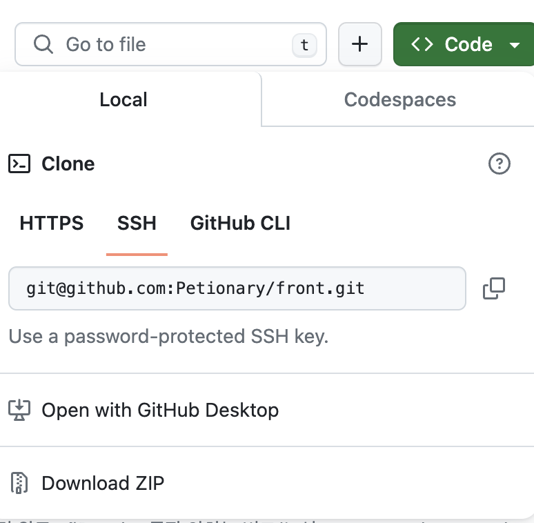

**HTTPS로 github clone 받는 사람 손절하셈~~!!!**

**다음 TIL : tailwind 꼭 써야 되는 상황.... ㄷ**

**(이 내용은 필자의 생각이며 잘 못 된 부분이나 개인적인 의견이**

**있다면 자유롭게 댓글 달아줘)**

### **✔️ Summary**

1. **왜 여러개의 계정을 SSH로 등록해야 하는지**
2. **ssh-keygen이란???**
3. **ssh key-gen 적용**
4. **git clone 잘 되는지 확인**

### **✔️ 왜 여러개의 계정을 SSH로 등록해야 하는지**

> 💡 ssh 로 접근 불가한 서버인지 먼저 확인해야 됨

#### **적용 가능한 상황**

- 회사에서 몰래 개인 프로젝트를 하고 싶을 때
- 아이디 비밀번호를 push할 때마다 적는게 귀찮을 때

#### **알아야 할 네트워크 지식 (HTTPS vs SSH 프로토콜)**

**HTTPS 프로토콜**

- HTTP의 암호화된 버전
- 브라우저와 액세스 중인 웹사이트를 호스팅하는 서버 간에 데이터가 교환되는 프로토콜
- SSL/TLS 인증서를 사용하여 교환되는 데이터를 암호화하여 인터넷을 통한 보안 통신을 보장

**SSH 프로토콜**

- 보안되지 않은 네트워크를 통한 보안 통신을 가능하게 하는 암호화 네트워크 프로토콜
- 일반적으로 원격 서버 액세스, 파일 전송 및 네트워크 인프라 관리에 사용
- SSH는 인증을 위해 공개 키 암호화를 사용하고 전송된 데이터에 대한 기밀성과 무결성을 제공

#### **ssh 로 git clone 받는 이유**

- https 로 clone 받으면 별도 없이 사용 가능하지만 매번 푸쉬할 때마다 인증을 해야함
- https 는 통신에는 안전하지만 암호 또는 토큰을 입력해야 하므로 보안상 취약함
- https는 SSL/TLS 연결 설정에 따른 추가 오버헤드 때문에 ssh 보다 느릴 수 있음
- ssh는 별도의 키(공개 및 개인 키)를 만들어 인증해야 되지만 이후 설정없이 사용가능합니다.
- https는 표준 포트 443에서 작동하므로 방화벽이나 프록시에서 쉽게 통과 가능합니다.   
  하지만 ssh 는 22 포트를 사용하기 때문에 차단 될 수 있습니다.

### **✔️ ssh-keygen이란???**

#### **정의**

- SSH (Secure Shell) 프로토콜을 사용함
- 원격 컴퓨터 간 안전한 셸 세션을 확립하기 위해 다양한 암호학 기법을 사용
- 인증키를 생성, 관리, 변환 가능
- 공개키(Public key), 비공개키(Private key) 제어 가능
- 두 키는 서로 쌍(pair)을 이루고 있음

#### **생성 방식 2가지**

```excel
ssh-keygen -t rsa -b 4096 -C "github 계정"
ssh-keygen -t ed25519 -C "github 계정" -f "id_ed25519_github_ashappy"
```

**RSA 키 생성**:

- 키 타입: **RSA**
- 비트 수: **4096**
- 키 파일 이름: 기본값 (일반적으로 **id_rsa**와 **id_rsa.pub**로 생성됨)
- 설명: RSA 키는 전통적인 방식으로 많이 사용되며, 대부분의 Git 호스팅 서비스에서 지원됩니다.   
  GitHub도 RSA 키를 지원합니다.

**Ed25519 키 생성**:

- 키 타입: **Ed25519**
- 키 파일 이름: **id\_ed25519\_github\_ashappy**
- 설명: Ed25519 키는 최신 암호화 알고리즘으로 더 강력하고 보안성이 높습니다.   
  하지만 모든 Git 호스팅 서비스에서 지원하지는 않을 수 있습니다.   
  GitHub는 Ed25519 키를 지원합니다.

### **✔️ ssh key-gen 적용**

#### **사용하는 과정**

**keygen 생성하기 (gitlab, github)**

```lsl
ssh-keygen -t rsa -b 4096 -C "github 계정"
ssh-keygen -t rsa -b 4096 -C "gitlab 계정
```

```gherkin
Generating public/private rsa key pair.
Enter file in which to save the key (/c/Users/Karim/.ssh/id_rsa):hub
Enter passphrase (empty for no passphrase):
Enter same passphrase again:
Your identification has been saved in /c/Users/Karim/.ssh/hub
Your public key has been saved in /c/Users/Karim/.ssh/hub.pub
The key fingerprint is:
SHA256:P/PLrFQoFM4iWgLHtH+wzfsvGNlCIFERW2RJvUmpKFc aaa@gmail.com
The key's randomart image is:
+---[RSA 4096]----+
|.o+o+==o..       |
| oo..+Eo+.       |
|  o.=+.o+o       |
|  .=o*ooo  .     |
|  .oo.+oS . .    |
|     .+..o .     |
|      .+  =      |
|      .... *     |
|        .oo.=.   |
+----[SHA256]-----+
```

**ssh 에이전트 실행 및 키 등록**

```gams
//등록
$ eval $(ssh-agent)
Agent pid 3215
//실행
$ ssh-add ~/.ssh/hub
$ ssh-add ~/.ssh/lab
```

**config 설정 파일 등록 및 설정**

```routeros
# config 수정
vi ~/.ssh/config

# config 설정
Host github.com
        HostName github.com
        User git
        IdentityFile ~/.ssh/hub <- keygen 이름
Host gitlab.com
        HostName gitlab.com
        User git
        IdentityFile ~/.ssh/lab <- keygen 이름
```

**연결 테스트**

```applescript
$ ssh -T gitlab.com
Welcome to GitLab
$ ssh -T github.com
Hi! You've successfully authenticated, but GitHub does not provide shell access.
```

#### **문제**

gitlab으로 적용한 부분이 연결이 되지 않는다

이유 : ssh 로 접근 불가능한 서버

```css
ssh -Tvv git@git.netand.co.kr
이거 입력시 'ssh: connect to host git.netand.co.kr port 22: Operation timed out'
```

### **✔️ git clone 잘 되는지 확인**

#### **git repository ssh clone**

```asciidoc
git@**"config의 설정한 host"**:**git주소**/**Repositories명**.git
```



#### **계정 초기 등록(나중에 git commit 할 때 이력에 남음)**

```routeros
git config --local user.name "git 이름"
git config --local user.email "git 계정"
```

#### **참고**

**여러개 계정 등록**

[[GitHub] 여러 계정에서 ssh로 git clone 하기](https://velog.io/@ashappyasikonw/GitHub-%EC%97%AC%EB%9F%AC-%EA%B3%84%EC%A0%95%EC%97%90%EC%84%9C-ssh%EB%A1%9C-git-clone-%ED%95%98%EA%B8%B0)

[🔗 [GitHub] 여러 계정에서 ssh로 git clone 하기](https://velog.io/@ashappyasikonw/GitHub-%EC%97%AC%EB%9F%AC-%EA%B3%84%EC%A0%95%EC%97%90%EC%84%9C-ssh%EB%A1%9C-git-clone-%ED%95%98%EA%B8%B0) — GitHub에서 ssh를 이용해서 소스코드를 clone 받을 때 여러 계정인 경우 config와 git clone path 에 username 을 추가 해서 구분 해 줄 수 있다.

**config 설정**

[SSH config를 통해 간편하게 SSH 연결하기](https://hudi.blog/ssh-config/)

[🔗 SSH config를 통해 간편하게 SSH 연결하기](https://hudi.blog/ssh-config/) — 유닉스 계열 OS에서는 SSH의 Config를 설정하여 마치 Alias를 설정한 것 처럼 간단하게 SSH 접속을 할 수 있다. 지금까지 달록 프로젝트를 하면서 SSH 연결을 위해 쉘 스크립트를 작성하고 사용했는데
