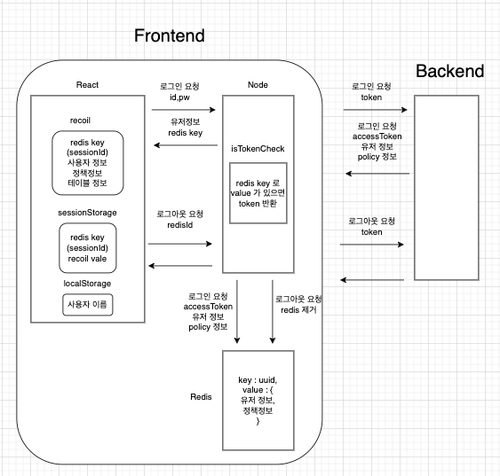

**결론! : Front 는 sessionStorage, Back은 Redis**

**(회사 코드는 안적음)**

### **✔️ Summary**

1. **로그인 동작 방식**
2. **프론트엔드 저장소 종류**
3. **localStorage 는 어떻게 Tab마다 공유?**
4. **recoil 사용 방법 요약**
5. **프로젝트 전체 흐름 요**
6. **session 말고 redis를 쓴 이유**

### **✔️ 고민**

**Hivault 로그인은 다른 웹사이트와 다르게 Tab 마다 다른 계정으로 로그인이 가능하고**

**Tab마다 다른 storage  를 사용함**

**모노레포로 구현되어 있고 node 에서나 react 에서 구현하는 방식에 대해 생각해야 되었음**

**(네이버나 구글 같은 경우 로그인 후 다른 Tab으로 로그인 하면 자동으로 같은 사용자가 로그인 됨)**

localStorage 는 오리진이 같으면 모든 탭이 값을 공유하기 때문에 탭마다 다른 계정을 유지해야 되는 요구사항이랑 안 맞았음. 그래서 탭 단위로 분리되는 sessionStorage 로 갈 수밖에 없었음.

### **✔️ 프론트엔드 저장소 종류**

> **key, value 로 저장**

#### **localStorage**

- 브라우저가 종료 되어도 OS를 재시작해도 데이터 유지
- 오리진(domain/port/protocol)이 같으면 서로 공유 가능(오리진마다 생성)

```less
localStorage.setItem('name', 'jisu');
localStorage.setItem('birth', 1993);
localStorage.getItem('name'); // jisu
localStorage.getItem('birth'); // 1993 (문자열)
localStorage.removeItem('birth');
localStorage.getItem('birth'); // null (삭제됨)
localStorage.clear(); // 전체 삭제
```

#### **sessionStorage**

- 현재 떠 있는 탭 내에서만 유지
- 같은 페이지라도 다른 탭에 있으면 다른 곳에 저장
- 하나의 탭에 여러 개의 iframe이 있는 경우엔 동일한 오리진에서 왔다고 취급되기 때문에 공유

```less
sessionStorage.setItem('test', 1);
sessionStorage.getItem('test')
```

### **✔️ localStorage 는 어떻게 Tab마다 공유?**

**참고** : <https://ko.javascript.info/localstorage>

- storage 저장 데이터가 갱신될 때, 접근 가능한 window 객체 전부에서 이벤트가 발생되고   
  창은 다르지만 서로 공유됨.
- 두개의 창 모두 이벤트를 수신하고 있기 때문에 한 창에서 실행해 데이터를 갱신하면   
  다른 창에 해당 사항이 반영되는 것을 확인가능
- 이벤트의 또 다른 중요한 특징은 event.url이 있어 갱신된 문서의 URL을 알 수 있다는 점
- 이벤트는 sessionStorage나 localStorage가 변경될 때 모두 발생
- 이벤트는 스토리지 종류에 상관없이 실제 수정이 일어난 것을 참조한다는 것 역시 중요한 특징
- 변경이 일어났을 때 설정해 '응답’이 가능하도록 할 수 있음

### **✔️ recoil 사용 방법 요약**

#### **정의**

**atom의 상태가 업데이트되면, 이를 구독하던 컴포넌트들이 모두 리렌더링**

- **key** : 고유한 key 값 (보통 해당 atom을 생성하는 변수 명으로 지정합니다.)
- **default** : atom 의 초기값을 정의합니다. 정적인 값(int, string...), promise, 다른 atom 의 값으로 설정할 수 있습니다.

```groovy
//store/atom.js
export const todoListState = atom({
	key: 'todoListState',
	default: [
		{id: 1, text: 'clean', status: false},
		{id: 2, text: 'door', status: true},
	],
});
```

#### **Hooks 종류**

- **useRecoilState()**: useState() 와 유사하다. [state, setState] 튜플에 할당하며, 인자에 Atoms(혹은 Selector)를 넣어준다.
- **useRecoilValue()** : 전역상태의 state 상태값만을 참조하기 위해 사용된다. 선언된 변수에 할당하여 사용하면 된다.
- **useSetRecoilState()**: 전역상태의 setter 함수만을 활용하기 위해 사용된다. 선언된 함수변수에 할당하여 사용하면 된다.
- **useResetRecoilState()** : 전역상태를 default(초기값)으로 Reset 하기 위해 사용된다. 선언된 함수변수에 할당하여 사용하면 된다.

```pf
const todoList = useRecoilValue<TodoType[]>(todoListState);
const setTodoList = useSetRecoilState<TodoType[]>(todoListState);
const [todoList, setTodoList] = useRecoilState<string>(todoListState);
```

### **✔️ 프로젝트 전체 흐름 요약**

#### **요약**

- redis Id는 현재 front 에서 session Id로 사용 중이고
- node에서 생성한 uuid 이다
- redis에서는 key 값으로 저장됨



### **✔️ session 말고 redis를 쓴 이유**

**참고** : <https://inkyu-yoon.github.io/docs/Language/SpringBoot/RefreshToken>

- 세션은 기본적으로 메모리에 생성됨
- 메모리의 크기가 무한하지 않기 때문에 꼭 필요한 경우만 생성해서 사용해야 함,
- Tab 마다 다른 사용자 정보를 저장하기 때문에 제한있는데 DB에 저장하기에는 중요 정보 아님
- Redis는 key-value 쌍으로 데이터를 관리할 수 있는 데이터 스토리지,   
  모든 데이터를 메모리에(메인 메모리인 RAM) 저장하고 조회하는 in-memory 데이터 베이스임
- 인메모리 상태에서 데이터를 처리하기 때문에, 다른 DB들보다 빠르고 가볍다는 장점이 있음
- Memcached 라는 인메모리 데이터 스토리지도 있지만, 성능차이가 크게 없고,   
  Memcached는 문자열만 지원하기 때문에 Redis를 선택했다.

### **✔️ 정리**

Front 는 탭마다 분리되어야 해서 sessionStorage, Back 은 여러 탭(=여러 로그인 세션)을 가볍게 들고 있어야 해서 메모리 기반인 Redis를 씀. 결국 둘 다 "탭마다 다른 상태를 가져가야 한다"는 같은 요구사항에서 나온 선택이었음.


