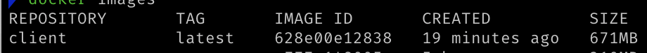
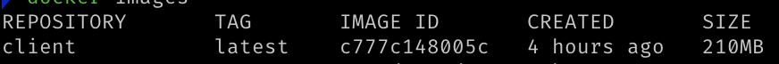

Next.js 애플리케이션에도 Docker로 배포할 때,

**standalone 빌드**를 사용하면 이미지 크기를 최소화하면서도

운영 환경에 맞게 유연하게 구성할 수 있다.  
이 글은  

**커스텀 서버 없이** 풀리지 않는 4가지  해결한 실제 사례를 정리한 것이다.

1️⃣ HTTPS 설정

2️⃣ 환경변수 런타임 주입

3️⃣ Docker 스크립트 최적화

4️⃣ 포트(PORT) 동적 설정

### ✅  요구사항

> 부장님 : 프론트는 빌드했을 때 이미지 사이즈가 얼마나 나오지?  
> 사수 : 도커 멀티스테이징 빌드를 도입해서 600MB 정도 나옵니다. standalone 되어있는데  
> 지금 세팅된 커스텀한 서버(server.js)에 설정들이 있어서 그것만 제거하면 될 것 같아요  
> -------(자리로 돌아가서)  
> 사수 : OO 씨 들으셨겠지만 standalone 설정하면 이미지가 절반 넘게 줄어들거에요  
> 그런데 안에 설정들(ssl 인증서, cors 설정, 환경변수) 를 다른곳에서 세팅해야 되는데 그쪽을 알아봐줄 수 있나요?  
> 예스맨 : YES!

### ✅  standalone을 사용하면 뭐가 좋은가?

Next.js의 standalone 설정은 실행에 필요한 파일만 추출해 배포 최적화를 가능하게 한다.

- 최소한의 코드만 포함해 빌드
- server.js 자동 생성 (단, 런타임 때 코드 수정 불가)
- node\_modules에서 필요한 부분만 생성
- ./next/standalone폴더로 필요 모듈 생성

🔗 [공식 문서 보기](https://nextjs.org/docs/pages/api-reference/config/next-config-js/output)

### ✅  요구사항 분석

도커 스크립트는 멀티스테이징 도입해서 따로 수정 안해도 될 것 같고   
커스텀 서버로 구현한 server.mjs 에 있는 ssl 인증서 설정, cors, 환경변수(포트) 주입하는 부분을

어떻게 구성할지 생각해봐야 된다.

그리고 Next.js 공식문서에서 최적화 옵션으로 제공하는 standalone 일 때 빌드 시 딱 1번 생성해주기 때문에  
커스텀서버(server.mjs) 를 사용하기 권장 하나 우리는 여러 고객사에 설치될 수 있기 때문에(port, ip 가 달라질 수 있어음)

런타임 시 원하는 환경변수로 세팅 되어야 한다.

그리고 https 는 next.config.js 자체에 설정할 수 없기 때문에(next.js 에서 제공 안함)

Nginx 를 구축해야 될 것 같다.(인프라 대리님 도움)

### ❌  기존 구조: 커스텀 서버 + 전체 패키지 빌드

- HTTPS와 런타임 환경변수 처리를 위해 server.mjs 커스텀 서버 사용
- node\_modules 전체 포함 → Docker 이미지 증가
- 멀티 스테이징 최적화 후에도 이미지 크기 약 600MB

### ✅  최종 목표

- 커스텀 서버 제거 (server.mjs 제거)
- HTTPS 설정 유지
- 런타임 시 환경변수 주입 가능
- Docker 스크립트 최적화 (최소 이미지 구성)
- 포트 번호를 패키지별로 다르게 설정 가능하게

### 🔐  HTTPS 설정

Next.js는 기본적으로 HTTPS 설정을 지원하지 않는다.  
기존에는 커스텀 서버로 인증서를 로딩했지만, standalone에서는 server.js가 자동 생성되므로 불가능하다.

**👉 해결: nginx 리버스 프록시 적용**  
nginx가 TLS를 처리하고 내부 애플리케이션은 http로 유지하고 Nginx 가 앞에서 받아 정해진 곳으로 전달한다

```nginx
server {
  listen 4000 ssl;
  ssl_certificate     /path/to/cert.pem;
  ssl_certificate_key /path/to/key.pem;

  location / {
    proxy_pass http://localhost:3000;
  }
}
```

### 🌡️  환경변수 런타임 주입

**문제:** Next.js는 빌드 시점에 .env를 읽고 next.config.js 를 통해 고정된 설정으로 포함시킨다.  
standalone은 server.js가 자동 생성되므로 이후 환경변수 반영이 불가능하다.

**👉 해결: Shell 스크립트로 server.js 내 문자열 치환**

```bash
// next.config.js
publicRuntimeConfig: {
  iamUrl: '%%NEXT_PUBLIC_XXX_URL%%'
}

// start.sh
sed -i "s#%%NEXT_PUBLIC_XXX_URL%%#$NEXT_PUBLIC_XXX_URL#g" server.js
exec node server.js
```

- %%...%% 형태로 placeholder 지정
- 런타임에 start.sh에서 sed 명령어로 값 치환
- 클라이언트에서도 getConfig()로 접근 가능

### 🚪  PORT 환경변수 주입

**문제:**

standalone에는 server.js 에서 이미 PORT 라는 이름으로 환경변수를 사용하기 때문에  
모든 패키지마다 환경변수를 다르게 만드는 것 아니면 불가능하다

```bash
// server.js
const currentPort = parseInt(process.env.PORT, 10) || 3000;
```

**👉 해결: Shell 스크립트에서 포트 동적으로 지정**

```bash
// start.sh
export PORT=${NEXT_PUBLIC_XXX_PORT:-$PORT}
sed -i "s#%%PORT%%#$PORT#g" server.js
exec node server.js
```

.env.production에는 다른 네이밍으로 환경변수를 설정하고, 값을 주입해서 사용

### 📦  Docker 스크립트 최종 구조

**변경 전:** 커스텀 서버 포함, node\_modules 전체 포함 → 이미지 600MB

**변경 후:** server.mjs 제거, standalone 결과물만 복사, start.sh로 환경 치환 → 이미지 250MB

```bash
FROM base AS runner

RUN addgroup --system --gid 1001 nodejs
RUN adduser --system --uid 1001 nextjs

COPY --from=builder /app/.next/standalone/ ./
COPY --from=builder /app/.next/static ./apps/xxx/.next/static
COPY --from=builder /app/public ./apps/xxx/public

COPY ./apps/xxx/start.sh ./apps/xxx/
RUN chmod +x /app/apps/xxx/start.sh
```

주요 변경사항

- server.mjs, node\_modules 제거
- standalone 빌드된 최소 실행 파일만 복사
- start.sh를 통해 환경변수와 포트 치환 처리
- server.js를 직접 수정하지 않음

### ✅  전체 동작 방식 요약

1. next.config.js에 output: 'standalone 설정
2. next build → .next/standalone 생성
3. server.js 자동 생성 (환경변수는 placeholder 형태로 삽입)
4. nginx로 HTTPS 처리
5. start.sh에서 문자열 치환
6. Dockerfile에서 start.sh 실행
7. 런타임 시 환경에 맞게 값 주입됨

#### **🎯 결과:**

커스텀 서버 없이도 standalone 기반으로 HTTPS, 환경변수, 포트 설정까지 모두 처리할 수 있다.  
운영 환경이 다양하거나 패키지 분리가 필요한 구조라면 매우 효과적인 방식이다.

변경 전 : 600~650 MB

변경 후 : 200~250 MB



*멀티스테이징 적용*



*멀티스테이징 + standalone 적용*
