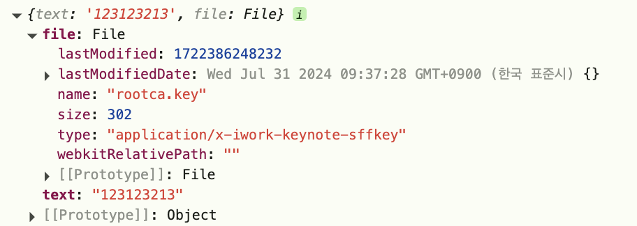
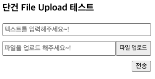
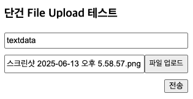
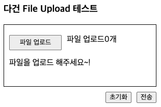
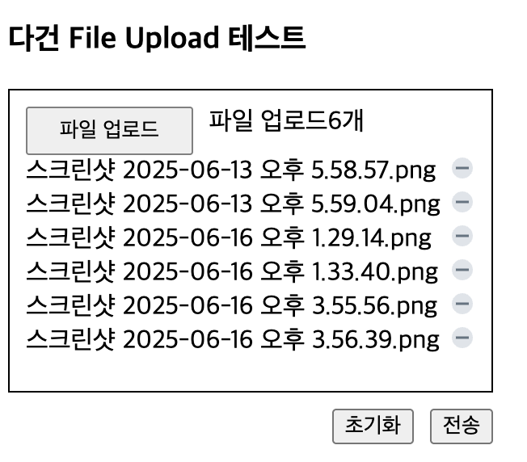
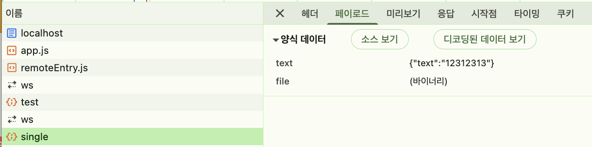

Next.js 뿐만 아니라 React 에서 동일하게 UI 구현하면 된다.  
다만 File 데이터와 Multipart 전송 타입에 대해서는  
인지하고 있는게 좋을 것 같다

1️⃣ FormData

2️⃣ multipart/form-data

### ✅  요구사항

> 설계 부장님 : 배포 서버에 인증서를 AM UI 를 통해 관리자가 직접 첨부해야되고 플렛폼마다 라이센스를 파일들을  
> 업로드 할 수 있어야 돼~  
> AM 서버 대리님 : 프론트엔드에서 파일만 전송해주면 쿠버 환경에서 파일을 주입될 수 있게 처리하려고요  
> 지금 세팅된 커스텀한 서버(server.js)에 설정들이 있어서 그것만 제거하면 될 것 같아요!  
> 예스맨 : YES! 인증서는 단건인데 다른 데이터와 같이 전송, 라이센스는 3개 파일 전송~

### ✅  그럼 파일은 어떻게 전송하지?

해당 일감을 받았을 때 가장 먼저 드는 생각이 '파일 첨부하려면 UI 를 어떻게 그릴까?', '첨부한 파일을 어떻게 데이터로 보관 및 전송할까?'  라는 생각이 들었다. 기본적으로 백엔드 서버로 데이터를 전송할 때  Content-Type: 'application/json' 과 같은 값을 헤더에 실어서 보낸다. 하지만 File 은 이진수로 되어있는 바이너리 데이터이기 때문에 Content-Type: 'multipart/form-data' 형태로 보내야 된다.

또한 직접 객체 형태로 데이터를 보내는 것이 아니라 FormData 에 파일과 데이터를 넣어서 보내야된다고 이야기한다.

이렇게 된김에 File 처리 방식이랑 친해져보려고 한다.

[MDN FormData 설명](https://developer.mozilla.org/en-US/docs/Web/API/XMLHttpRequest_API/Using_FormData_Objects "MDN FormData 설명")

### ✅  File 전용 데이터, Multipart Type

File 인터페이스는 <input type="file"> 요소로 파일 데이터를 받을 수 있고  Blob 인터페이스를 상속받습니다.



**👉 파일 요청 인터페이스 FormData**

File 데이터를 전송하기 위해 FormData 를 사용하고 자바스크립트에서 제공하는 인터페이스이지만 Web UI 에서 파일 데이터와 텍스트 데이터를 같이 요청 시 전달하기 위해 사용해서 Node.js 에서는 사용이 불가능합니다.   
FormData는 내부적으로 key-value 쌍의 데이터를 저장하지만, 이는 일반적인 JavaScript 객체처럼 직렬화(serialization)되어 콘솔에 바로 출력되지 않습니다. 파일 데이터를 확인하려면 FileReader 를 사용해야합니다

```javascript
//데이터 저장
formData.append('data', JSON.stringify({data: data.text}));
formData.append(data.file.type, data.file);

//출력
for (const pair of formData.entries()) {
  console.log(pair[0] + ': ' + pair[1]);
}
```

**👉 multipart/form-data**

multipart/form-data는 웹에서 HTTP 요청을 통해 파일을 포함한 폼 데이터를 서버로 전송할 때 사용되는 HTTP Content-Type 헤더의 값 중 하나입니다. 특히 바이너리 데이터(예: 이미지, 동영상, 문서 파일)를 전송해야 할 때 필수적으로 사용됩니다.  
이름에서 알 수 있듯이, 단일 HTTP 요청 내에 여러 종류의 데이터(텍스트 필드, 파일, 기타 데이터 등)를 각각 별개의 "파트(part)"로 나누어 전송할 수 있도록 설계되었습니다. 요청 본문을 보면 각 파트 별로 Boundary 로 구분해서 data, file 나눠서 표시 되는것을 볼 수 있다.

```bash
Content-Type: multipart/form-data; boundary=----WebKitFormBoundaryxxxxxxxxxxxx // 이 boundary는 자동 생성됨

----WebKitFormBoundaryxxxxxxxxxxxx
Content-Disposition: form-data; name="data"
Content-Type: application/json // 또는 text/plain;charset=UTF-8

{"data":"123213123"}
----WebKitFormBoundaryxxxxxxxxxxxx
Content-Disposition: form-data; name="uploadedFile"; filename="스크린샷 2025-06-16 오후 1.29.14.png"
Content-Type: image/png

[스크린샷 2025-06-16 오후 1.29.14.png 파일의 바이너리 데이터]
----WebKitFormBoundaryxxxxxxxxxxxx--
```

### ✅  단건 or 다건 처리할 UI 구현

파일 첨부에 관한 UI 는 이미 HTML 요소로 제공 해주고 있다 하지만 실제로 보면 어떻게 스타일을 해야될지 정말 막막하다.


*<input type="file" /> 기본 태그*

```html
<input type="file">
```

그래서 과감하게 해당 요소를 숨기고 HTML 에서 제공하는 기능(파일 첨부할 수 있는 화면)만 사용하려고 한다.  
일단 해야될 거는 2가지 이다. 2개의 input 을 구현해서 file 로 되어있는 input 은 css 로 숨김처리하고 ref 로 DOM 을 저장해서  
다른 요소가 이벤트가 발생하면 저장한 ref 에 onclick 이벤트를 발생시키면 된다.

**👉 단건 UI 구현**

아래 코드는 간단하게 구현한 UI 이고 css 에 대한 부분은 제외했다. 

```javascript
const [fileName, setFileName] = useState('');
const fileInputRef = useRef(null);

//버튼 클릭 이벤트
const onChangeButtonClick = () => { //2. 이벤트 발생
  if (fileInputRef.current) {
    fileInputRef.current.click(); //3. file input 이벤트 발생
  }
}

//파일 값 저장 이벤트
const handleFileInputChange = (e) => { //4. 파일 저장 시 이벤트 발생
  const files = e.target.files;
  setFileName(files[0].name);
}

//파일필드
<input
  className={'hidden_input'}
  type={'file'}
  ref={fileInputRef}
  onChange={handleFileInputChange}
/>

//파일 이름을 보여줄 커스텀 필드
<input
  className={'input_box'}
  type={'text'}
  value={fileName}
  placeholder={'파일을 업로드 해주세요~!'}
  readOnly={true}
/>

//클릭 시 파일 이벤트를 처리할 버튼
<button
  className={'open_file_button-single'}
  onClick={onChangeButtonClick} //1. 버튼클릭
>
  파일 업로드
</button>
```





*단건 파일첨부 UI 구현*

**👉 다건 UI 구현**

다건 파일 첨부는 단건과 다르게 해당 파일들을 리스트로 보여줘야되고 첨부할 파일 갯수 제한, 특정 파일 삭제, 첨부한 파일 개수 표시 등  
추가로 구현해줘야 될 부분도 있다. 그리고 다건의 파일을 첨부하려면 file input 에 multiple 를 추가해줘야 한다

```javascript
const {setValue, watch} = methods;

const selectedFiles = watch(name, []);
const fileInputRef = useRef(null);

//현재 데이터 추가 데이터 합치는 함수
const addFilesToSelectedState = (files) => {
  const newFiles = Array.from(files);
  const currentFiles = watch(name, []);

  const uniqueNewFiles = newFiles.filter
    (newFile) =>
      !currentFiles.some(
        (existingFile) =>
          existingFile.name === newFile.name &&
          existingFile.size === newFile.size,
    ),
  );

// 추가하려는 파일이 없는 경우 (모두 중복인 경우) 함수 종료
if (uniqueNewFiles.length === 0) return;

//갯수 제한 로직
// if (currentFiles.length + uniqueNewFiles.length > 3) {
// 	alert('최대 3개의 파일만 첨부할 수 있습니다.');
// 	return;
// }

setValue(name, [...currentFiles, ...uniqueNewFiles], {
  shouldValidate: true,
  shouldDirty: true,
});
};

//버튼 클릭 시 동작 이벤트
const onChangeButtonClick = () => { //2. 버튼 이벤트 함수 수행
  if (fileInputRef.current) {
    fileInputRef.current.click();
  }
};

//파일 첨부시 동작 이벤트
const onClickFileChange = (event) => { //3. 파일 첨부시 동작
  addFilesToSelectedState(event.target.files);
  if (fileInputRef.current) fileInputRef.current.value = '';
};

//파일 첨부 및 개수 표시 영역
<div className={'file_container_one'}>
  <input
    className={'hidden_input'}
    type={'file'}
    onChange={onClickFileChange}
    ref={fileInputRef}
    multiple
  />
  <button className={'open_file_button'} onClick={onChangeButtonClick}> //1. 버튼 클릭 이벤트 발생
    파일 업로드
  </button>
  <span>
    파일 업로드
    {selectedFiles.length}개
  </span>
</div>

//파일 리스트 및 삭제 영역
<div
  className={'file_upload_container'}
  ref={refs.setReference}
  {...}
>
  {selectedFiles.length > 0 ? (
    <ul className={'file_list'}>
      {selectedFiles.map((file, index) => (
         <li key={index} className={'file_list_item'}>
            <span>{file.name}</span>
            <span
              className={'default_icon'}
              onClick={() => onClickRemoveFile(index)}
            >
              <span className={'icon_hover'}>{minusIcon}</span>
            </span>
        </li>
     ))}
    </ul>
  ) : (
    <p>파일을 업로드 해주세요~!</p>
  )}
</div>
```





*다건 파일 첨부 구현*

**👉 드레그 드롭으로 파일 첨부**

파일 로직을 구현하면 필수로 들어가야 될 부분이다. 첨부해야될 영역에 div 태그로 감싸서 제공하는 드래그 이벤트를 적용하면 된다

```javascript
//드레그 이벤트
const handleDrop = (e) => {
  //이벤트 버블 제거
  e.preventDefault();
  e.stopPropagation();

  const files = e.dataTransfer.files;
  if (files && files[0]) {
    setFileName(files[0].name);
    setValue(name, files[0]);
  }
};

//영역 표시
<div
  className={'file_container_one'}
  onDragEnter={handleDragEnter}
  onDragLeave={handleDragEnter}
  onDragOver={handleDragEnter}
  onDrop={handleDrop}
>
  <input
    className={'hidden_input'}
    type={'file'}
    ref={fileInputRef}
    onChange={handleFileInputChange}
  />
  {...}
</div>
```

**👉 submit 이벤트 발생 시 file 데이터를 FormData 에 담기**

FormData 에 담을 때는 파일이랑 일반 데이터랑 분리하는 key 값으로 담는게 좋다

```javascript
//데이터 포멧
const buildFormData = (data) => {
  console.log(data);
  const formData = new FormData();

  formData.append('data', JSON.stringify({text: data.text}));
  formData.append(data.file.type, data.file);
  for (const pair of formData.entries()) {
    console.log(pair[0] + ': ' + pair[1]);
  }
  return formData;
};

//submit 이벤트 발생 시 수행
const onClickSubmitFile = async (data) => {
  try {
    const formData = buildFormData(data);
    await createFileSingleApi({data: formData});
  } catch (e) {
    console.log(e);
  }
};

//submit 영역 설정
<FormProvider {...methods}>
  <input
    className={'hidden_input'}
    type={'file'}
    {...}
  />
</FormProvider>

//전송 버튼
<div className={'button_group_one'}>
  <button onClick={methods.handleSubmit(onClickSubmitFile)}>전송</button>
</div>
```



*요청 페이로드*

**파일 전송 2탄! - 전송한 데이터를 BFF 로 받아 Backend Server 로 전송하는 방법**

**글 작성중~~**
